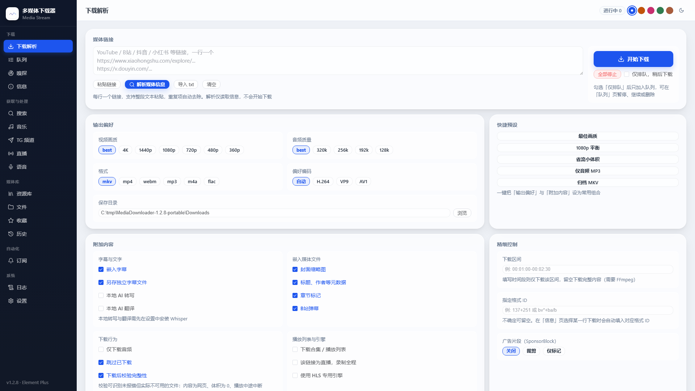

# 多媒体下载器 Web · MediaDownloader Web

**解析下载 · 磁力与种子 · 页面嗅探 · 跨平台音乐 · 字幕与 AI · 语音工具 · 订阅追新**

一个只跑在自己电脑上的多媒体工作台：粘链接就能下，浏览器里管队列、下磁力与种子、抓页面里的 m3u8、按曲名找歌与歌词封面、做字幕转写与逐句校对、订阅追新。
设置、Cookie、历史与下载内容全部留在程序所在文件夹，不上传到任何地方。

  

中文 · [English](README.en.md)

本工具**不绕过**登录墙、付费墙、DRM 与人机校验，不执行站点下发的 JS，也不伪造反爬签名。完整边界见[不在本工具范围内](docs/详细功能介绍.md#不在本工具范围内)。

> 这一份只讲**怎么开始**与**有什么**。每个页面怎么操作、每项能力的判定口径、已知限制与常见问题，完整说明在 **[详细功能介绍](docs/详细功能介绍.md)**；逐版本改动在 [CHANGELOG.md](CHANGELOG.md)。

## 30 秒上手

1. 下载 [Releases](https://github.com/QingYan1012/media-downloader-web/releases/latest) 里的 `MediaDownloader-1.4.0-portable.zip`。
2. 解压到路径里不含中文与空格、且不在 `C:\Program Files` 下的目录。
3. 双击 `启动.bat`，约 3 秒后自动打开 `http://127.0.0.1:8765`。

不想用免安装包：`pip install -r requirements.txt && python server.py`（Linux / macOS 同一条路），或者 `docker compose up -d --build`（群晖 / 家用服务器，镜像里连 aria2c 都带）。
**aria2c 不在便携包里**（「磁力 / 种子」那一页的引擎），但不用自己去 GitHub 找：在「设置 → 组件与依赖」点 aria2 那行的「安装」就把它取进 `tools/`。

换端口、换数据目录、无界面运行这三件事各自的环境变量，以及包里到底带了哪些依赖，见[详细功能介绍 → 上手的完整说明](docs/详细功能介绍.md#上手的完整说明)。

## 便携包里有什么

自带 Python runtime **与 pip**、FFmpeg / ffprobe、yt-dlp、N_m3u8DL-RE、fpcalc，音乐那条线（musicdl / mutagen / edge-tts / deep-translator / zhconv）与 Telegram 那条线（telethon / python-socks / cryptg）也都在；首次启动生成一份干净的默认配置。

不带的是体积数 GB 的语音那几项（faster-whisper 与模型、Demucs、librosa）、aria2c 与 psutil —— 这三样都是「设置 → 组件与依赖」表里的红点行，点一下「安装」就用包内 pip 现装，装完重启一次 `启动.bat`，不需要重新发包。

包里**没有任何本机数据**：没有 `config.json`、没有 Cookie、没有 `Downloads/`、没有历史与订阅记录；出包前跑泄漏自检，发现混入即中止打包。

## 关键功能

侧栏 17 个页面分 5 组（下载 / 获取与处理 / 媒体库 / 自动化 / 系统），能力大致是这八块：

| 这一块 | 一句话 | 再细一点 |
| --- | --- | --- |
| [解析与下载](docs/详细功能介绍.md#下载与队列) | 粘一条或一批链接解析成可选码率并入队，每一档带预估体积；同域并发、命中 429 自动降速、全局限速、按时段分档 | 队列支持多选、暂停 / 继续、置顶、移到队首、稍后下载；一张规则表（比名字或比链接）决定每条任务落到下载目录下的哪个子目录，你自己在「保存目录」那一格选过的以你选的为准；剪贴板监听默认关，开了也只是认出刚复制的链接问一句，绝不自己入队 |
| [成品质量核对](docs/详细功能介绍.md#下载与队列) | 下完用 ffprobe 回读成片真实分辨率，对一下你点的那一档，对不上就写明是谁的问题 | 默认封装 mkv，站点只给单条 mp4 流时只做无损换壳、不重编码；下载后做完整性校验，杜绝「假成功」 |
| [流媒体与磁力](docs/详细功能介绍.md#磁力与种子) | HLS / DASH 分片走专用引擎 N_m3u8DL-RE（可以框选区间）；磁力与 `.torrent` 独立一页：选内部文件、做种看护、tracker 加料、按种子名或链接自动分类、上下行分别限速 | 磁力这一页的引擎是本机 aria2，缺了就在「组件与依赖」点一行装好；自动分类那张表与普通下载共用，界面上能先试跑一条再看命中哪条 |
| [页面嗅探](docs/详细功能介绍.md#浏览器扩展) | 自带浏览器扩展监听页面里的 m3u8 / mp4 / ts / m4s，勾选后一键送进本机队列 | 也接收第三方嗅探扩展猫抓（cat-catch）的 POST 推送，并可导入它导出的正则规则 |
| [音乐](docs/详细功能介绍.md#音乐) | 24 个平台按曲名并行搜索，歌词 / 封面 / 标签写入、歌单整单下载、单曲链接解析（Spotify / 网易云）、换源、自建收藏清单、本地库索引与底部常驻播放条 | 「是不是同一首歌」过的是一道打分闸门（曲名 / 歌手 / 时长分开评分），被刷掉的候选写明原因；匹配时勾选的平台全部搜一遍再择优，只有三项全等时才按勾选顺序；音质要求可参与排序、可「不达标不下」 |
| [字幕 / AI / 语音](docs/详细功能介绍.md#字幕与-ai-处理) | 站点字幕按语言勾选、术语表校验译名、双语导出 SRT / VTT / ASS、硬字幕烧录；AI 四阶段流水线：字幕 → 润色 → 摘要 → 翻译 | 机翻后逐句质检 + 时间轴三维（覆盖率 / 最大间隙 / 读速）+ 逐句校对台；本地转写（含说话人分离）、Edge-TTS 配音、Demucs 人声分离、音频分析、指纹识别 |
| [Telegram 与订阅追新](docs/详细功能介绍.md#订阅追踪) | `t.me/s/` 匿名列公开频道历史，或用自己的账号会话批量下载；四类订阅源（RSS / 网页更新 / Telegram 频道 / 音乐歌单）定时扫描入队 | 每条订阅单设规则；扫描前先给一份「这轮打算怎么做」的计划，上游删掉的条目留档不凭空消失 |
| [通知与运维](docs/详细功能介绍.md#通知) | Telegram Bot / 企业微信 / Server酱三套通知，完成 / 失败 / 订阅各自独立开关；没送出去的落盘按递增间隔补发，重启不丢 | 组件与依赖在程序里更新、镜像站一键测速、运行日志只记界面上的写操作与失败（光翻页面不占行）、脱敏诊断包一键导出、设置改完自动存 + 单项 / 一键恢复默认、访问保护（默认关）、5 套主题 × 明暗 |

直播录制可以设「录满 N 分钟自动结束并保存」，到点自己停并走完整的保存流程（收拉流子进程、收尾 `.part`、摘弹幕与聊天文件）；整站接口另挂了一条只连本机的 [MCP 桥](docs/详细功能介绍.md#mcp-接口桥)，把接口原样交给支持 MCP 的智能体调用。

## 隐私

- 全部数据留在本机：配置、历史、Cookie、下载内容都在程序所在文件夹，程序不上传任何内容。
- 日志与诊断包只记动作与报错，口令 / Token / 密钥 / Cookie 内容一个字都不写；「导出诊断包」在后端就完成脱敏，Cookie、会话、下载成品、做种状态目录一律不带。
- 唯一会把 Cookie 送出本机的是可选的 **CookieCloud 同步**：默认关，开着也只往你自己填的那个地址发，密钥只存本机、界面不回显。
- 开了「访问保护」时：口令只存加盐哈希，会话是本地签名的 cookie，登录失败计数与锁定名单存本机、不出包。

完整口径与出包排除名单见[详细功能介绍 → 隐私](docs/详细功能介绍.md#隐私)。

## 进一步阅读

- **[详细功能介绍](docs/详细功能介绍.md)** —— 页面总览、每项能力的口径与细节、目录结构、常用 API、贡献方式，以及[已知限制](docs/详细功能介绍.md#已知限制)与[常见问题](docs/详细功能介绍.md#常见问题)。
- [English README](README.en.md) · [Detailed feature guide（英文完整版）](docs/detailed-features.en.md) · [Release notes 英文摘要](CHANGELOG.en.md) · [CHANGELOG.md](CHANGELOG.md)
- 便携包解压后的 `使用说明.txt` 是最短的那一版：怎么启动、端口被占用怎么办、缺组件去哪一行点「安装」。

## 许可

GNU GPL-3.0-only，全文见同目录的 `LICENSE`。衍生或包含本程序源码的作品必须同样以 GPL-3.0 开源，并保留上游鸣谢。

## 免责声明

本程序只是把已有公开接口与开源下载组件串起来的本地图形前端，不提供任何绕过登录、付费、DRM 或站点风控的能力，也不会替你去做这些事；用它下载的每个链接，合法性与授权都要自己确认。因使用本程序导致的账号受限、下载失败、文件损失或法律问题，作者不承担任何责任。

---

版本更新记录见 [CHANGELOG.md](CHANGELOG.md)（英文摘要见 [CHANGELOG.en.md](CHANGELOG.en.md)）。英文文档见 [README.en.md](README.en.md)。
