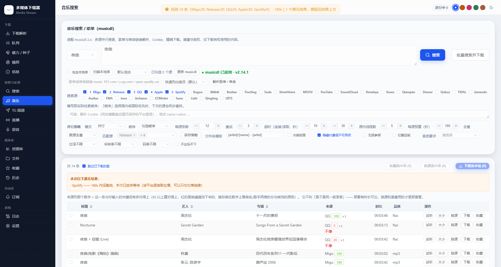
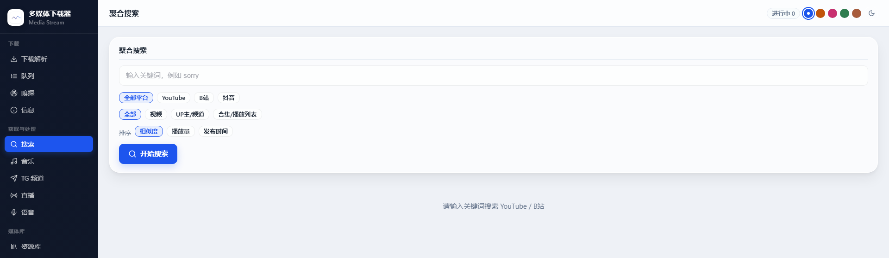
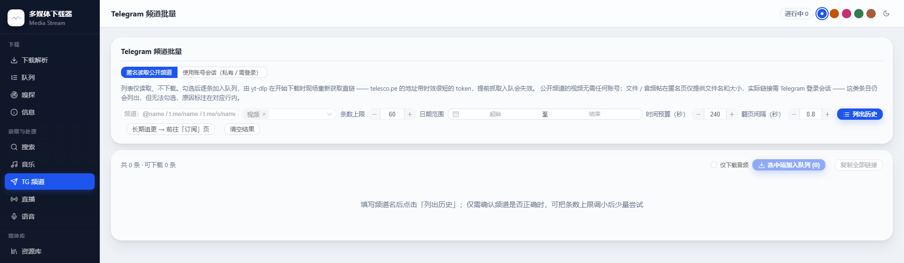
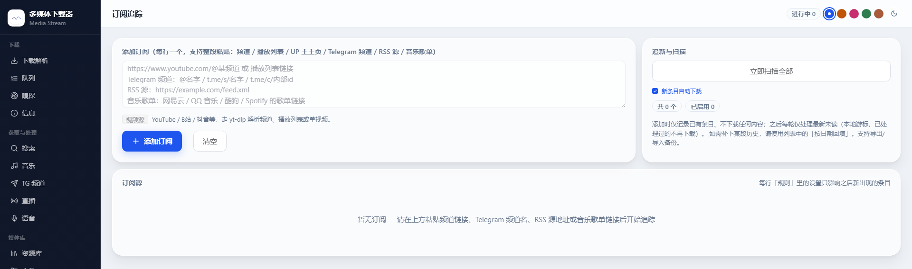
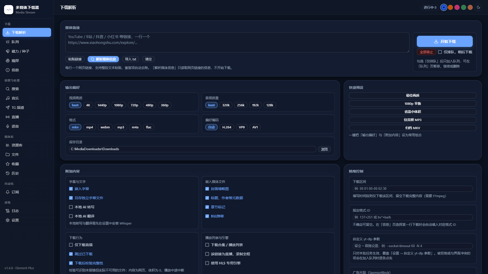

# 详细功能介绍 · MediaDownloader Web

这一份是 [README.md](../README.md) 的完整版：每个页面与每项能力的详细说明、判定口径、已知限制、常见问题与范围边界。只想跑起来或看关键功能，请先读 README；逐版本改动见 [CHANGELOG.md](../CHANGELOG.md)。

## 目录

- [上手的完整说明](#上手的完整说明) · [便携包里有什么](#便携包里有什么) · [能做什么](#能做什么) · [页面总览](#页面总览)
- [界面截图](#界面截图) · [下载与队列](#下载与队列) · [磁力与种子](#磁力与种子) · [Cookie 与站点登录](#cookie-与站点登录)
- [网络与代理](#网络与代理) · [音乐](#音乐) · [Telegram](#telegram) · [订阅追踪](#订阅追踪)
- [字幕与 AI 处理](#字幕与-ai-处理) · [语音工具](#语音工具) · [浏览器扩展](#浏览器扩展) · [视频编码与转码](#视频编码与转码)
- [组件与依赖：在程序里更新](#组件与依赖在程序里更新) · [解析插件与 aria2](#解析插件与-aria2) · [通知](#通知) · [访问保护（登录）](#访问保护登录)
- [界面主题与语言](#界面主题与语言) · [离线自检](#离线自检) · [MCP 接口桥](#mcp-接口桥) · [目录结构](#目录结构)
- [常用 API](#常用-api) · [贡献方式](#贡献方式) · [隐私](#隐私) · [已知限制](#已知限制)
- [常见问题](#常见问题) · [不在本工具范围内](#不在本工具范围内) · [鸣谢](#鸣谢) · [许可](#许可)
- [免责声明](#免责声明)

## 上手的完整说明

**Windows 免安装（推荐）**

1. 下载 [Releases](https://github.com/QingYan1012/media-downloader-web/releases/latest) 里的 `MediaDownloader-1.4.0-portable.zip`。
2. 解压到路径里不含中文与空格、且不在 `C:\Program Files` 下的目录。
3. 双击 `启动.bat`，约 3 秒后自动打开 `http://127.0.0.1:8765`。

包内自带 Python runtime 与 pip、FFmpeg / ffprobe、yt-dlp、N_m3u8DL-RE、fpcalc，首次启动生成一份干净的默认配置。**aria2c 不在包里**（「磁力 / 种子」那一页的引擎），但不用自己去 GitHub 找：在「设置 → 组件与依赖」点 aria2 那行的「安装」就把它取进 `tools/`（见[磁力与种子](#磁力与种子)）。

**源码运行**

```bash
pip install -r requirements.txt
python server.py
```

Linux / macOS 也走这一条：外部工具按当前平台的文件名与「这个文件在本机上能不能 exec」来认，所以 apt 装的 `ffmpeg` 会被识别成已装，而随包带进来的 `tools/*.exe`（Windows 的 PE 文件）不会被选中、不会跑到一半报 `Exec format error`。监听地址与端口读环境变量（默认仍只绑 `127.0.0.1`），配置、历史、Cookie、日志与默认下载目录可以整体用 `MEDIADOWNLOADER_STATE_DIR` 挪到一个目录里。没有桌面环境时「打开文件夹」不会甩一句 `TclError` 原文，而是回一句「当前是无界面运行，目录请在输入框里填」。

**Docker（群晖 / 家用服务器）**

```bash
docker compose up -d --build
```

镜像里用 apt 装好了 FFmpeg、aria2c 与 fpcalc，所以容器里「磁力 / 种子」那一页开箱能用，不用另起 aria2 服务。
配置、历史、Cookie、日志、做种会话统一落在命名卷 `mediadownloader_data:/data`，下载目录另挂在本机的 `./Downloads`。
默认只把端口绑到宿主的 `127.0.0.1`（程序本身没有登录），要从局域网直连得自己改 `docker-compose.yml` 里的端口写法。

端口被占用、缺组件、想要会员音质这三种情况各有一行办法，见[常见问题](#常见问题)。


## 便携包里有什么

免安装这条路只有一个取舍：语音那几项（faster-whisper 与模型、人声分离的 `audio-separator` / `demucs` 与 torch、四份 RoFormer 权重、librosa）体积数 GB，包里不带；红点项在「设置 → 组件与依赖」点一下就装好，不用重新发包。人声分离那套装进 `tools/separator/venv` 这个**独立环境**（不和包内 runtime 共用解释器），界面上一句「搭建分离环境」就建好。aria2c（「磁力 / 种子」那一页的引擎）与 psutil（结束直播录制时收拉流子进程要用）同样不在包里，但两者都在「组件与依赖」那张表里 —— 点一行按钮就装好，aria2c 是从 GitHub 的 release 取回来落进 `tools/`，只有想指定别的发行版时才自己下载放进去。前端框架（Vue / Element Plus / lucide）六件都在包内，首屏不向任何外部 CDN 取东西 —— 断网、代理不通、CDN 拉不动都照样把界面挂载起来。

<details>
<summary>技术细节：三种取法对照、包内已带与不带、本机数据强制排除与出包自检、换端口与解压位置</summary>

三种取法，按需选一种：

| 方式 | 适合谁 | 怎么拿 | 装完之后 |
| --- | --- | --- | --- |
| **便携包（免安装，推荐）** | Windows，不想装 Python | 本仓库 [Releases](https://github.com/QingYan1012/media-downloader-web/releases/latest) 里的 `MediaDownloader-1.4.0-portable.zip` | 解压后双击 `启动.bat`，3 秒后自动打开 `http://127.0.0.1:8765`；包内自带 Python runtime、pip 与 FFmpeg / yt-dlp / N_m3u8DL-RE |
| **源码运行** | 已经有 Python 3.12 | `git clone` 后按[30 秒上手](../README.md#30-秒上手)一节装依赖 | 外部工具要自己放进 `tools/`，或在「设置 → 组件与依赖」点安装 |
| **Docker** | 群晖 / 家用服务器 | `docker compose up -d --build` | 镜像自带 FFmpeg / aria2c / fpcalc；见 [Dockerfile](../Dockerfile) 与 [docker-compose.yml](../docker-compose.yml) |

便携包里有什么、不带什么：

| 包内已带 | 包内不带（可在程序里现装） |
| --- | --- |
| 内嵌 Python runtime **与 pip** | faster-whisper 本体与 Whisper 模型（数 GB） |
| `tools/`：ffmpeg、ffprobe、yt-dlp、N_m3u8DL-RE | **人声分离那一整套**：`audio-separator` / `demucs` 与它们要的 torch（建在 `tools/separator/venv`，与主程序的解释器分开），四份 RoFormer 权重与 yaml 也一起现下（见[语音工具](#语音工具)） |
| 前端框架六件（Vue 3.5.12、Element Plus 2.8.8 的 css + 主包 + 中/英两枚 locale、lucide 0.468.0，合计 1.8 MB）落在 `static/vendor/` —— **首屏不连任何外部 CDN**，离线、断代理、CDN 挂了都照样挂载 | librosa / numba（「音频分析」要用） |
| 音乐这条线的依赖：musicdl、mutagen、edge-tts、deep-translator、zhconv | psutil（结束直播录制时收拉流子进程要用，pip 现装） |
| Telegram：telethon、python-socks、cryptg | **aria2c.exe**（「磁力 / 种子」那一页的引擎，点「安装 aria2c」从 GitHub release 取回 `tools/`；也可自己放进去或指 PATH） |
| 音频指纹：`chromaprint/fpcalc.exe` | —— |
| `启动.bat`、`使用说明.txt`、`README.md` / `README.en.md` / `CHANGELOG.md` / `LICENSE`、`docs/详细功能介绍.md` / `docs/detailed-features.en.md` | —— |

- 红点项（缺的组件）在「设置 → 组件与依赖」里点「安装」或「一键更新」就能用包内 pip 现装，不需要重新发包；装完重启一次 `启动.bat` 生效。
- 便携包**强制排除**任何本机数据：没有 `config.json`、没有 Cookie、没有 `Downloads/`、没有历史与订阅记录，首次启动生成一份干净的默认配置。出包前有泄漏自检，发现混入即中止打包。
- 解压位置：不要放进 `C:\Program Files`，路径里尽量不要有中文或空格（`tools/` 与 runtime 会被第三方库按路径拼接调用）。
- 端口被占用：新建一个 `改端口启动.bat`，写两行 `set MEDIADOWNLOADER_PORT=8899` 与 `启动.bat`，然后双击它。现在双击之后那扇窗口也会把话说清：启动前先自己试绑一次端口，占着的那位**答得出 `/api/health`** 就是本程序的另一台实例（把它的地址给出来，劝你直接用原来那台），答不出的才是别的程序占着 —— 两种都记一行运行日志并以退出码 1 结束，`.bat` 那种窗口里话留得住（以前只丢一句 `Errno 10048`，和卡死看着一模一样）。正常启动那一边，横幅之后由后台线程真问到一次 `/api/health` 才打「服务已就绪」，不再让人对着四行横幅猜。
- 服务化 / 容器另有环境变量：`MEDIADOWNLOADER_HOST`（默认 `127.0.0.1`，镜像里设成 `0.0.0.0` 才进得来）、`MEDIADOWNLOADER_PORT`、`MEDIADOWNLOADER_STATE_DIR`（把配置、历史、订阅、Cookie、日志与默认下载目录整体挪到这一个目录，容器挂一卷就保住；不设就等于程序目录，本机行为与之前一致）。
- 仓库里只有源码、文档与离线自检脚本，不含任何二进制工具与下载物（`.gitignore` 用「默认全忽略、再逐项放行」的白名单写法）。

</details>

## 能做什么

**下载与流媒体**

- 粘一条或一批链接解析成可选码率并入队，自动归一去重；可以只排队不下。
- 队列支持多选、暂停/继续、置顶、移到队首、稍后下载；命名队列分开限速与放行，同域并发上限 + 命中 429 自动降速 + 全局限速。
- HLS / DASH 分片走专用引擎 N_m3u8DL-RE（回落 ffmpeg / yt-dlp），分片流可以框选区间。
- 默认封装 mkv：站点只给单条 mp4 流时只做无损换壳、不重编码；下载后做完整性校验，杜绝「假成功」。**换过容器或抽成音频的整批下载按同基名找回成品**，不再误报「写出 0 个文件 / 文件不可用」。
- **整批下合集时可以先落进一层与合集同名的文件夹**（默认关）：名字取合集自己的标题，叠在原本落点的下面，不替掉它，也不搬已经下好的东西。
- 可勾选嵌封面、嵌元数据、嵌章节、按语言嵌字幕、另存外挂 `.vtt`；B 站视频额外存弹幕 `.xml` 与可内嵌 `.ass`。
- 解析结果里每一档画质都带预估体积，队列卡片显示实际下到的清晰度、字节数与封面；限速可以按一天分几档（`00:00-08:00 -> 2M`）。
- **下完还会用 ffprobe 回读成片的真实高度，对一下你点的那一档**：对不上就在卡片上写一句是谁的问题（清单里有更高的、上游只给到这儿、清单过期判不出、上限没拦住），同时进运行日志与历史；达标、选 `best`、只下音频与直播都不吭声。
- 画质档按「高度 × 编码族」给：同一个 4K 有 AV1 与 VP9 时是两档、各走自己的那条流，只有一个编码族时标签就是「1080p」不带后缀；音频码率选了会真的进格式表达式。**上游只回风控后的低清流时，解析卡会当场写明这次拿到几条流、最高到几、为什么没有 4K**，并列出这台机器上实际能做的下一步（带 Cookie、启用 PO Token、换出口、更新 yt-dlp）。
- **直播录制可以设「录满 N 分钟自动结束并保存」**：全局默认在设置里，这一场在「开始录制」旁边，监控房间各有其值 —— 取其中第一个非零的那一档（0–1440 分钟），到点自己停并走完整的保存路径（收拉流子进程、收尾 `.part`、摘弹幕与聊天文件），任务卡上给的是「还剩 X 分钟自动保存」的倒计时。
- **磁力 / 种子**独立成一页：下载、选内部文件、做种看护、tracker 加料、按名字或链接自动分类（同一张规则表也管普通下载落到哪个子目录）、上下行分别限速，引擎是本机的 aria2。
- **剪贴板监听**（默认关）：开着时本机服务认出你刚复制的磁力 / 网页链接，在首页问一句「要不要用」；「加入」只把链接填进输入框，程序绝不自己入队、绝不自己开始下载。

**嗅探**

- 自带浏览器扩展监听页面里的 m3u8 / mp4 / ts / m4s，勾选后一键送进本机队列。
- 也接收第三方嗅探扩展猫抓（cat-catch）的 POST 推送，并可导入它导出的正则规则文件。

**音乐**

- 多平台聚合搜索（每个源有时间预算，一条也没有时把原因写上屏）、歌词 / 封面 / 标签写入、歌单整单下载、**单曲链接解析**（Spotify / 网易云，QQ 免 Cookie 拿不到就直说）、换源、自建收藏清单。
- 「是不是同一首歌」过的是一道打分闸门：曲名、歌手、时长分开评分再过录取线，被刷掉的候选写明原因。
- 搜索结果每一行的来源后面挂一个**关键词吻合度**（0–100）：这一条与你输入的关键词有多对得上，鼠标停留给出曲名 / 歌手两维的分与被挡的原因；它不判「是不是同一版录音」。
- 「内嵌封面」是一个真开关：勾上写完会回读文件自己的标签逐首确认，不勾时**连下载器自己塞进标签的那张也会移出去**（只动标签、不重编码，同名图片文件照旧留在旁边）。
- 本地音乐库索引 + 窗口底部常驻播放条；音质要求可以参与排序、可以「不达标不下」、成品落盘后按它自带的标签复核。
- 「无损参照」只补 Qobuz / Tidal 的元数据（ISRC、时长、位深 / 采样率、是否无损），音频一个字都不取。

**字幕 / AI / 语音**

- 站点字幕按语言勾选，术语表校验译名，字幕智能换行，双语导出 SRT / VTT / ASS，支持硬字幕烧录。
- 机翻之后逐句查一遍可疑（十类问题写进运行日志，可选反射修），时间轴另算三维（覆盖率 / 最大间隙 / 读速，只报不删；拿不到媒体时长就直说「这一项没算」，不和「质检没开」混为一谈），并在「逐句校对」里改字幕本身：改前留备份，字幕被别人改写过会拒写并点名改写时刻。
- AI 流水线四阶段：字幕 → 润色 → 摘要 → 翻译，每阶段产物落盘、可单独重跑。
- 本地转写（含声纹说话人分离，点时间可跳播）、Edge-TTS 配音、人声 / 伴奏分离（RoFormer 两族权重与 Demucs 两个引擎，跑在自己的独立环境里，CPU / GPU 可择）、音频分析（BPM / 调性 / 响度 / 频谱质心）、AcoustID 指纹识别。

**自动化与运维**

- Telegram：`t.me/s/` 匿名列历史；用自己的账号会话批量下载私有频道里可访问的媒体；接入订阅追新。
- 订阅追新四类源（RSS / 网页更新 / Telegram 频道 / 音乐歌单）定时扫描入队，每条订阅单设规则；扫描前先给一份「这轮打算怎么做」的计划，上游删掉的条目留档不凭空消失。
- 通知三套：Telegram Bot、企业微信、Server酱，完成 / 失败 / 订阅各自独立开关；没送出去的会落盘按递增间隔补发（重启不丢），浏览器桌面通知可以直接点开那条任务。
- 组件与依赖在程序里更新（含一键更新、打开程序时自动检测上游版本）、镜像站一键测速、运行日志记录界面上每一次写操作与失败（**光翻页面不占行**）并按天归档、一键导出脱敏诊断包。
- **设置改完自动存**：只把改动的那几项发给后端（整包回存会把别的入口刚改的设置盖回去），一行一条的那十栏仍需手动点「保存设置」；另有一张能对着看的默认值表，单项或一键拧回默认，牵扯到密钥与本机路径时改前先留一份 `config.json.bak-<时间>`。
- 整站接口另挂了一条 MCP 桥（`mcp_server.py`，只连本机），把接口原样交给支持 MCP 的智能体调用。
- 5 套主题色 × 明亮 / 暗色；**界面中英双语**（顶栏 `AUTO / 中 / EN`，默认跟随浏览器，17 页正文全在词表里）；侧栏可折成只剩图标、`Ctrl+K` 跳页、顶部常驻通知条、行内右键菜单；全部数据只落本机。
- **首屏不向任何外部 CDN 取东西**：Vue / Element Plus / lucide 那六件随包放在 `static/vendor/`，断网、代理不通、CDN 拉不动都照样把界面挂载起来。

每项能力靠哪个引擎实现，见下面这张对照表与后面各节。

<details>
<summary>能力域对照表：每个能力域做什么、靠什么实现</summary>

| 能力域 | 做什么 | 靠什么 |
| --- | --- | --- |
| 解析与下载 | 粘链接解析成可选码率并入队，一次可粘多条并自动归一去重；可只排队不下；每档画质带预估体积；画质按「高度 × 编码族」分档，站点风控导致只拿到低清流时如实写明 | yt-dlp、插件解析 |
| 队列调度 | 多选、暂停/继续、置顶、移到队首、稍后下载；命名队列分开限速与放行；同域并发上限 + 429 自动降速 + 全局限速 + 按时段分档限速 | 内置调度器 |
| 磁力与种子 | 磁力链接与本地 `.torrent` 下载、选内部文件、做种看护、tracker 加料、按名字或链接自动分类、上下行分别限速 | aria2 JSON-RPC（aria2c 在「组件与依赖」点一下就装） |
| 自动落目录 | 一张规则表（名字规则 / 链接规则混排，包含或正则）决定每条任务存到下载目录下的哪个子目录；磁力先比名字再比链接，普通下载比链接；手动选过目录的以手动的为准；界面上能试跑 | `bt_auto_rules`、`POST /api/torrent/rules/test` |
| 剪贴板监听 | 默认关；开着时本机读剪贴板文本、认出磁力 / 网页链接就在首页问一句，「加入」只填进输入框，不自动入队、内容不落日志 | `clipboard_watch`、`GET /api/clipboard` |
| 流媒体 | HLS / DASH 分片下载、嗅探到的 m3u8 走专用引擎；**框选片段**只对分片流可裁 | N_m3u8DL-RE，回落 ffmpeg / yt-dlp |
| 页面嗅探 | 浏览器扩展监听 m3u8/mp4/ts/m4s 一键送进本机队列；也可接收第三方猫抓（cat-catch）POST 推送 | `extension/`、`POST /api/catcatch/push` |
| 成品质量 | 默认封装 mkv（单条 mp4 流只做无损换壳、不重编码），下载后做完整性校验，杜绝「假成功」 | FFmpeg |
| 视频编码 | 转码与硬字幕烧录用哪个编码器可选：CPU 的 x264 / x265，或 NVIDIA / Intel / AMD 显卡的硬件 HEVC；先真跑一帧探测，起不来的跳过，真跑失败自动换下一个 | FFmpeg |
| 附加内容 | 嵌封面、嵌元数据、嵌章节、按语言嵌字幕、外挂 `.vtt`；B 站额外存弹幕 `.xml` 与可内嵌 `.ass` | FFmpeg、mutagen |
| 音乐 | 多源聚合搜索、按曲名取歌词 / 封面 / 标签、歌单整单下载、单曲链接解析（Spotify / 网易云）、跨平台按曲名匹配、换源、自建收藏清单、本地库索引、底部常驻播放条 | musicdl、mutagen、AcoustID / MusicBrainz |
| 同曲判定 | 一条打分闸门：曲名 / 歌手 / 时长分开评分再过录取线，被刷掉的候选写明原因 | 内置匹配器 |
| 关键词吻合度 | 搜索结果每行标一个「与输入的关键词多对得上」的分，没到线的写明是曲名、歌手还是版本词挡的；同一套阈值，时长恒不参与，不判「是不是同一版录音」 | 内置匹配器 |
| 音质 | 音质要求参与排序、可「不达标不下」、成品落盘后按自带标签复核；「无损参照」只补 Qobuz / Tidal 元数据 | mutagen、ffprobe |
| 字幕与 AI | 站点字幕按语言勾选、术语表校验译名、智能换行、双语导出 SRT / VTT / ASS、硬字幕烧录、AI 四阶段流水线、译后逐句质检、字幕时间轴三维（覆盖率 / 最大间隙 / 读速）、逐句校对台 | faster-whisper、deep-translator |
| 语音 | 本地转写（含声纹说话人分离）、Edge-TTS 配音、人声 / 伴奏分离（RoFormer 两族四条权重与 Demucs，跑在自己的独立环境里，CPU / GPU 可择）、音频分析（BPM / 调性 / 响度 / 频谱质心）、指纹识别 | faster-whisper、python-audio-separator、Demucs、librosa、chromaprint |
| Telegram | `t.me/s/` 匿名列历史、MTProto 用户会话批量下自己账号可访问的媒体、接入订阅追新 | telethon、cryptg |
| 订阅追新 | RSS / 网页更新 / Telegram 频道 / 音乐歌单四类源定时扫描入队，每条订阅单设规则（类型、时长、必含与排除词、日期窗、画质、命名模板、单次上限）；扫描前给同步计划，上游删条目进留档 | 内置扫描器 |
| 媒体库 | 资源库检索播放与打包、文件浏览、B 站与 YouTube 收藏夹 / 关注同步、下载历史导出 | 本机扫描 |
| 通知 | Telegram Bot、企业微信、Server酱，完成 / 失败 / 订阅各自独立开关；没送出去的落盘按递增间隔补发（重启不丢），桌面通知点击跳到那条任务 | 出站推送（密钥只存本机） |
| 访问保护 | 端口可上一道登录门：**默认关，开着也只拦从非本机地址来的连接**（127.0.0.1、MCP 桥、扩展不受影响）；口令加盐哈希、会话签名 cookie、空闲超时、连错锁定、机器令牌只开数据接口 | 内置 HTTP 中间件 |
| Cookie 同步（CookieCloud） | 跟浏览器扩展共用一份登录 Cookie：从云端拉下来写成本机 Netscape 文件（覆盖前留备份），或把本机这份推上去。**默认关**；两种写法（legacy / aes-128-cbc-fixed）+ 域名过滤 + 测试连接 + 上次同步时间戳；密钥只存本机、界面不回显、日志里不写 | 你自己填的 CookieCloud 服务器 |
| 运维 | 运行日志（记的是界面上的写操作与失败，**光翻页面不占行**；按天归档、超 7 天自动删）、组件与依赖在程序里更新、镜像站一键测速、脱敏诊断包一键导出、5 套主题 × 明暗、界面中英双语（`ui_language`，默认跟随浏览器）、侧栏折叠、`Ctrl+K` 跳页、顶部常驻通知条、行内右键菜单 | `pkg_update.py`、`static/i18n.js` |
| 设置的存法 | 改完自动存，**只交与快照不一样的那几项**（整包回存会把别的入口刚改的设置盖回去）；「一行一条」的十栏仍走「保存设置」；默认值表可单项 / 一键恢复，牵扯密钥与本机路径时改前留一份 `config.json.bak-<时间>` | `GET /api/config/defaults`、`POST /api/config/reset` |
| 对外接口 | 把本机接口原样挂成 MCP 工具供智能体调用，工具清单从 `/openapi.json` 现取 | `mcp_server.py`（stdio，只连本机） |

</details>

## 页面总览

侧栏 17 个页面，分 5 组：

| 分组 | 页面 | 干什么 |
| --- | --- | --- |
| 下载 | 下载解析 / 队列 / 磁力 · 种子 / 嗅探 / 媒体信息 | 粘链接解析入队、排队与暂停续传、磁力与种子下载与做种、抓页面里的 m3u8 与 mp4、看容器与码流 |
| 获取与处理 | 聚合搜索 / 音乐搜索 / Telegram 频道批量 / 直播录制 / 语音工具 | 多源搜索后挑一条下、按曲名拿歌词封面标签、频道历史批量、开播录制与托管浏览器嗅探、转写与配音、人声 / 伴奏分离 |
| 媒体库 | 资源库 / 文件浏览 / 收藏关注 / 历史记录 | 已下载内容的检索播放与打包、B 站与 YouTube 收藏夹同步、下载历史导出 |
| 自动化 | 订阅追踪 | RSS、网页更新、Telegram 频道、音乐歌单四种订阅源的定时扫描入队 |
| 系统 | 运行日志 / 设置 | 全量操作日志（记的是界面上的写操作与失败、点通知跳过来那一下，**光翻页面不占行**；按天归档、超过 7 天自动删除；页面上写明日志文件在程序所在文件夹并可一键打开，另有「导出诊断包」一键取一份脱敏的排查件）、按龄清理（日志归档 / 编辑备份 / 下载成品先进回收目录，**默认关**，删除要先看名单）、设置改动自动保存（只交改动的那几项）与单项 / 一键恢复默认、Cookie（含 CookieCloud 同步）、网络、通知、组件与依赖 |

<details>
<summary>导航口径：侧栏能折成只留图标、`Ctrl+K` 面板管什么与不管什么、顶部通知条挂哪几件事、行内右键菜单为什么不另写动作清单</summary>

- **侧栏可以折成只剩图标**：标题行右端一枚折叠钮，点了把 212 px 收成 64 px —— 分组标题整排收掉、组与组之间换成一条线，只剩图标时每项靠悬停提示认页面，角标与橙点改挂到格子右上角（47 px 宽的格子放不下原位）。折不折只记在浏览器本地（与「只读视图偏好」同一套约定），不进配置、不写后端，也不改变功能，只是把 148 px 让给主区。折叠档下按钮换行到图标下面，而不是把两个一起缩小硬挤 —— 那样只剩十几像素，等于点不着。
- **`Ctrl+K` 面板只做「跳页 + 跑界面上的动作」，不搜内容**：资源库 / 收藏 / 历史 / 队列各自页内已经有筛选框，跨页搜内容得把五份列表拉平到顶栏、命中之后还要先切页再定位那一行，那是另一件事 —— 这条边界就写在顶栏那行提示里。面板里是 17 个页面加五个动作（回下载页并聚焦链接框、折叠 / 展开侧栏、切深浅色、切界面语言、暂停或继续整个队列），侧栏折起来后那一行自己变成「展开侧栏」。匹配吃三份：当前语言的页名、另一种语言的页名、一张只用来匹配、一个都不显示在界面上的别名表；按空格分词且每个词都得命中，所以「aria2 队列」只剩队列那一条。上下键挪选中行、首尾环绕、回车执行。
- **顶部常驻通知条只挂「此刻在场、但要进某一页才看得见」的事**：组件出了新版、通知欠发没送出、域名被限流降过速 —— 这三件事原来各藏在设置页与队列页里，人在下载页时永远看不到。一条一个事由，能就地办就就地办（去更新 / 立即重发·看队列 / 解除降速），办不掉的只提醒不代做；关闭按事由记在本次浏览器会话里，同一次会话一件事只关一次，换页与滚动都还在。自动检测那一下的弹窗换成了通知条，**手动「立即检测」的弹窗仍留着** —— 人主动按的那一下要有回执，不该只多一条横幅。
- **行内右键菜单不另写一份动作清单**：在表格行 / 任务卡片 / 原生表格行上右键，它把那一行现有的、真能点的按钮当场列出来，点菜单项等于替你点那颗按钮 —— 动作自己的埋点、确认框、成功失败提示全照旧，也不会出现「模板改了、菜单还在说旧话」的第二个真源。**让路同样是口径**：输入框、下拉框、勾选框上右键，正在选字时的右键，以及这一行根本没有可点动作时一律不接管，浏览器原生菜单（粘贴、复制选中）原样留着。破坏性那一项的红跟着按钮自带的 danger 样式走，**不按「删除」这两个字猜** —— 词表一切成英文，按字面判的染色就整条失灵。
- **两处顺手的收口**：文件页行内「更多」那 16 项按功能族（转写 / 流水线 / 人声分离 / 字幕工具 / 音乐标签）加了分隔线，而 Picard 那一族在 `flac` / `ogg` / `wma` / `opus` 上是整份菜单的第一项，那种时候线要收起来；文件浏览页默认按修改时间倒序，与资源库同一口径，后端没动 —— 这一页的排序本来就整个在前端做，改后端等于把同一件事做两遍。同一行里提示文字比控件低半截那类偏差是先量再改的（17 页共 31 行，根因全是说明文字那 6 px 上边距 —— flex 居中的是外边距盒），独占一行的说明文字不受影响。

</details>

<details>
<summary>列表口径：分页规则、表头排序的作用范围、聚合搜索的排序参数与一次取回多少条、哪些单行框支持右键粘贴、两个主按钮落在哪</summary>

超过一屏的列表（队列 / 文件 / 历史 / 聚合搜索 / 音乐 / Telegram / 收藏关注 / 订阅 / 资源库 / 网页嗅探 / 直播）统一每页 50 条并带上一页、下一页与跳页，不足 50 条时不显示分页条；表头排序作用于全量结果，不是只排当前这一页。收藏 / 关注会把平台接口的分页取全（B 站收藏夹 500 条、关注列表 2000 条、YouTube 播放列表 200 条以内），真的碰到上限时表格上方会写明「只返回了前 N 条」。

聚合搜索可选排序：相似度 / 播放量 / 发布时间。切换排序会带着平台的排序参数重新取数（B 站 `order`、YouTube `sp`），不是把已拿到的结果在前端重排；单平台单类内容一次取回 100 条、聚合一次最多返回 300 条，被截断时结果区会写明上游返回了多少条。

**右键粘贴与 `Ctrl+V` 走同一套清洗**。七个单行框绑了粘贴处理（`@paste="onPaste($event, …)"`）：媒体信息页「解析媒体链接」、音乐页歌单链接、Telegram 页频道名、直播页直播间链接、收藏关注页 YouTube 播放列表、聚合搜索关键词、磁力 / 种子页自动分类的试验框。链接框用 `extractUrls()` 抓第一条链接并去掉尾部标点与包裹的引号（粘一整段分享文案也只留链接），关键词与试验框只取首行、把连续空白并成一个空格 —— 与点「粘贴」按钮的结果一致，按钮都保留着。多行的列表框（首页媒体链接、磁力添加、订阅地址、直播监控列表）不绑：粘进来的原文要留在框里对着看，解析时才归一。

**剪贴板监听（默认关）**：开着时由**本机服务**每 2 秒读一次系统剪贴板的文本（`clipboard_watch`），认出 `magnet:` 或 `http(s)://` 就在首页挂一张「剪贴板里发现 1 条链接」的卡片，只给两个按钮：「加入」和「忽略」。**「加入」也只是把这一条填进首页那个链接框** —— 解不解析、下不下，仍然是你按那一下决定的；程序不会自己入队、不会自己开始下载，页面关着也不影响捕获（回到首页那条卡片还在）。这不是浏览器里的 `navigator.clipboard`：那套只在页面上有效、还常被非 HTTPS 拒绝，而这里是本机进程读本机剪贴板，所以页面开不开都照样认。边界都写死在实现里：只读文本格式（图片、文件列表直接跳过且不算错误），超过 4000 字的整段文章不进链接抽取，同一条内容只问一次（记最近 30 份的指纹，来回翻复制同一条不会反复弹），关掉开关线程就不再碰剪贴板一下。**读到的内容一个字都不写运行日志、不落任何状态文件**，`GET /api/clipboard` 只经 loopback 把「抽出来的那一条链接」交给本机浏览器；开 / 关这个动作本身各记一行（谁在什么时候开始让程序盯剪贴板，事后该看得出来，盯到了什么不该留在盘上）。

**两个主按钮在输入框那一行的末尾**：媒体信息页的「确定解析」与聚合搜索页的「开始搜索」和输入框同在一根 flex 行里（输入框 `flex:1; min-width:240px`），键入完直接回车或点最右边那枚，不用再往下找一行；「粘贴」「清空」仍在下面一行。

</details>

<details>
<summary>设置页口径：改完怎么自动存、发的是哪几项、哪十栏仍要手动点「保存设置」、单项 / 一键恢复默认各恢复得到什么</summary>

**自动存的是「改动的那几项」，不是整包**。进设置页时前端留一份快照，改动静下来 700 毫秒后只把与快照不一样的那几个键交给 `POST /api/config`，写成功再用后端回来的值刷新这几个键的快照。以前点一次「保存设置」把界面上那份配置整包发回去，于是别的入口（另一个浏览器标签、程序自己写的键）在你打开页面之后改过的东西，会被你这份旧快照原样盖回去 —— 谁都没做错，设置却退了。

**保存进行中的改动不会丢**：上一笔还没返回又来了新的改动，这一笔落完会立刻重新排队下一笔，而不是把这一轮忽略掉。**后端没有的键与 `null` 值都点名，不假装存好了**：发之前对着 `GET /api/config` 实返的键名筛一遍，不在其中的提示「后端没有这一项」；值为 `null` / `undefined` 的提示「这一项没发出去」—— 空值到了后端等于「这次不改」，发过去也不会写。**十栏仍是手动保存**：限速时段、队列定时窗、每队列定时窗、自定义 yt-dlp 参数、磁力自动分类规则、tracker 列表、tracker 来源、按平台的代理、访问保护总开关、字幕术语表 —— 共同点是「一行一条」的多行框，键入到一半就被存下去等于把半行存成一条规则。

**恢复默认是一张能对着看的表**（`GET /api/config/defaults`）：每行给中文名、默认值摘要、「和默认差在哪」与一枚「恢复这一项」，表头那枚「一键恢复默认」只恢复「和默认不一样」的那些行，走的都是 `POST /api/config/reset` 同一个入口。**默认值表里 200 个键，界面写得进去的只有 163 个，这张表取的就是这 163** —— 剩下那 37 个没有配置写入口（提交那一步就掉了），列出来只会变成「点了恢复、什么都没发生」。问的项全不在名单里就整批 400 并逐项点名原因；混着问则能恢复的恢复、`refused` 里写明哪几项没动，日志也跟着记这句。这一笔恢复多项、或者牵扯到密钥与指向本机路径的（下载目录、Cookie 文件与来源、ffmpeg / aria2 路径、按平台的 Cookie），改前先拷一份 `config.json.bak-<时间>` 并在界面上写明留在哪儿 —— 命名沿用编辑备份那套（同一秒再加序号），归「按龄清理 → 编辑备份」那一组管，也不会跟着出包。

**四样钥匙不在表里，一键也动不到**：签名密钥（`secret_key`）、访问保护的口令哈希、机器令牌、CookieCloud 同步密钥 —— 它们是这门锁本身和它的钥匙，不是「一项设置」。**机器令牌打不开这扇门**：`POST /api/config/reset` 见到机器令牌（不带会话那种）就 403，和「带 `web_auth_*` 键的配置写入一律不认机器令牌」同一口径 —— 把设置拧回默认要从界面登录。**点恢复时先把还在等待里的那点编辑落盘再恢复**，否则刚敲进去的值会被恢复动作盖掉、而那份快照还以为自己存过了。自检：`tests/settingsave_test.py`（111 项，全程只写临时目录里那份假 `config.json`，末尾还要证明真那份一个字节都没被碰过）。

</details>

<details>
<summary>运行日志的口径：哪几类进得来、哪几类进不来、为什么「切换到「X」」这一行被去掉了</summary>

**进得来的**：界面上每一次写操作（保存设置、开始下载、删任务、清历史、装组件、同步 Cookie……）与它们的失败 —— 失败记成 warning 并带「（失败）」，错误照样抛给界面，埋点不咽错误。这些由 `api()` 那条埋点分支统一发 `POST /api/ui_event`，`uiName` 让「同一个接口被不同按钮共用」时写得清是哪一下；每条不超过约 200 字，发出去之前先过一遍敏感词（口令 / token / 密钥那类整句替成 `[已隐藏敏感参数]`）。

**进不来的**：① GET 类读取，含进度轮询 —— 一问一记，日志就只剩噪音；② 点名 `noLog` 的那几处，典型是网易云扫码登录的状态轮询（几秒一问，问一次记一行会把别的全淹掉）；③ **切换侧栏页面** —— 以前每点一次多一行「切换到「X」」，日志页只展示最近 200 条，翻一圈 17 页就吃掉 17 行，把真正的写操作与失败记录往上顶，而那行对排查没有贡献（它不写任何东西、也不取任何数据）。**留下的界线**：由外部触发的一次性跳转仍记一行（点系统通知跳到队列 / 磁力页、点更新弹窗跳到组件与依赖），它说的是「人是怎么到这一页的」，而且一次一下不刷屏；主题与明暗也仍记，因为它们真的写进 `config.json`。

后端那条通道不判断发来的是什么：只压平空白、截 200 字、`level` 只认 info / warning（**界面这条路写不出 error 级**）、空文本不记、同一句发两次记两条（去重会把「真点了两下」抹掉）。自检：`tests/navlog_test.py`（43 条，把 `watch(page, …)` 的回调体与 `api()` 原样抠出来交给本机 node 跑 —— 17 页翻一遍一条埋点都不发，而 12 个页面各自该取的数据一个没少；反向把旧那行塞回去时 `B3` / `B4` / `C1` 三条一起红）。

</details>

## 界面截图

下面每一张都取自一份**新解压、没有用过的实例**：没有下载记录、没有 Cookie、没有订阅源，保存目录是包内默认值。界面文字为中文，各页职责见[页面总览](#页面总览)。

| 音乐搜索：24 个平台按曲名并行取歌，可选匹配源与音质要求 | 聚合搜索：YouTube / B 站 / 抖音按关键词与内容类型检索 |
| --- | --- |
|  |  |
| Telegram 频道批量：匿名读取公开频道历史，或改用已登录账号会话 | 订阅追踪：频道 / 播放列表 / RSS / 音乐歌单一处管理，新条目自动下 |
|  |  |

暗色模式与浅色模式功能完全一致，顶栏的月亮 / 太阳按钮随时切换，另有五套主题色可选（见[界面主题与语言](#界面主题与语言)）。

<p align="center">
  
</p>

## 下载与队列

粘链接 → 解析成可选码率 → 入队下载。点了「开始下载」而本机缺了这单必然要用的东西，会当场回错并指名去哪一行点「安装」，任务一条也不会建。

<details>
<summary>技术细节：入队前的依赖检查、命名队列、同域并发与 429 降速打点、限速（全局 / 时段 / 单任务）、队列定时窗、mkv 封装与完整性校验、合集落进一层同名文件夹、换容器后按同基名找回成品、框选区间为什么只对分片流生效、画质档怎么排、每档预估体积、播放列表区间勾选、自定义 yt-dlp 参数的闸门、落盘文件名清洗、直播录满自动保存与每房间设置、按龄清理怎么守住「先看名单再动手」</summary>

- 支持一次粘贴多条 URL，自动归一化与去重；可只入队不下（「仅排队，稍后下载」）。这一框与磁力添加、订阅地址、直播监控列表都是多行框：粘进来的原文留在框里对着看，解析时才归一，单行框的右键清洗规则见[页面总览](#页面总览)。
- **入队前先查依赖**：点了「开始下载」而本机缺了这单必然要用的东西（解析站点靠的 yt-dlp、嵌字幕 / 嵌封面 / 嵌章节 / 封装 mkv / 选段靠的 FFmpeg、本地转写靠的 faster-whisper、HLS 专用引擎 N_m3u8DL-RE、`tgmt://` 靠的 telethon，以及写不进去的下载目录），当场回错并指名去「设置 → 组件与依赖」的哪一行点「安装」，任务一条也不会创建，运行日志同步记下这次拒绝。只是会慢、会降质的情况（例如没有 FFmpeg 但仍直下 mp4）不拦，只在日志里提示一句。
- 队列：多选、暂停/继续、置顶、移到队首、稍后下载；任务卡片显示「置顶」「稍后」标记，并显示这条实际下到的清晰度、已下 / 总字节与封面（`1080p HDR 60fps · 420.0 MB / 1000.0 MB`，鼠标停留给出完整一句）。这几项由 SSE 的进度帧带着推，没量到的那项就不占位，界面上不会出现「0 MB」。
- **命名队列** `queue_name`：`default` / `night` / `subscribe` / `sniff`（设置里 `named_queues`，音乐批量走 `music`），可按队列分开限速与放行。
- **按链接自动分类落目录**：与磁力 / 种子共用同一张规则表（`bt_auto_rules` 里 `scope=url` 的那些）。下载循环在真正开跑之前问一次这条链接命中哪条**链接规则**（`url_target_dir`），命中就把这一条的落点改成下载目录下的那个相对子目录，并在日志写明「里含「youtube.com」 → 规则「网页视频」，这一条存到 …」，任务卡片上跟着挂一个「分类 网页视频」的标记。三条口径要提前说清：**①「保存目录」那一格是你自己改过的，手动的赢** —— 界面那格预填的就是全局目录，所以只有与全局目录真不一样才算手动（判据是规范化后的目录比较，大小写与结尾斜杠不算差异），这时规则不改落点、但命中了照样记一行，不让你以为规则写错了；**②名字规则不参与** —— 普通下载没有种子名可比，只比 `scope=url` 的那些；**③不吃磁力那一页的兜底目录** —— `bt_auto_fallback` 是为「磁力此刻还没有名字」准备的，普通下载照它走等于只加一条链接规则就把整个下载目录搬了家，所以没命中就存默认目录。一条链接规则都没配时这段代码一次都不问，默认设置下的行为与从前一字不差（不会「开着默认设置却莫名其妙多了层目录」）。
- **整批下合集时先落进一层同名文件夹** `playlist_subdir`（默认关）：勾了才多建这一层，名字取合集自己的标题（Windows 禁字符换掉、超 60 字截断、保留名加前导下划线，**不加编号**）；标题清洗后没剩下可用字符时不建，日志照实说「这一批仍平铺在 …」。**这一层加在这一趟原本的落点下面** —— 下载目录，或上面自动分类规则命中的那个子目录，不替掉它。名字有两个来处：整表那一颗取解析回来的容器自己的标题；「下载全部 / 选中分集 / 单条补下」走的是 N 条独立任务、容器不在手上，取解析页在入队那一刻带过来的合集名（带完就清空，不让上一批的名字漏到下一批）；两个都没拿到就平铺，不兜一个谁都想不到的文件夹名。这一层在建队那一刻就 `mkdir` 出来 —— 日志那句「合集整批存到 X」里的 X 必须真的在场，不能先报后建；建不出来（路径被文件占着、权限不够）就回原目录并把缘故说清。单条下载与直播录制照旧平铺（录的是流，不是一个合集）；**已经下好的文件不搬**，改名或取消勾选只影响以后下的内容。**顺带说一句「文件名模板」为什么不管这件事**：那一栏在渲染前会把 `/` 与 `\` 换成下划线（`server.py` 里 `Path(out_dir) / template` 那一步），所以模板里写不出子目录，以前举例 `%(uploader)s/%(title)s` 是想当然，现在说明改实了 —— 要分层用这一项或上面的自动分类规则。相关判定集中在 `playlist_landing_dir()` / `playlist_folder_name()` 一处，自检 `tests/playlistdir_test.py`。
- **同域并发上限** `max_per_host`（默认 2），配合 **429 自动降速** `adaptive_throttle`：命中站点限流后把该域名临时降到 1 并发并冷却（冷却时长取「风控与加速 → 遇 429 冷却（秒）」，反爬校验页那类判定用的也是这一个值），队列页顶部会出现「站点降速中」条，可手动立即恢复。触发点不止下载循环里的 HTTP 429：抖音搜索被 `risk_control` 判成「限流」或「反爬校验页」时也会打一次同样的降速点，下载失败原因归入这两类时亦然；判成「要先登录」的不打点，因为放慢对它没有用。抖音搜索入口在发请求之前先查这张表：冷却还没过时，直接把上一次的判定复述上屏（`本次没有再向它发请求`），一条请求都不发、也不再叠加 strike —— 每多点一次搜索就把同一域名罚得更久，而重试本来就是用户唯一能做的动作。想在冷却结束前真搜一次，点「站点降速中」条上的「立即恢复」。
- **全局限速** `global_speed_limit`（如 `2M`，与单任务 `speed_limit` 二选一）。
- 默认封装 mkv：站点给单条 mp4 流时只做无损换壳，不重新编码。下载后做完整性校验，杜绝「假成功」；失败原因全部翻成人话并附原始报错。
- **换过容器的整批下载按同基名找回成品**（`resolve_written_file()`）：目标容器选了 mkv / mp4 / webm（挂了 `FFmpegVideoRemuxer`）或抽取音频时，yt-dlp 处理完写回分集 info 的 `filepath` 仍是换容器前那一个（`.webm` / `.mp4`），成品其实躺在旁边换了后缀。只认那个名字的话，分集那一路逐条判在场会把整批全部判丢 —— 先打「列表 N 条，本次在下载目录写出 0 个文件」，空 `filepath` 又让文件名渲染出一个挂 `.NA` 的名字，最后被完整性校验说成「下载完成但文件不可用」，而 `.mkv` 确实在盘上。单条那一支早就有「按同名换扩展找回」的兜底，分集那一支没有，所以只有整批这一路中招。现在给的名字在场就原样用，确实不在才按同一基名换扩展找，**先找这一趟真正要的那个容器**（同一个基名旁边可能既躺着上一次选 mp4 留下的旧件、又躺着这次的 mkv 成品，按目标容器先排才不认领错文件）；换哪个扩展都不在场时仍把原名还回去，照实说「文件不存在」，这里不替工具撒谎。成品扩展名单 `REMUX_FALLBACK_EXTS` 只定义一处，分集与单条共用；「命中下载记录」那两种说法保持原样，那是另一种「没有文件」。**这一轮修的是形状本身**：此前已经写进历史的那几句「下载完成但文件不可用」与挂 `.NA` 的标题不会自动改写，按同名换个扩展去下载目录里找，那些成品本来就在。自检 `tests/remuxcount_test.py`。
- **下载完再核对一次画质档位**（`tier_readback()`）：「文件能播」不等于「下到的是你点的那一档」，所以成品要用 ffprobe 回读真实高度，和所选档位对一下。对不上时卡片上出现一行橙色的「成品核对 · 所选 4K，成品 1080p：上游清单最高就到这儿，这一档它给不了」，同一句进运行日志与 `history.json`（历史页鼠标停在状态标上也能看）。**四种情况分开说，不含糊成一句「没到 4K」**：清单里有更高档 → 差在选择/合并这一段；清单最高就到实得这一档 → 上游给不了；清单已过期读不到 → 只报实得；实得明显高于所选 → 高度上限没拦住（自定义参数或站点只给这一条流）。选 `best`、只下音频、直播录制（格式恒为 `best`，画质档根本不参与）以及编码按 16 对齐多出的那几行（2176 / 1088 这种）都不吭声，免得天天报警最后没人看。
- **期望校验值核对**（`expect_hash` / `hash_algo`，`hash_readback()`）：精细控制里可选粘一条发布方给的摘要（MD5 / SHA-1 / SHA-256 / SHA-512 都收），下完对成品按同算法实算一次再比对。**位数自己会认算法**（32=MD5、40=SHA-1、64=SHA-256、128=SHA-512），粘贴时带的 `md5:` / `SHA-256=` 前缀、空格与 UUID 式连字符都会先收干净；点明算法只为了在**入队那一刻**拦住「少粘了一个字符」—— 那是整条链上唯一还来得及发现的时机，等下完再算只能得到一句没用的「对不上」。Base64 明拒（只收十六进制），裸 `sha` / `sha2` 这种没说清第几代的写法交给长度反推，反推不出就当场报错。一致时卡片不占行（免得每次都亮橙色），只在运行日志留一句「校验值核对：MD5 一致（…）」，并在卡片标题的悬浮里补一句「校验值一致 · MD5 754a369d0817…」；对不上才在卡片上说话，走的是上面那条同一句 `verify_note`，历史与 tooltip 一并看得到。**「对不上」分两种怪法，这是这一项的全部难度所在**：站内解析那一路下完默认还要无损换壳、嵌封面/元数据/章节/字幕、剪 SponsorBlock，每一步都重写文件字节，拿发布方给原文件的摘要去对它，对不上是应该的 —— 那一句会点名是哪几步重写了成品（`hash_rewrite_steps()`），并说清「这一项要对磁力/种子或原样落盘的直链才有意义」；只有成品确实是原样落盘时（磁力/种子、以及走 CDN 直链那一支——引擎把这件事按 `task_id` 记下来给收尾用，不靠收尾去猜）才说「这份文件不是期望的那一支（上游给错、下载被截断、算法点错都算在这条里）；文件已保留，没删」。读不到成品（被移走 / 没权限）只说「这一项没法判」。刻意**没有**用 aria2 的 `checksum` 选项：它的语义是「不对就删文件」，而一个 torrent 会落多个文件、一条摘要盖不住。核对挂在 `verify_download` 那道闸门之外：体检说「文件能播」，摘要说「是不是这一份文件」，两件事各有各的开关，磁力任务只想要后一句；只在任务成功时算，核对本身出异常就跳过并把成功任务照原样交回。**只往 `history.json` 写那一句 `verify_note`**，不另存 `hash_state` / `file_hash` —— 所以重启之后「对不上」的那句还在，而「一致」的正面确认只剩运行日志可查。
- **附加内容**可勾选：嵌入封面缩略图（`thumb`）、元数据（`embed_metadata`）、章节（`embed_chapters`）；B 站视频额外存弹幕的 `.xml` 与可内嵌的 `.ass`。
- **框选片段** `download_section`：填 `00:01:00-00:02:30`，底层走 yt-dlp 的 `download_ranges` 且强制加 `*` 自动分片前缀，**因此只有 HLS/m3u8 这类分片流能裁区间**；单文件流会忽略该参数并在任务日志里写明。
- **画质档按「高度 × 编码族」排**（`_quality_presets()`）：同一个 4K 有 AV1 与 VP9 时是两档（`2160p · AV1` / `2160p · VP9`），各走自己那条流；只有一个编码族时标签仍是 `1080p`，不加没用的后缀。点某一档用的是那条流自己的 `format_id`，视频＋音频的表达式会带上界面选的音频上限（`abr<=N`）。只有渐进流（影音同一条）的源**没有独立音轨**，那一排音质 chip 整排不显示，改写明「音质跟着清晰度走，没有可选项」—— 拿渐进流的合计码率冒充音质档位，选了也不改变任何东西。
- **上游只回风控后的低清流时如实说明**（`_format_gate_note()`）：解析卡上写明「本次只拿到 N 条流，最高 1080p，且全部是渐进流 —— 这是站点对这个出口做了风控」，并按本机实际状态列出可动的下一步（带 Cookie / 启用 PO Token / 换出口 + 更新 yt-dlp），带一枚「去设置」直接跳过去。PO Token 那一条按**开关、服务、插件**三种状态分开说（`_po_gate_tip()`）：开关没开就说没开；开关开了但 `127.0.0.1:4416` 上没人应答，就点名你填的那个地址、说清造票的那个服务在 `tools/bgutil-pot-server/` 里，程序探测到端口空着会拿本机 node 把它拉起来，本机 PATH 里没有 node 才起不来；它的 yt-dlp 插件没装时再补一句「票要靠插件取」。**不会对着一个已经拧开的开关再喊一遍「去启用它」。** 而且这句话只在该说的时候说：清单里一条独立视频轨都没有、后面还排着 `player_client=all` 那次尝试时，解析不会就此收工，会换 all 重解一遍取优（`_yt_widen_attempt()` / `_yt_has_dash()`）—— 高清要「票 + 会吃票的客户端」两样一起，只有票而客户端不吃票，高清照样不在响应里。票通着、all 也试过了却仍只回低清流时，卡片也不会装没这事：`_po_ready_tip()` 会写明「PO Token 这一层是通的（插件已装，`<你填的地址>` 在线取票），带票的 all 客户端也已试过，清单里仍没有更高的档位 —— 这一次是真的只发到这儿了」，剩下能动的才是网络出口。 上游不给的档位在本程序里变不出来，能做的是不让用户以为是自己没点到。
- **每档画质的预估体积**：解析结果里每一档给出按该分流码率乘时长折算的预估大小（`_estimate_tier_sizes()`，纯音频那档不把视频轨重复算进去）。上限之上没有对应分流时**回退到实际最高档**，回退不会算出比 `best` 更大的值；视频压根查不到时不当成「算好了但体积是 0」。
- **合集 / 播放列表按区间勾选**：两个序号框（起 / 止）实时显示「区间起点：第 N 条《标题》」，点「勾选这一区间」批量勾上，再点下载才提交；序号区间与逐条勾选共存（勾了 5–9 而其中一条已下过就只提 4 条，提示写「已加入 4 个任务」）。
- **自定义 yt-dlp 参数** `ytdlp_extra_args`：设置里一栏全局，首页任务栏一栏单任务（任务级覆盖全局）。**不是原样转发** —— 逐项过闸门，被拒的项当场逐条点名并指回该去的地方：`--exec`（会在下载完成后执行任意命令）、`-f` / `--format`（格式由首页档位决定，要指定某条流请用「指定 format_id」）、自带 Cookie（指回设置页）、外挂配置文件、会改变失败处理的参数、会连带指定格式的预设。没被拒的参数不陪绑，照常附加；「已保存，其中 N 项参数没生效：…」的弹窗保持不关，改完可以直接再存一次。
- **限速按时段分档** `speed_windows`：一行一条 `00:00-08:00 -> 2M`，`->` `=>` `→` 空格 `=` `–` `~` 「至」「到」都认，全角冒号归一，最多 30 行。优先级是**任务级 > 命中时段 > 全局**；卡上「体检一下」按钮（`POST /api/config/speed_windows/check`）只按设置本身判、不碰任务级那一档，回报认出几档、哪几行报错、此刻钟点命中哪一档。
- **队列只在指定时段开新任务** `run_window` / `queue_windows`：设置里一栏全局（一行一条 `22:00-06:00`，开始晚于结束按跨零点算，`#` 或 `//` 开头是注释；从限速那栏照抄过来的 `09:00-12:00 -> 2M` 只取前面那段，不报错），每条命名队列还可以各自再套一层窗（`{"night": "22:00-06:00"}`，套了窗的队列只看自己那一层，全局那层不再管它）。**只管「开不开新任务」，已经在下载的一律不打断**；到点由一个按真实剩余时间排的闹钟自己把队列重新泵起来（站点冷却那条 900 秒封顶的通道在这儿不管用，离开门可能是六个小时）。留空 = 什么时候都能跑，升级上来没配过这一栏的人行为一字不变。卡上「检查格式」（`POST /api/config/run_window/check`）逐行点名认不出的写法，并说明此刻开不开门、几点开门；`09:00-09:00`（说不上是整圈还是零圈）、`24:00`、设置里不存在的队列名，在保存时当场顶回 400，存下去的那一刻立刻重新泵一次，不用等下一个事件。队列页因此多一条横幅（数据来自 `GET /api/tasks` 里新增的 `window` 与 SSE `state` 帧），按队列逐个写清「等待几条 · 几点自动开始」；SSE 的结构签名只认「开没开、几点开、压了几条」，还剩几分钟由界面自己倒数，不为一串倒数把整张任务表重推。
- **落盘文件名统一清洗**：`safe_filename_component()` 是唯一入口，Windows 保留字符与保留名、零宽与方向控制符（`\u200b-\u200f`、`\u202a-\u202e`）统一处理。**多后缀不被截**（`app.tar.gz` 还是 `app.tar.gz`），**截断之后才查保留名**（截短本身可能把名字截成 `CON` / `NUL`，那时补下划线前缀）。Telegram 批量下载那一路用的是同一套清洗，不再有第二套正则；清洗改过名字时日志点名（「标题里有 Windows 不能用于文件名的字符，落盘名已清洗为「…」」）。
- **直播录制的每房间设置**：一间房单独设六项 —— 容器（跟随软件设置 / mkv / mp4 / webm）、画质档、转码预设（如「转 MP4（重编码 + AAC，编码器见设置）」「转 MP4 并限制 1080p」「抽取音频 MP3」）、最长录制时长（`0–1440` 分钟，0 = 跟随设置里的默认）、监控时段起 / 止（支持跨零点，如 20:00–02:00；只填一端不生效）。六项存进 `live_monitors.json`，非法值逐条点名拒绝且不入库；录满设定时长会自己结束本场并转为暂停（等下播再放开），日志写「本房间已录满 N 分钟，自动结束录制」；时段外如实报「直播中(不在监控时段 …)」但一条任务都不开。
- **录满自动保存对「手动点开始录制」的那一场同样生效**：以前 `最长录制时长` 只管监控房间自动开录的那几场，手动开的直播没有任何房间设置可挂，会一直录到人来手动收尾 —— 更要紧的是收尾检查 `_live_recording_tick()` 原本写在 `if items:` 里面，一个监控房间都没添加过的用户从来没跑过它。现在三处取值走同一个判定 `_live_effective_minutes()`：**这一场填的非零值 > 该房间设的非零值 > 设置里的「直播默认最长录制（分钟）」> 不限**，一律夹在 0–1440；检查挪出 `if items:` 每轮必跑（`_live_used_seconds()`：还没记 `started_at` 的排队任务算 0 秒，不会一入队就被收掉）；结束动作带原因（`end_live_tasks(ids, reason=…)`），任务卡上因此是「已录满 N 分钟，自动结束并保存」而不是以前那句写死的「用户结束录制」。自动结束走的是完整保存路径（停拉流子进程 → 收尾 `.part` → 摘弹幕 / 聊天文件），`to_dict()` 对直播任务多带回 `live_limit_min`，界面上是「还剩 X 分钟自动保存」。
- **按龄清理**（`GET /api/cleanup` 读这一层，`POST /api/cleanup/account` / `/preview` / `/run` / `/restore` 与 `GET /api/cleanup/trash` 是五个动作，设置页那张「按龄清理」卡片）：**默认关**，四个天数各管一组 —— 日志归档 `app-日期.log`（`cleanup_log_days`，默认 7；启动时那趟日志轮转读的就是这一个值）、编辑备份 `.bak-时间`（`cleanup_backup_days`，默认 0）、下载成品（`cleanup_download_days`，默认 0）、回收目录里待够天数的（`cleanup_trash_days`，默认 30）。**天数都按文件 mtime**（最后一次被动过的时间）算，不按历史里的记录时间；填 0 = 这一档整条不碰，所以没配过这一栏的人行为跟从前一字不差。**成品不硬删**：下载成品与编辑备份先挪进 `<下载目录>/_cleanup_trash/`（相对路径保住，同目录下的 `manifest.json` 记着每一条的来路），在里面待够 `cleanup_trash_days` 才由「回收目录到期」那一组真删，日志归档是直接删；回收目录里随时能「放回原位」，**原位置已经有同名文件就不覆盖**（那份可能是重新下过的新东西），被挡住的那条留在账本里等下一次。**自动那一趟永远不碰下载目录里的成品**（`CL_AUTO_GROUPS` 只有日志 / 备份 / 回收目录，这条写在代码层，不靠界面上有没有按钮），每天 `03:05` 由一个按真实剩余时间排的闹钟跑；进程在那个点之后才起来就开机补一趟，一天最多一趟。手动删除走**两道 dry-run**：「先看名单」只算不碰盘，「按名单删除」必须带上刚生成的名单指纹，后端先比指纹（对不上 409「这中间磁盘上的东西变了」）、再看有没有过十分钟的有效期、然后**重算一遍再比一次**才动手 —— 客户端传来的永远是组名，路径一律由服务端重算。正在下、排队、暂停/稍后与**仍在做种**的那些路径都会被护住（做种那一整条目录都护：种子目录里的文件 mtime 可能很旧，按龄看全该删，其实正被占用），名单里不会出现它们，运行时再挡一次，日志和界面都报「护住 N 个」。回收目录连同它的子目录被媒体库跳过，挪出原位的成品顺手从 `library_cache.json` 摘掉，放回后再扫就回来；符号链接不跟着删（跟过去会把盘外的东西一起带走）。`.part` / `.ytdl` 那类半成品仍由原来的「清理临时文件」按钮管，两边不抢活。开关与天数**只能从 `/api/cleanup/account` 写**，机器令牌打这条口子 403 —— 「有个能写配置的令牌」不该顺手把「会删文件的开关」也开掉。`cleanup_state.json` 只记上次跑的时间、组、条数与体积，和 `config.json`、`notify_outbox.json`、`login_state.json` 一样在打包排除清单里。自检：`tests/cleanup_test.py`，159 项（全程只写临时目录；含「空回收目录报 0 个而不是 1 个」「只剩账本不算成品」「天数填 0 整条不扫」这几条边界；A 段末尾另有三条盯的是打包本身 —— 随包的文件一个都不许被 `pack_release.py` 的排除正则判掉（那个正则里多一个 `|` 就成了空分支、匹配任意文件名，界面会被压成空壳）、该挡的私密文件还挡着、出包前有「必进包文件在场」自检，缺文件直接中止不许压成 zip）。

</details>

## 磁力与种子

磁力链接与本地 `.torrent` 都在侧栏「磁力 / 种子」这一页，下载、做种、加料、分类、限速一体。这一页**完全靠 aria2**：本机没有可用的 aria2c 时点「开始下载」会当场说清缺什么（并点名去「组件与依赖」的哪一行点安装），任务一条也不建。

<details>
<summary>技术细节：aria2 的 RPC 与自动拉起、缺 aria2c 时怎么装与报错怎么写、tracker 运行时抓取与缓存、注入上限、做种看护、自动分类与试匹配、哪些设置只对新任务生效、只做种</summary>

页面上五节：**添加磁力链接或种子** / **种子任务** / **Tracker 与限速** / **自动分类** / **aria2 与做种**。

- **交给 aria2**：`aria2_client.py` 走 JSON-RPC（`aria2_rpc`，留空即 `http://127.0.0.1:6800/jsonrpc`，可选 `aria2_secret`）。RPC 没人应答时，`aria2_autostart`（默认开）让程序自己拉起一个**只监听 127.0.0.1** 的 aria2c（`aria2_daemon.py`，退出程序时一并关闭）；`aria2_bin` 留空时按「设置里指的路径 → `tools/` → 环境变量 `MEDIA_ARIA2_BIN` → PATH」找，且只认当前平台跑得起来的那一个（Linux 容器里不会去选随包带进来的 `aria2c.exe`）。「检测 aria2」这枚按钮**负责真的把它拉起来**，回包带 `ensure:{ok,why}` 显示在状态那一行，不是只读现状；`GET /api/aria2/status` 里 `daemon`（是不是本程序起的、PID、活着没）在自动拉起成功之后重读一次，免得「刚才是本程序起的、界面却说不是」。本机压根没有 aria2c 时不再自报 `未安装`：这一行在「组件与依赖」里，点「安装 / 更新 aria2c」（`POST /api/update/aria2`，走设置里的 GitHub 镜像前缀、失败自动换源）取回 `tools/aria2c.exe`，装完当场拉起。
- **aria2 的报错翻成人话**：`aria2_err_cn()`（server.py:4171）把 `<urlopen error [WinError 10061]…>`「目标计算机积极拒绝」这类原文分平台写成下一步 —— 找不到可执行文件就指「去「组件与依赖」点 aria2 那行的安装」或「点「检测 aria2」，它会自动拉起」，连接超时与带密钥的 401/403 各有自己的分支；做种那一栏读活动任务前先看 RPC 通不通，不通就先 `bt_ensure()` 试着拉一次并把原因写进那一行，而不是每 30 秒报一次「读 aria2 活动任务失败」。
- **添加**：一行一条 `magnet:?xt=urn:btih:...`，本地种子写 `file:///H:/…/影片.torrent` 或直接写盘符路径，也可以点「上传种子」选 `.torrent`（`POST /api/torrent/upload`）。认不出的行不计入并写明有多少行被忽略；缺 `xt=urn:btih`、或那一串既不是 40 位十六进制也不是 32 位 base32 的，报错直接指着是哪一条。
- **只做种**：本机已经有成品、只想挂上去做种时勾这一项（`torrent_seed_only`），已有文件不会被重新下载。磁力链接这一刻还没有文件清单，勾了「只做种」会被挡下 —— 请先用「上传种子」给出 `.torrent`。
- **选内部文件**：拿到种子元数据之后（磁力要先等这一步，`torrent_meta_timeout` 默认 180 秒，超时即判失败并说明通常是此刻没有做种者），点「文件 n/m」改选要下的部分（`POST /api/torrent/select`）。
- **Tracker 加料**：列表**运行时抓**，`bt_tracker_sources` 默认是 ngosang/trackerslist 与 XIU2/TrackersListCollection 两个公开维护的地址 —— 源码与发布包里都不写死任何一条 tracker，抓回来的清单只存本机 `torrent_state/`。`bt_trackers` 是自己填的 announce，排在抓来的前面，只有 http / https 的会被收下。`bt_tracker_auto_update` 开着时，提交新任务前若缓存缺某个来源就补抓一次；**抓不到不拿空白当最新**，旧缓存照用，任务也不许被这一步打死。`bt_tracker_max`（默认 30，可填 0 = 不注入）限的是**一次给任务带多少条**，不是列表本身 —— aria2 是挨个问的，堆太多第一轮反而慢。`GET /api/bt/trackers` 读现状，`POST /api/bt/trackers/refresh` 强制刷。
- **限速与首尾优先**：`bt_dl_limit` / `bt_ul_limit`（`1M` / `512K`，留空不限）只加在新提交的任务上，做种阶段同样吃上传限速；已经在任务行上单独改过的以那一行读回值为准。`bt_prioritize_piece` 先下每个文件首尾各 1M，边下边预览时能更早打开。
- **做种看护**：`torrent_seed_ratio`（上传量达到下载量的该倍数时停，0 = 不按比率停）与 `torrent_seed_time`（做满该秒数停，0 = 不按时长停）；两者同时为 0 时任务下完会一直上传，要在「正在做种」面板手动停（`POST /api/torrent/stop-seed`）。做种只上传，不占下载并发，**停止做种不会删除已下载的文件**。「正在做种」面板（`GET /api/torrent/seeding`）带 aria2 当场读数：上传速率 / 连接数 / 对方做种人数 / 这份种子里的 tracker 条数，aria2 没回的那项就不显示；面板还会区分「本程序登记的」与「aria2 里其他的」。
- **自动分类**：`bt_auto_rules` 决定任务存到全局下载目录下的哪个子目录，规则从上往下问、第一条命中就定下来。每条规则先问「这一条比的是**名字**还是**链接**」（`scope`，默认名字），再选「包含 / 正则」两种写法之一 —— 一张表里两类规则混排也行，比的时候**各比各的**：链接规则绝不拿去比种子名（否则 `https://` 这种词会把所有种子都收走）。磁力 / 种子这一路是**先问名字规则、名字没中再问链接规则**（`_rule_decide`，真正落点与界面「试匹配」共用这一句，两处顺序不会漂）；名字取种子文件内的名称、磁力链接里带的 `dn`，或种子文件名，来源一起在试跑结果里写明。都不中落 `bt_auto_fallback`（留空 = 就用默认下载目录）。没配规则时不凭空造目录；没写文件名的磁力在拿到元数据前没有名字可比，也会被兜底那一档接住。子目录是下载目录之下的相对路径（可多级），带盘符或 `..` 的当场顶回去。`POST /api/torrent/rules/test` 让「试匹配」先在界面上试一个名字、一条磁力 / 种子、或一条普通下载链接，不必存了才知道命中哪条。规则只决定**之后新提交**的任务存在哪：已经在下载或已经在做种的不搬迁，勾了「只做种」的也不改落点。**链接规则同时管普通下载**（YouTube / B 站 / 直链这类没有种子名可比的任务，见[下载与队列](#下载与队列)），所以「磁力按种子名分、网页视频按域名分」写进同一张表就够了；代价是两类任务吃的兜底不同 —— 普通下载**不吃** `bt_auto_fallback`（那档是给磁力「此刻还没有名字」准备的，普通下载照它走等于只加一条链接规则就把整个下载目录搬走），链接规则没命中就仍存默认目录，试跑那句会把这个区别讲出来。
- **只对新任务生效的东西要讲明白**：tracker 与首尾优先改不了已存在的任务 —— aria2 对 `bt-tracker` 当场回「Cannot change option」，对 `seed-ratio` / `bt-prioritize-piece` / `check-integrity` 甚至回 OK 但值原样不动。所以界面上只有按任务的上下行限速能写成「立即生效」，其余都写明「对新任务生效」。
- **aria2 的报错码逐条翻成人话**：例如码 12 会明确写出「同一个种子在 aria2 里只能登记一次，先删掉或停止做种再重提」。
- **进度里的字节是 aria2 报的整个下载**（所有选中文件之和），不是主文件那一份 —— 单文件种子里两者能差一个数量级。

</details>

## Cookie 与站点登录

需要登录的站点靠 Cookie 两条路：从本机浏览器直接读，或把 Netscape 格式的 `cookies.txt` 丢进 `cookies/`。第三条是可选的 CookieCloud 同步 —— 浏览器扩展那边已经在同步的那一份，这里当它的另一个客户端用（**默认关**）。音乐平台的登录 Cookie 另按平台分三格存，只写在本机。还有一档「**公开优先**」（`cookie_public_first`，**默认关**）：开着时解析先不带 Cookie 试一次，被登录墙那类挡住才带上，见下面那段。

<details>
<summary>技术细节：从浏览器读取的限制、YouTube 风控表现、公开优先这一档怎么决定要不要带 Cookie、抖音无 Cookie 的几种返回与分类判定、三平台音乐 Cookie 的三态显示与合并规则、登录态红标怎么来的与为什么重启就没了、CookieCloud 同步怎么写盘与怎么守住密钥</summary>

三条路，任选其一：

1. 设置 → Cookie → 「从浏览器读取」，直接读本机浏览器已登录的站点（读 Chrome 需 Chrome 完全退出，Edge / Firefox 不用）。
2. 把 Netscape 格式的 `cookies.txt` 丢进 `cookies/` 目录，默认就会读，不用改设置。
3. 设置 → Cookie 与登录 → 「CookieCloud 同步」→ 填地址、UUID、密钥，按「从云端拉取」，本机文件就按云端那一份写好（默认关着，不填不动）。

YouTube 未带 Cookie 时会命中「sign in to confirm you're not a bot」风控（解析失败或只给 360p），这是站点侧限制，不是程序缺陷。

**「公开优先」这一档（`cookie_public_first`，默认关）解决的是「每一次都把登录态发出去」**。以前只要 Cookie 那一层配了东西，每一次解析与每一次下载都无条件带上它。开着这一档时，每条链接先按「没登录」解析一次，只有那一次被登录墙 / 会员 / 年龄 / 风控校验那类挡住，或只给到被裁的清单（影音同条那种），才带上 Cookie 再解析一次；判过的结论按链接记 15 分钟，**下载沿用同一次判定** —— 判成「匿名就够」的这条，连 CDN / aria2 的直链请求头里也不会出现 Cookie。**429 限流、连不上、内容不存在这三类失败不会为此重跑**：带 Cookie 对它们没有用，多打一次只会把冷却加长。这一档换来的不是「省一次请求」，而是「公开就能看到的东西不必把登录态发给平台」，代价是本来就要登录的视频多打一次接口。**两次尝试拿到的本来就不是同一份清单** —— 带 Cookie 时 yt-dlp 会跳过 android/ios 两条客户端链，所以「匿名那份更低」是常态而不是异常：匿名那份能解析开且清单没被裁就直接用它，被裁了才换带 Cookie 那份，带 Cookie 那份反而更低时退回匿名那份。本机实测过一例值得记下来的形状：YouTube 匿名失败时回的不是登录墙话术，而是 `No video formats found`（一条流都不给），同一条链接带 Cookie 却有 43 条流、最高 2160p —— 所以这一档的门槛认的是「失败的样子」，不是「有没有那句需要登录」，那种整条解不开的 YouTube 失败也会重跑一次。改了 Cookie 相关的任何一项（全局来源、浏览器、文件路径、逐平台覆写、CookieCloud 拉取、B 站扫码登录）都会把已判过的结论一次作废，免得旧判定替新配置做决定。逐平台覆写照常优先于全局来源，这一档只决定「第一次要不要带」；直播**聊天**抓取那一条链不吃这一档（它照旧按配置直接带 Cookie —— 会员直播的聊天没有匿名退路）。关着时行为与从前一字不差。

抖音的无 Cookie 搜索在本机实测下有两种返回：搜索接口给 HTTP 200 + `{"status_code":2483,"status_msg":"请先登录，再继续搜索吧"}`，搜索页 HTML 给一张字节的 JS 挑战页（`Set-Cookie: __ac_nonce`，正文含 `byted_acrawler` / `__ac_signature`）。两者都不是「没有这条内容」。现在这类情况会被分成要登录 / 反爬挑战 / 限流 / 接口报错 / 确实没有，原因直接显示在聚合搜索的结果区，并在日志里带上判断依据；下载失败的报错也会附上同一套分类说法。这里只做识别与转述：程序不会执行站点下发的 JS，也不伪造签名。

音乐这条线另有一套按平台分开保存的登录 Cookie，在设置 → 「音乐平台登录 Cookie」里分三格（网易云音乐 / QQ 音乐 / 酷狗音乐），不带就是免费那一档音质。网易云那格有「扫码获取」，走网易云自己的登录二维码（手机 App 扫码确认后点「检查扫码状态」把会话收进来），不借任何第三方登录服务；QQ 音乐与酷狗**没有**扫码——那两家的二维码接口要带风控签名，做签名绕过就越界了，所以仍是从浏览器开发者工具复制粘贴。每格会按该平台真正需要的键显示三态「已登录 / 缺关键字段 / 未配置」，缺哪个键直接点名（例如「缺 token 或 userid，这个源拿不到会员音质」），填了一串用不上的键不会再被显示成已配置。三条 Cookie 会与上面那条全局 Cookie 合并成一条交给下载器（各平台只挑自己认的键），搜索框临时粘贴的那串只覆盖同名键，不会把设置页存好的登录挤掉。Cookie 值只写进本机 `config.json`，日志只写键名个数，出包时 `cookies/` 与该文件都在排除表里。

Cookie 卡片还会**自己报「这一家的登录态可能不行」**：某平台的下载被判定为需要先登录时，后端在内存里记一面旗，那一行从「已配置 / 未配置」变成红标「疑似需登录」，鼠标停留写明是哪一次下载判的、什么时候判的、该做什么，卡顶另有一行汇总说明有几家被标出。行尾「清除标记」调 `POST /api/platforms/cookies/clear-flag`，重新导入该平台的 Cookie 也会自动把旗摘掉。这面旗（`_LOGIN_FLAGS`）**只保留到程序关闭、不写进配置** —— 它是当下的网络事实而不是设置，所以重启或换一次网络它可能重新出现，「昨天标过的那一家」今天不会自己提醒。

**CookieCloud 同步**（`GET /api/cookiecloud` 读这一层的状态与上次同步时间，`POST /api/cookiecloud/account` / `/test` / `/pull` / `/push` 四个动作）：接的是 [easychen/CookieCloud](https://github.com/easychen/CookieCloud) 那份协议，浏览器扩展、自建服务器、官方托管与第三方镜像的地址都直接填 —— 地址整串由你填（协议、端口、自建时那层 API_ROOT 子目录都在里面），代码只做尾部斜杠归一化，所以「存进配置的那串」和「真发出去的那串」是同一个。两种写法都实现了：**`legacy`** 是官方扩展那种（CryptoJS / OpenSSL 口令模式：`Salted__` + 8 字节随机盐 + AES-256-CBC，KDF 走 OpenSSL 的 `EVP_BytesToKey(MD5)`），**`aes-128-cbc-fixed`** 是固定 IV 那种（那 16 个十六进制字符直接当 AES-128 密钥、IV 取 16 个零字节）；密钥材料两处同源，都是 `md5(f"{UUID}-{同步密钥}")` 的前 16 个字符。选「自动」（默认）时先按服务器自己标的 `crypto_type` 解，解不开换另一种，两种都试过才报错，报错时**把两次各自失败的原因都列出来**。「本机推给云端」是把服务器上这个 UUID 的那一份**整个覆盖**，所以界面上要确认一次，别的设备之后拉到的就是现在这一份。

拉下来写哪儿：`cookie_file` 那一份全局文件，加上一批 `cookies/<平台>_cookies.txt` —— **只有云端这一份里真给了该平台 Cookie 的平台文件才动**，其它一个字节不碰；真被覆盖过的平台顺手清掉「疑似需登录」那面红标。每个文件覆盖前在同目录留一份 `原名.bak-<时间>`，而内容一模一样时不动文件也不造备份。写完下载链路什么都不用改，yt-dlp 本来就读这些文件。域名过滤与扩展同一口径（`.youtube.com` 命中 `youtube.com`，`m.youtube.com` 也命中），填了词却一条不剩时会报错并写清「云端 N 条、被滤掉 M 条」，不会静默生成一份空 Cookie 文件。认不出的形状只说明、不猜：第三方客户端把 `cookie_data` 写成扁平列表的也收，云端带的 localStorage 报一句「下载用不上，没写盘」。

密钥这条线：`cookiecloud_key` **只能从 `POST /api/cookiecloud/account` 写**（留空表示「这次不改」，`clear_key:true` 才是清掉），`GET /api/config` 里它一律是空串，界面上那个密码框因此永不回填；机器令牌（不带会话那种）打这条口子直接 403 —— 「有个能写配置的令牌」不该顺手把「Cookie 往哪儿送」的开关也开掉。「导出诊断包」那套是按键名整片收走 Cookie 相关项的，`cookiecloud_scheme` / `domains` / `server` / `enabled` 四行只是算法、过滤词、主机名和开关，被显式放出来，而 `uuid` 与 `key` 照藏（这俩是一对，藏一个漏一个等于都没藏）。失败信息里 requests 会带上完整的 `/get/<UUID>`，落盘前把当前 UUID 替成 `‹UUID›`；日志里只写主机与端口、不写 netloc（地址里夹 `user:pass` 是常见写法）。上次同步的时间、条数与写了哪几个文件存本机 `cookiecloud_state.json`，和 `config.json` 一样在出包排除名单里。**上游有 15 分钟 100 次的限流，所以界面没有任何轮询**：只在进设置页和点完按钮之后各读一次。自检：`tests/cookiecloud_test.py`（全程不联网 —— 用 stdlib 起了一个真的 CookieCloud 假服务器；加解密那两条 pinned 向量则由 `openssl enc` 现生成再让我方解，反向也实测过）。

</details>

## 网络与代理

代理三档：按平台自动（境外走代理、境内强制直连）/ 始终 / 交给系统。可在「设置 → 网络与并发」逐平台覆写，并看到本次实际生效的代理地址。

<details>
<summary>技术细节：按平台代理表、一键取系统代理与「清空并重置网络」的范围、镜像站测速、TLS 指纹与 PO Token 健康门控</summary>

- 代理策略三档：`auto`（按平台自动：境外走代理、境内强制直连）/ `always` / `none`（交给系统）。
- 认得出的站点 18 个：YouTube、Telegram、B站、抖音/TikTok、小红书、Instagram、Twitter/X、Pinterest、微信视频号、新片场，加上 Facebook（含 `fb.watch` 短链）、Twitch、Reddit、Vimeo、SoundCloud、LinkedIn、微博、AcFun。**这张识别表是「逐平台」这件事的前提**：站点名不在表里时 `detect_platform()` 只会回 `default`，代码里对它的任何归属都不生效，界面上也列不出那一行。TikTok 与抖音共用一份 Cookie（同属字节），但代理归属相反 —— 前者走代理、后者直连。
- 自动模式下「设置 → 网络与并发 → 按平台代理」列出每个平台与音乐源的本次结论、手动覆写（自动 / 走代理 / 强制直连）与实际生效的代理地址，改动即时保存生效。
- 读取系统代理并「一键使用系统代理」；「清空并重置网络」只清代理地址、按平台策略与嗅探列表，不动 Cookie、历史与任务。
- **镜像站一键获取**：`/api/mirrors/probe` 对内置 GitHub / HF 镜像候选逐个测速，取可用前缀；直连不通时下载工具会自动依次试内置镜像。
- TLS 指纹模拟（curl_cffi）、跳过 SSL 证书校验、PO Token 健康门控与 `player_client` 回退链均在设置里可控。

</details>

## 音乐

多源搜索、歌单整单下载、单曲链接解析、跨平台按曲名匹配、换源与自建收藏清单都在这一路。这一节最长：取值口径、去重判定、索引缓存与音质复核的每一条规则都写在折叠里。

<details>
<summary>技术细节：匹配源的默认与回落、单曲链接（Spotify / 网易云 / QQ）的口径、打分闸门的每一条阈值与拒因、搜索结果那行的关键词吻合度、歌单去重与分片批量、跳过已下载、换源的改写条件、本地库快照索引、音质要求与无损参照、内嵌封面这一勾管到哪一层、收藏清单与文件名模板</summary>

聚合搜索与音乐搜索页：`musicdl` 多源搜索（每源有时间预算，0 条时把原因写上屏）、歌词、封面、标签写入、MusicBrainz 查找与 AcoustID 音频指纹（包内带 `chromaprint/fpcalc.exe`）。

### 跨平台按曲名匹配的打分闸门

Spotify 歌单因 DRM 无法整单下载，做法是「只列曲目 + 到其他平台按曲名匹配下载」。去哪些平台匹配由「音乐搜索 → 并行策略 → 匹配源」决定，候选与「搜索源」完全一致、都能选；默认是网易云 / QQ / 咪咕 / 酷狗 / 酷我（这几家取址走自家 CDN，搜到就能下），Spotify 与 Apple 标注为「取址慢」——它们的地址要经第三方转链拿，单曲实测能下，但每首约十秒且时常失败，所以不进默认。只有完全没指定匹配源时才回落到默认 5 个源，并在日志写明，不会静默改用别的平台。

跨平台按曲名匹配时「是不是同一首歌」过的是一道打分闸门，三条快捷判据之外再加阈值：曲名与歌手**分开打分**，曲名相似度低于 60 分算两首歌、歌手低于 70 分不算同一个人、时长低于 25 分（约差 14 秒）不可能是同一版；曲名不完全相同时时长要求更严（低于 50 分即拒，约 7 秒），综合分还得过 85 分录取线。时长只当闸门、不参与加分 —— 两首不同的歌恰好同长太常见。两条快捷判定保留：曲名 + 歌手归一后完全相同、且时长落在 `min(60 秒, max(20 秒, 全长的 12%))` 内（30 秒的短片只允许差 20 秒、4 小时的播客只允许差 60 秒）；曲名对得上但歌手不同的，时长必须几乎一致（差 5 秒以内）。成品这一侧多出来的版本词会单独硬挡 —— 你要录音室版而下回来的写着 `(Live)` / `DJ` / `伴奏`，那是另一版录音；反方向不拦（歌单标了 Live 而曲库这条省了后缀，多半就是同一条录音）。多条候选都过线时取 `(分数, 音质)` 最高的一条，所以同一首有损与无损并存时拿到无损。被刷掉的候选会把原因写进日志（如「同名「XXX」歌手不同、时长差 78s」「「XXX」时长差 78s，超出容差」「成品标了 live，与标注的不是同一版录音」），于是「没找到」能分清是曲库里压根没有这首歌、找到同名歌却因时长对不上被拒、还是歌手不是同一个人。

### 单曲链接入口（Spotify / 网易云；QQ 这条只说实话）

「解析歌单 / 单曲」那个框既能粘整张歌单，也能粘**一条单曲链接**：`open.spotify.com/track/…`（含 `/intl-xx/` 前缀和 `spotify.link`、`t.spotify.com` 短链）、`music.163.com/song?id=…`（`#/…` 那种 hash 写法也认）。识别按路径里的 `track` / `song` 判，所以同一域名下的 `playlist?id=…` 仍然走整张歌单那条路，不会被当成单曲。短链只发一个 GET 看 `Location`，不执行页面下发的任何 JS。

两条路都只**取元数据**（曲名 / 歌手 / 专辑 / 时长 / 封面），产出与 Spotify 歌单同一种「待匹配」行，音频地址留到点下载时才去找 —— 找法是**把「匹配源」里勾选的平台全部搜一遍**，再把过闸的候选放在一起取分最高的一条；分数、档位、音质三项全都相等时才按勾选顺序，先勾的那个赢。不会因为某个源先撞上了一首能用的，就跳过后面的平台，也不会重排或暗中剔除任何勾选的源。网易云这条看着像绕远（它自己的链接又要靠搜索回网易云匹配），其实不是：`api/song/detail` 只给元数据、不给音频地址，而「有没有会员、这一档给不给无损」这些判断只有搜索那条链路才有；这一走通常也就匹配回网易云本身。选了「逐曲获取高音质地址」时，一条单曲链接**也不会**退回逐曲取址那条慢路。

Spotify 的接口指纹（persisted query 的 sha256）跟它的前端版本走，本机实测主包一跳 1.2 秒就带回全部查询指纹，而它引用的 75 个分片要 57 秒且一个指纹都不含，所以只扫主包、扫不到目标操作名才补分片，整表缓存 6 小时 —— 翻页、第二张歌单、单曲都不再付这笔钱；拿不到真指纹就直接报错，不拿假的顶上。

**QQ 音乐的单曲链接不装能做**：免 Cookie 时它的三个详情接口分别回空 data / 500003 / 500005，网页本身是 JS 壳，拿不到曲名与时长；本程序没有做带 Cookie 的 QQ 单曲解析。所以这种链接会明确失败并给出办法 —— 把「曲名 歌手」填到上面的搜索框，那边能出可下载的曲目。QQ 的**歌单**链接不受影响，照旧能整单列出。

### 搜索结果那行的「关键词吻合度」

按曲名搜出来的表可能有几十行同名不同人，光看曲名分不清该下哪一条。现在每行的来源后面挂一个 0–100 的数字：**这一条与你输入的关键词有多对得上**。过了录取线绿、没过线黄、被阈值挡下红并在旁边写「不像」，鼠标停在数字上看曲名 / 歌手两维各自的分与被挡的原因，表头下面一行图例说清这个数字管什么。

它和上面那道打分闸门用的是同一批比对函数与同一套阈值，回答的却是**另一件事**：自由输入的关键词既没有「曲名 / 歌手」的字段结构、也没有时长可比，所以这一管**时长恒为「未参与」**，它也**不判「是不是同一版录音」** —— 要判同一版录音得拿一条带时长的标注去比，那是换源与查重用的另一套管。

算法是把关键词按空格与标点拆成词，**逐词**拿去这一行的曲名与歌手上各比一次：曲名维按命中的那几个词取平均，歌手维合起来打一次分。两个字段里都找不着的词不会被原谅 —— 它记到没人认领的那一维补 0 分，并把话说明白（`关键词里的晴天在这条的曲名/歌手上认不出来（这条歌手一栏写的是「张信哲」）`）。`专辑 / 单曲 / 歌曲 / album / collection` 这类模式词不参与比对：歌单搜索会往关键词尾巴上拼「专辑」，留着它每一行都会被这三个字拖到线以下。成品自己标了关键词里没有的版本词同样红旗，`晴天 (Live) / 林俊杰, 周杰伦` 对「周杰伦 晴天」数字能到 98，却因为「你要的词里没有这些版本词」照样挡下 —— **分数高不等于就给你下**。

三维的分、录取线（85）与上面那道闸门同源于后端 `music_search.py` 的 `MATCH_*`，目前不能在界面改。行内「换源」改写这一行时旧的数字会清空重算，上一行的分不会跟着换完源还挂在原地。

### 歌单去重与分片批量下载

歌单里同一首歌被加过多次时，列表会合并成一行并在曲名后标 `×N`（鼠标停留写明排了几遍、下载只下一遍），点「下载选中项」时清单在开跑前也会按同一口径再去一次重（覆盖分次勾选的情况），运行日志点名是哪几首（`下载清单里有 1 首重复（同一首歌排了两遍），只下第一遍：「晴天」×2`）。判重口径与按曲名匹配用的是同一条：曲名 + 歌手相同，再要时长落在 `min(60 秒, max(20 秒, 全长的 12%))` 内；曲名和歌手只抹平大小写、连续空白与逗号旁的空格，**不剥「(Live) / 现场 / 伴奏」这类版本词**，所以录音室版和现场版不会被并成同一首、导致其中一版从列表里消失。没有曲名的行永不合并，缓存里查不到对应条目的行一律保留。进度总数按去重后的首数算，被跳过的重复单独记成 `dup_skipped`，与「没取到地址」的失败数分开，完成回执里两件事分别说明。

勾选多首点「下载选中项」时，下载按每 6 首一片推进，每片一下完就归档到文件名模板指向的位置，因此文件页边下边就能看到成品，不必等整批；这条路径不进下载队列，进度写运行日志（`下载进度 x/N（成功 k 首，已归档 i/j 片）`），整批结束时界面弹一条「多选下载结束：成功 x 首，y 首没取到地址，用时 z 秒」的回执（本批清单里去掉过重复时，还会多一句「N 首是重复排的、只下了一遍」）。某一片在下载中途报错时也不会整片作废：已经落盘的成品会就地找回并照常归档，日志写 `第 i/n 片中断后从缓存救回 k/n 首`；这一片里还没落盘的歌各自再单独重试一次（`第 i/n 片逐首重试补回 k 首`），一首歌的坏路径不会带走同片其余无辜的歌。同一条报错后面跟着最后三帧调用栈，标准库自身的帧（`os.makedirs` 递归之类）先被剔掉，因此指得出是谁调的。整轮按曲名匹配的预算是 1500 秒，匹配源里有 Spotify 或 Apple 时放宽到 3000 秒（这两个源的地址要经第三方转链，一首约十秒）。超预算后没排到搜索的歌单独写成「本轮没轮到搜」并给出办法（再下一次，或改用取址快的默认匹配源），不会和「按曲名没找到」混在一条里。两份清单在日志里整份列出（表头一行、每行 10 首，不再只报前 12 首），整批结束时界面再弹一次同名清单（标题「按曲名未匹配的曲目」）。交给 musicdl 之前还会检查每首歌的落盘目录：曲名以 `/` 或 `\` 开头时，它拼出的路径会跳到盘根，而 musicdl 接着对盘根的 `\\?\H:/` 写法建目录必然报 `FileNotFoundError [WinError 2]` 并带走整片，这里把曲名洗干净并把文件留在下载目录内，日志点名是哪首。一批歌是并发下的、下载库按**线程完成顺序**把成品还回来，所以「哪个文件是哪一首」不能按位置认 —— 现在按曲名认回去：文件名（先削掉下载库为避让同名加的「 - 编号 (1)」尾段，再抹平非法字符替换与路径截断）与这一行的曲名对得上才算这一首的成品；同目录里只有一个候选对得上才取，一个都对不上就宁可少这一首 —— 绝不拿同目录里剩下的文件顶上，日志逐条列出是哪几首「认不出哪个文件是它自己」并按没下成算。

### 跳过已下载、换源与真实来路

上一次下的歌还留在下载目录里，这次再点整张歌单不会下出第二份：清单「共 N 条」右边的**「跳过已下载的歌」**（默认勾选）会在开跑前扫一遍下载目录里的音频，拿曲名 / 歌手 / 时长跟这一单要下的歌逐条过上面那道打分闸门，判定是同一个人的同一首歌就把这一行从本次清单里摘掉、整份列名写进运行日志（带着分数），完成回执与进度里另记一句「N 首目录里已有同名成品、没再下一份」；取消勾选则会重新下载。这里比的是**歌**而不是文件名（同一首歌换个平台收录，文件名写法与码率常不一样，改了命名模板之后老成品也对不上号），扩展名不同也算同一首（目录里是 `.flac`、模板算出 `.mp3` 照样认得）。目录判重这一路额外要求歌手也对得上（`require_artist`）：同一个曲名不同人唱的多半真是两版录音（原版与翻唱），不能只看曲名相同、时长差不多就认同一首。没打过标签的行是按文件名猜曲名的，而下载器默认模板写的是「曲名 - 歌手」、文件名兜底却按「歌手 - 曲名」拆，方向正好相反，所以这种行会连对调后的写法一起投进候选比一遍（带标签的行方向可信，不翻倍）。真要重下某一首时用行内的「下载」按钮 —— 单首是明确动作，不受这个勾选约束。四种情况一律不拦、照常下载：模板里带 `{id}` 或 `{source}`（每首路径都带来源，同名不等于同一首）、拿不到曲名、目标目录还不存在、目录里只有 `.lrc` 或封面这类附属文件。归档那一步也不再产生副本：目标位置已经有文件时把旧那份整只替换掉，并在日志写明新旧两份的字节数（过去的写法是改名成 `曲名_1.mp3` 留两份）。

某一行在 A 平台取到的地址下不动、或者想换一家拿无损，用行内的「换源」；批量改就用工具条上的「换源选中项」。后端到「匹配源」里除当前平台之外的其他平台重新找同一首歌，**只有过上面那道打分闸门、并且新地址探测得到结果的才改写这一行**（探不到地址就原样留着），换不成会在日志和界面上写明是被曲名、歌手还是时长挡的，整批结束时未成功的曲目再列一次清单。本地扫描出来的行与「无损参照」行会直接拒掉这个操作并说明原因：前者本来就是磁盘上的成品、后者只有元数据，两者都没有「换一条来路」这回事。

标着 Spotify 的成品其实是从 YouTube 抽回来的 —— 这件事过去只藏在日志里，现在来源列会写清楚：这类行带一个「转链」标记，鼠标停留给出完整链路（`Spotify → YouTube`、`Spotify → spotsaver` 这种），下载日志写的也是这条真实来路。旁边的「拦搬运版」勾选（默认关）管的是另一件事：打开后，取回来的成品与你点开的那一行对不上（曲名或歌手不同、或时长差超过 3 秒）就不下，当场记日志并在结束时列清单。注意它的界线 —— 它**不拦「经转链站从别的平台取回」这件事本身**：Spotify 与 Apple 压根没有官方音频通路，拦掉那一类等于整张歌单下不到歌；只有元数据对不上（也就是另一版录音的搬运版）才守得住，所以默认关着。

### 本地音乐库与快照索引

「包含本地库」勾上后，搜索结果里会带上本机下载目录里已有的歌，这一路现在读的是**文件自带的标签**：mutagen 能给的（标题 / 歌手 / 专辑 / 时长 / 码率 / 采样率 / 位深 / 内嵌封面 / 内嵌歌词 / 标签类型）一次解析全拿走，只有位深这类它给不出的才问 ffprobe，两样都拿不到才退回按文件名猜，并且每行标出这条是标签给的还是猜的。解析结果按「路径 + 字节数 + 修改时间」缓存，整份扫描索引另存成**快照**：位置在程序目录的 `local_index\`，一个被扫描目录一份文件（文件名是按目录路径算出的哈希，所以同时索引几个下载目录不会互相覆盖），**不再往用户的下载目录里写东西**；升级前留在下载目录里的 `local_music_index.json` 会在第一次读到时自动搬进程序目录并删掉原件，老索引里的记录照样拿来回填，不会白重解析一遍。搜索默认只用 5 分钟之内的快照：命中就直接给结果，连目录都不遍历；快照过期时**先把上次那份立刻交给界面**（上千首也是秒开），同时把重扫丢给后台线程，同一个目录同时只跑一个，下一次查询即拿到新内容。搬家按老文件原本的修改时间算它有多旧（不是按搬动的那一刻），所以上一小时扫出来的那份仍然会被正确认成过期。想现在就重扫，点旁边的「扫描本地库」—— 它绕过快照当场扫，扫完的提示里写着一共有几首、索引文件在哪；如果这一刻后台正好在扫同一个目录，这个按钮会并进去等那一次扫完再回结果（最长 90 秒），而不是给你屏幕上没变的旧数字；普通搜索与「跳过已下载」的判重都不排队，界面永远不等扫描。「跳过已下载的歌」那条判重不吃快照，每次都按当前磁盘状态重扫，免得刚下完的那首被旧快照遮住、隔天又下一份副本；整批下载收尾时后台再刷一次快照。库越大这些差别越明显。

听歌的地方只有一处：音乐搜索结果行与收藏夹行点「试听」之后，控件出现在**窗口底部的常驻播放条**（当前曲名与歌手、封面、进度条与时间、上一首 / 播放暂停 / 下一首、音量与静音、关闭），切到别的页面它不消失、也不换个播放器重头播。空格键切播放 / 暂停，但焦点在输入框、文本域、下拉框里，或者停在按钮、链接上，又或者有任何弹窗打开时不抢这个键。播完自动接队列里的下一首（同一次列表），没有下一首就停住。批量下载结束时，这一批里被「跳过已下载的歌」拦下的那些会弹窗逐行列出：曲名 → 目录里那一份的文件名，并写明判定分数与目录里的曲名，末尾提示要重下就取消勾选清单上方的「跳过已下载的歌」。

### 音质要求与无损参照

「无损参照」勾上后，每次搜索附带查一次 Qobuz / Tidal 官方曲库的元数据：曲名、歌手、专辑、精确时长、ISRC、位深与采样率、是否无损、官方链接。本平台的结果最常缺的就是「这首歌到底该多长、有没有无损」，而 musicdl 自带的 Qobuz / Tidal 源要账号令牌，没登录就是 0 条，所以这一路只补元数据这一口气。**它只到元数据为止**：音频那一步锁在第三方的人机校验后面，那是对方有意设的门槛，程序不取校验令牌、不绕验证、也不碰任何凭据。这类行在界面上很好认 —— 来源列写「Qobuz·参照」，鼠标停留列出 ISRC、位深/采样率、精确时长、版本标注、发行日与厂牌，末尾固定一句「只读，音频不从这一行下」，操作列是「官方页面」（只打开平台给的官方链接），勾不上选、也进不了下载和匹配链路。

「并行策略」里的**「音质要求」**四个下拉（格式 / 位深 / 采样率 / 码率）与旁边的「不达标不下」管的是三件做得到的事，做不到的那件先说清楚：**这一层钉不住平台给哪一档** —— 各家源的音质档是 `musicdl` 自己源类里写死的常量，建客户端时能传的只有搜索条数、重试次数、工作目录与 Cookie，没有任何入口能指定「给我 24bit」。所以这个要求不假装能钉，只做三件事：① 同一首歌几个平台都有结果时，档位达标的那条排到前面；② 勾上「不达标不下」后，**平台自己标出来的档位确认低于要求**的这一首根本不递交，日志点名是哪一首、差在哪一维；③ 成品落盘后读**它自己带着的标签**核一遍实际档位，标注骗人（挂着 flac 的名下回来一个 128k 的 MP3）照样核得出来，结论并在那一行「已下载」日志上，整批结束时再列一次清单。两条口径固定：某一维**读不出来就不拿这一维卡人**，只写「这一维没核到」（否则所有没自报档位的源会被「仅无损」全部跳过，那是拿「不知道」当「不合格」用）；**无损文件不看码率**（16bit/44.1kHz 的 flac 本来就在 900kbps 以上，而平台常不给无损文件报码率，按码率卡它只会把最好的那一档判成不达标）。勾了「无损参照」时，每条结果与每份成品还会跟 Qobuz / Tidal 曲库那一行比一比位深 / 采样率 / 是否无损 —— 同样只比元数据，音频一个字都不取；这一步先过同一道打分闸门，参照里那条时长对不上的，结论是「没有可比对的参照」而不是「低于参照」，因为那是两版录音、不是音质差，结论里附上参照那条的 ISRC 便于你自己去官方页面对一眼。档位清单只写在后端一处，界面从状态接口取回选项渲染，所以不会有两边不一致。盘上已有的成品想复查就去资源库点「核对音质」：当前筛选出的音频逐份读自己的标签，结论回挂在「音质」列那一行上（低于要求 / 符合 / 没核到 / 文件不在），卡顶摘要行报数量；这个接口只接受下载目录之内的路径，混进一个越界路径就整批拒掉并说明目录在哪。

### 内嵌封面这一勾管到哪一层

「下载完把封面写进音频文件」（`embed_cover`，默认开）管的是**成品文件里那张图**，不是「要不要打标签」：不勾时曲名 / 歌手 / 专辑 / 歌词那些文字标签照写，同名 `.jpg` 也原样留在旁边、一个字节不碰。

- **勾上**：写完按文件自己的标签回读确认，结论逐行写进日志（已嵌入 / 没嵌上并指名缘故），没嵌上的那几首在音乐小结里单独点出来。
- **不勾**：只在旁边留一个同名图片文件，文件里不写封面，**连下载器自己塞进标签的那张也会被移出去**（`strip_embedded_cover()`）。这一层是补出来的：musicdl 的 `auto_supplement_song` 默认开着，它在打标签之前就把封面写进了文件，所以「我们自己不写」只保证了一半 —— 曾经出现过界面不勾、成品里照样有图。现在 mp3 删 `APIC`、flac 清 `PICTURE`、m4a / mp4 删 `covr`，**只改标签、不重编码**（同一首歌两臂实测音频帧字节一模一样）；认不了的容器（封面不是标签级写入的那种）不动它，照实说没动。改过标签却回读仍读到图，按失败处理并逐首点名「勾了不嵌入，但文件里那张没能移出去」，日志升成 warning、音乐小结补一句「{n} 首封面没能移出去」，不假装成功。
- **一条按实说的差别**：mp3 移图会收小标签区、文件跟着变小；flac 移图后**体积不缩** —— 空出来的位置由 mutagen 补成全零的 PADDING（逐字节验过不是旧图残留），所以这里不承诺「体积一定回到没封面时那样」。

### 收藏清单与文件名模板

搜索结果行内点「收藏」可以把跨平台找到的歌攒成自己的一单：清单卡能整单下载、逐行或批量换源，上次没找到的那几首也会被记住。清单存在本机 `music_favorites.json`（不会被打进分享包），行按「曲名 + 歌手 + 时长」认，所以同一首歌存两遍也会并成一条。每一行另配一个缓存槽位：同一轮搜索里加进来的歌，槽位里就住着那条真结果，整单下载原样下即可；槽位空了（服务重启过、或超出缓存上限被挤掉）就在下载时按曲名重新找地址，取不到的标成失效。失效分两种原因并各给办法：一是「在匹配源里按曲名没找到同一首歌 —— 换个源、或先补上该平台登录再下这一单」，二是「整轮匹配超时，这一首这轮没轮到搜（不是没找到），再下一遍即可」。

「文件名模板」除了 `{name}` 曲名、`{artist}` 歌手、`{album}` 专辑、`{source}` 来源、`{id}` 编号、`{ext}` 扩展名，还给了归档用的 `{track}` 曲目序号、`{disc}` 碟片号、`{year}` 年份、`{date}` 发布日，例：`{artist}/{album}/{year}/{track} - {name}` —— 这是 Emby / Jellyfin 那类媒体库按目录读曲的排法。序号会自动补零成 `01`，否则曲库里会排成 1、10、11、2；`{track}` 优先取平台原始返回里的曲目号（各平台键名写法不同，网易云把发布日期塞在专辑的毫秒时间戳里、QQ 把曲目号写在条目自己身上），平台没给就按这一行在歌单里排第几。取不到值的字段一律留空：空掉的目录层不会建，行首行尾多余的「- 」会被削掉，打错的占位符（`{track_no}`）也绝不会原样变成文件名里的花括号。日期接受 `2005-01-01`、`2005.1.1`、`2005年1月1日`、`20050101` 与秒 / 毫秒时间戳，认不出来就留空，不会写出怪目录名。

文件页「更多 → 指纹识别」用包内的 `chromaprint/fpcalc.exe` 生成指纹，不需要再把它加入 PATH（「一键 PATH」只影响之后新开的终端，正在跑的服务读不到）。设置里那栏要填 **应用** 的 client key（在 acoustid.org 注册应用得到），登录账户后看到的 user API key 会被 AcoustID 以 `invalid API key` 拒收。缺 fpcalc、Key 被拒、文件没有声轨这三种情况都在点击时直接弹错，不会先回「正在指纹识别」再把失败埋进日志。

</details>

## Telegram

公开频道可以匿名列出历史；私有频道用你自己的账号会话（api_id / api_hash + 手机验证码 + 2FA）批量下载你的账号本来就能访问的媒体。频道主人开启「限制保存内容」的视为明确的禁止保存信号，不去绕。

<details>
<summary>技术细节：匿名爬取端点、MTProto 会话与 `tgmt://` 任务分流、受限频道如何标红与逐个确认、接入订阅追新的两条分支</summary>

- **匿名历史爬取**：`t.me/s/` 页面列出不下载（`/api/telegram/list`），支持日期窗与快捷范围。
- **MTProto 用户会话**：填 api_id / api_hash + 手机验证码 + 2FA 登录你自己的账号，可批量下载私有频道里你的账号能正常访问的媒体（`tgmt://` 任务分流）。登录方式只有这一种，不做扫码。
- 频道主人开启「限制保存内容」的频道视为明确的禁止保存信号，程序不会去绕这个保护；API 拒绝时把原因如实上屏，受限频道会标红并逐个确认。
- **接入订阅追新**：公开频道走匿名、私有走会话两条分支，本地增量游标只下新条目，也可按日期窗回填历史。

</details>

## 订阅追踪

RSS、网页更新、Telegram 频道、音乐歌单四类源在同一页管理，定时扫描后只把新出现的条目入队。每条订阅可单设规则，留空即跟随全局设置。

<details>
<summary>技术细节：规则字段与生效范围、扫描结果的日志口径、同步计划预览为什么不动队列与游标、上游删条目去哪了、音乐歌单游标为什么按曲名+歌手+时长算、批量通道被占用时不记已读</summary>

RSS / 网页 / Telegram 频道 / 音乐歌单四类源统一在「订阅」页管理（不再有独立界面）。页面上方左侧是「添加订阅」卡（粘贴链接、识别来源类型、Telegram 读取方式），右侧「追新与扫描」卡放着「立即扫描全部」、「新条目自动下载」开关和 `共 N 个 · 已启用 N` 的计数；下方整行「订阅源」卡是列表本身。每条订阅可单设规则：内容类型（长视频 / 短视频 / 直播 / 音频播客）、时长区间、标题必含与排除词、日期窗、画质与命名模板、是否只下音频、单次最多入队条数；留空即跟随全局设置。规则只对设好之后新出现的条目生效，运行日志会写明每次扫描下了几条、挡了几条、为什么挡。`sub_first_download_n` 控制首次扫描是否顺带下最近 N 条（0 = 只记 ID）。

**扫描前先给一份计划**：`POST /api/subs/preview` 回答的是「这一轮打算怎么做」—— 读到多少条、其中多少条未读、按当前规则会入队几条、被哪条规则挡掉，日志把这三件事分开写清。**它是纯干跑**：不入队、不动 `last_ids` 游标、不落任何盘，所以点了预览之后队列条数一条也不会多，也不会因此「已读」掉某条。查不存在的订阅、或给它查留档，都当场回 404。

**上游删掉的条目不再凭空消失**：`_feed_sync` 的对照口径改成「本轮读到的这一批 = 下一轮的基准」，条目从源上消失时进留档（`POST /api/subs/archived`，可 `POST /api/subs/archived/clear` 清掉）而不是直接不见了；留档每源最多 `SUB_ARCHIVE_CAP=100` 条，超出按最老的挤掉。

订阅源表与历史表原先让内容自己决定列宽，长链接把表撑到 1500px 以上而容器只有一千一二，右侧「操作」列被推出屏幕。两张表现在用一个共享变体（`table-layout: fixed` + 单元格溢出转省略号）并各自声明列宽，标题与链接装不下就截断、完整值留在鼠标停留的 `title` 里，1440 与 1280 两档量到「容器宽 == 表宽」、不用横向滚动；本版新出的同步计划那几张表直接用同一个变体。1024 档仍需横向滚（见[已知限制](#已知限制)）。

音乐平台的歌单链接（网易云 / QQ / 酷狗 / 咪咕 / 酷我 / Spotify / Apple 等）粘进来会被识别成「音乐歌单」源，每轮扫描重取一次整单、只下新出现的曲目。这类源的追新游标按「曲名 + 歌手 + 时长」算，所以同一首歌换个平台收录也不会重复下；有的平台在「只列曲目」这种快模式下每行只给曲名（不给歌手与时长），此时键尾会再补一段该曲链接的哈希，免得一张歌单里两首同名不同曲（原声版与混音版）被并成一条；这种只列了曲名的行没有音频地址，程序按曲名去匹配源里重新取址，而不是丢给通用下载队列；每轮看 300 条、游标也存 300 条（歌单里的歌不能因为窗口太窄被永久漏掉）。这一类源的条目一律算作「音频/播客」，所以「内容类型」规则里只勾长视频会让整张歌单每一轮都被挡掉。音乐批量在程序里只有一条通道，若上一批音乐下载还没跑完，这一轮的新歌**不会记成已读**（记了就没人补下），日志写明「等下轮扫描再补」。按曲名匹配也可能一首也没找到（匹配源里没这首歌、或这一行只有曲名可依据），日志会整份列出没找到的曲目，但这些行照常记成已读——下一轮不会重试，要再试得在歌单里让那一首换个写法、或改匹配源后手动「立即扫描」。这类源没有可靠的单曲发布时间可用，所以「按日期回填」在没填日期窗时按整张歌单说话，不会假装成某个窗口之内。

</details>

## 字幕与 AI 处理

站点自带字幕可按语言勾选嵌入容器或另存外挂 `.vtt`；本地转写、术语表校验译名、双语字幕导出与 AI 四阶段流水线都在这一路。机翻之后还能**逐句查一遍可疑**，并在「逐句校对」里直接改字幕本身。

<details>
<summary>技术细节：语言码匹配、说话人分离与点时间跳播、SRT / VTT / ASS 三件套、AI 流水线阶段产物落盘与单步重跑、译后质检的十类判定与反射修、字幕时间轴三维与「没算 ≠ 没开」、逐句校对台的备份与 409 闸门、硬字幕烧录的入口与产物命名</summary>

- 站点自带字幕按语言勾选嵌入容器（语言码整码匹配），并可「另存独立字幕文件」出外挂 `.vtt`。
- 本地转写：faster-whisper（含说话人分离，声纹聚类版）；转写结果点时间可跳播。
- 术语表 / 自定义词典校验译名，字幕智能换行（每行字数 `subtitle_wrap_width` 默认 16、每条最多 `subtitle_wrap_lines` 行默认 3），双语字幕导出 **SRT / VTT / ASS 三件套**。
- **AI 流水线**：字幕 → 润色 → 摘要 → 翻译四阶段，每阶段产物落盘并可单独重跑（`/api/ai/pipeline`）。
- **译后质检** `POST /api/subtitle/qc`（开关 `subtitle_qc`，默认开）：对照原文逐句查十类可疑 —— 没有译文 / 没翻译 / 没换成目标语言 / 疑似漏译 / 疑似加戏 / 术语没照表 / 数字对不上 / 疑似复读 / 超出每行字数 / 样式标签丢失。单次最多看 `QC_ROWS_CAP=200` 行，**结果只写进运行日志、不改动字幕**。可疑的那几行可以再交对话模型改一遍（`subtitle_qc_reflect`，默认关，要多花一次 token，一次一批 `REFLECT_CAP=80` 句）：合并成段落时**只收带序号的行**，认不出序号就整句留着第一遍的译文 —— 宁可不改，也不把模型的说明抄进字幕。「超出每行字数」与「样式标签丢失」这两类反射修不了，交给下面两件工具。
- **按每行字数重新断行** `POST /api/subtitle/rewrap`：已经译好的字幕按设置里那两个数值重新断行，不必重跑翻译。
- **逐句校对台**（文件页「逐句校对」）：`GET /api/ai/srt` 按字幕路径或媒体路径读出每句的序号 / 起 / 止 / 说话人 / 正文，`.srt` 与 `.vtt` 都支持（毫秒按位数换算，写回 `.vtt` 时首行仍是 `WEBVTT`、时间用点分隔）；改完只有点「保存」（`POST /api/ai/srt/save`）才写盘，**写前在同目录留一份 `原名.bak-<时间>` 备份**（一秒内连续保存也不会互相覆盖，撞名补 `.1 / .2`）。空正文那行跳过并回报 `dropped`，止比起早的兜到至少 40 毫秒、负起点夹到 0；说话人标记写回时保留，选中句可前后平移（按「起点 + 句长」重算止点）、合并、删句。**如果字幕在「读完之后」又被流水线或别人改写了，保存返回 409 并在报错里点名文件与改写时刻**，界面据此要求重读，绝不覆盖刚生成的内容 —— 不传 `base_mtime` 的老调用方不受这道闸门影响。整条平移仍走既有的「时间轴校准」。
- **字幕时间轴三维**（同一个 `POST /api/subtitle/qc` 响应里的 `timeline`，与逐句对照共用开关 `subtitle_qc`，但**不吃「另一路原文」**，单语字幕也算得出来）：**覆盖率**＝字幕时间段的并集 ÷ 媒体时长（按并集算，滚动式排布的两条本来就叠在一起，相加会超 100%；低于 35% 只是提醒，器乐与无人声段本来就该空着）· **最大间隙**＝句间空得最久的那段，阈值 `QC_TL_GAP_WARN=30` 秒，第一条之前的片头空档也算一条，片尾按媒体时长的 8% 给容忍带（下限 10 秒、上限 90 秒），末句之后那段一律不计入，句子重叠只计数不算问题 · **字符速率**＝显示宽度 ÷ 显示秒数，上限中文 9、外文换算后 14（与换行、「超出每行字数」用同一个 `text_units` 度量），不足 0.4 秒的进「太短」，比 0.1 秒还短的按站点排布产物看待（0.01 秒的重复闪光条）不参与统计，算字数前先剥 VTT 的内联标记。另列两份**只报不删**的名单：整句只是语气词、同一句连读三遍以上（Whisper 在静音与片尾背景乐上最容易复读，歌词副歌本来就会重复）；界面上给「按名单删掉这 N 句」，弹确认、只改界面上那份、按「保存」才写盘。刚转写出来的字幕也顺手算一遍，只写日志。**拿不到媒体时长时覆盖率与片尾两项如实回 `available: false` 并写明原因（「是缺输入，不是质检被关着」）**；反过来关掉 `subtitle_qc` 时流水线明确写一行「字幕质检没开……日志里看不到质检行不等于查过且没问题」，不再安静得像查过了。名单每项最多列 8 条、计数按全部，界面写明「其余 N 句没列在这里」。自检：`tests/timelineqc_test.py`。
- **硬字幕烧录**：文件页视频行「更多 → 烧录字幕」，选字幕与样式后输出 `原名.hardsub.mp4`，源文件不动。用哪个编码器由「设置 → 视频编码」说了算，首选真跑失败会自动换下一个从头重编（半成品先删，见[视频编码与转码](#视频编码与转码)）。

</details>

## 语音工具

转写、配音、人声 / 伴奏分离在「语音」页，音频分析与指纹识别在文件页的「更多」里。模型与依赖默认不在包里，可在设置里现装。

<details>
<summary>技术细节：人声分离为什么要一个独立环境、两族 RoFormer 权重与 Demucs 的选择口径、设备三档与「实际设备」的诚实、缺哪一层的五种提示、音频分析给的五个指标与 180 秒取样口径、统一先抽 PCM 的原因、起线程前的前置检查、fpcalc 回落与 client key 的坑</summary>

faster-whisper 转写、Edge-TTS 合成、人声 / 伴奏分离、声纹说话人分离，均在「语音」页；模型与依赖可在设置里安装（便携包默认不带，见「[便携包里有什么](#便携包里有什么)」与「[组件与依赖](#组件与依赖在程序里更新)」）。

**人声分离跑在一个独立环境里**。分离引擎装在程序目录下的 `tools/separator/venv`，不与主程序共用解释器 —— 主程序自带的是 CPU 构建的 torch，在它里面装的分离包永远碰不到 GPU。页面上点「搭建分离环境」就按钉死的版本装好（`audio-separator` 与 `demucs`：这两个包的小版本一直在改模型表与设备判定，「装成当时最新」会让本机验过的选项在下次装机上变成没验过的）。便携包既不带这个环境，也不带权重。

- **两个引擎**：RoFormer（人声更干净）与 Demucs（按下面的「分轨范围」出 2 / 4 / 6 轨）。Demucs 的模型由它自己去下（首次跑会等一会儿），这一档不依赖下面那四条权重 —— 但那些模型在「设置 → 组件与依赖」里看得见：齐了几个、还缺几个文件都报得出，旁边一枚「补齐 Demucs 模型」可以先把它们拿回来，不用等到点分离时才等。模型没有独立版本号，所以这里能说的只有「在不在」，「更新」也只有「补齐缺的」；名单与地址读自装好的那个包（`remote/files.txt` 加各模型的 yaml），程序里不抄第二份。
- **分轨范围三档**：只取人声（人声 + 伴奏两条，**默认，和这一项存在之前逐字相同**）/ 全部四轨 / 六轨（多吉他与钢琴，只有 `htdemucs_6s` 出得来，界面里那格在选别的模型时置灰）。档与模型对不上时后端在起线程之前就拒，不让人等几分钟才发现轨数不对。`htdemucs_6s` 能进选项是因为这台机器真跑通过：4 秒片段、CPU、262 秒，落出六条各 705,644 B。
- **RoFormer 权重两族四条可选**：两条 BS-RoFormer 走人声，一条 Mel-Band RoFormer（人声 / 伴奏都行），另有一条按伴奏训练的 Inst V2。点「下载权重」逐份取回，**每份按 sha256 核对，对不上就丢掉这一份、不当「下完了」**，支持断点续传。官方模型名录里另外那 84 个社区模型只有名字、没有可达的下载源，所以界面不给选项；Demucs 那一侧只列本机验过的四条（`htdemucs` / `htdemucs_ft` / `mdx_extra` / `htdemucs_6s`），注册表里确实存在但这台没跑通的名字同样不给 —— 给了就是让人点下去报「模型下不下来」。
- **跑在哪**三档：自动（有 GPU 就用）/ 只用 CPU / 只用 GPU，另有一枚半精度（FP16）推理开关（省显存、更快，个别机器会出 NaN，出现底噪就关掉）。GPU 那一档要看得到 CUDA 才成立；选了 GPU 而实跑落在 CPU 上时会说破 —— 页面与运行日志写的是**实际设备**，不让设置里那一格变成谎话。表外的权重名与设备名当场拒掉并点名认哪些。
- **「为什么还不能分离」说的是缺哪一层**：环境没建、入口脚本 `separator_runner.py` 不在、包在这个环境里 import 不动、权重缺 ckpt 还是缺 yaml、要 GPU 却看不到 CUDA —— 这五种在界面上是五句不同的话，处置也各不相同（前两种点「搭建分离环境」，中间两种点「下载权重」，最后一种得自己换设备或装驱动）。
- **怎么用**：文件页那一行的「更多 → 分离人声」先弹一格选择框 —— **分离引擎 / 模型 / 分轨范围 / 跑在哪**四项都预填自设置，改的只是这一次；语音页那张卡才是默认值的家，从这里点出去不回头改设置。开始之后那枚按钮换成「去混音台」，点它带着这个文件的路径跳过去。成品落在源文件旁边的 `separated/`（RoFormer）或 `demucs/`（Demucs）目录，路径逐条写进运行日志。
- **混音台的入口也在文件页**：分离过的文件，菜单里那条「分轨混音」直接跳进混音台并把那几条轨读回来，不用回语音页抄一遍路径。
- **模型名单全场只有一份**：Demucs 那四个名字由 `/api/ai/voice_status` 带回，界面两处下拉都照它渲染 —— 抄第二份迟早和保存闸门那份对不上，把界面自己的选项判成非法值。这一条顺带抓出一个真 bug：那份读数原先只在进语音页时才取，从不进语音页的人直接开对话框，模型那一格是空的（选中值只剩裸 id），现在打开时补取一次。
- **分轨混音台**（语音页那张卡）：把上一次分离出来的轨读回来，逐条给 静音 / 独奏 / 音量 / 中文名（人声·鼓·贝斯·其它·吉他·钢琴），可以一起播放与整段循环，再按当前这套平衡导出混音 —— 合成是本机 ffmpeg 干的（`amix` 关掉 `normalize`，否则每条轨会被按轨数等分压下去，界面听的和写出来的就不是一个东西），静音的轨根本不进命令，导出 WAV（`pcm_s16le`）或 MP3（320k），成品写在首条轨旁边、名字带 `-mix-` 时间戳，界面原地挂一个播放器。音量条只做 0–100%：预览走 `element.volume`，它上不去 1，做一根能拉到 200% 的条就是骗人。

**音频分析**在文件页「更多 → 音频分析」：librosa 给出 BPM、调性（Krumhansl 风格相关匹配）、响度 dBFS、频谱质心与整段时长，结果既写运行日志也落一份 `原名.analysis.json` 旁路文件，默认只取前 180 秒以免长视频占内存。音轨统一先经 ffmpeg 抽成 22050Hz 单声道 PCM 再分析，因此 `.mkv` / `.mp4` 与 `.mp3` 一视同仁。起线程前先用 ffmpeg 读一次文件头做前置检查：读不出媒体信息（例如误选了图片或脚本文本）、或压根没有声轨的，当场弹错并写明原因，不会先回一句「正在分析」再把失败埋进日志。没装 librosa 时同理直接弹错并指明在「组件与依赖」里安装。

</details>

## 浏览器扩展

自带扩展监听页面里的 m3u8 / mp4 / ts / m4s 并一键送进本机队列；不想装扩展也可以只把第三方猫抓（cat-catch）的推送收进来。

<details>
<summary>技术细节：MV2 / MV3 两份清单与安装步骤、拦截浏览器下载、专用引擎回落链、cat-catch 推送的请求体对接与解密密钥暂存、正则规则导入、为什么只填 127.0.0.1</summary>

`extension/` 内含两份清单：`manifest.json`（MV2，Firefox）与 `manifest.chrome.json`（MV3，Chrome / Edge）。

- Chrome：`chrome://extensions` → 开发者模式 → 加载已解压的扩展；Firefox：`about:debugging` → 临时载入附加组件 → 选 manifest.json。
- 能力：监听页面 m3u8/mp4/ts/m4s 等请求 → 弹窗勾选 → 一键发送到本机下载器；右键「发送到 MediaDownloader」；可选拦截浏览器下载改送本机队列。
- 嗅探到的 HLS 默认走专用引擎 `N_m3u8DL-RE`（未找到则回退 ffmpeg 拉流，再回退 yt-dlp）。
- 设置页可直接下载扩展 ZIP（`/api/extension/zip`）。

### 接收猫抓（cat-catch）的推送

第三方嗅探扩展 [cat-catch](https://github.com/xifangczy/cat-catch)（GPL-3.0）没有服务端接口，只能在它的「设置 → 发送数据」里把嗅到的资源 POST 到用户填的地址。本工具提供这个地址：`POST /api/catcatch/push`，界面上在「嗅探 → 接收猫抓（cat-catch）推送」一张卡里，把卡上的「发送数据 URL」和「请求体模板」两栏抄进猫抓即可（请求方法选 POST）。卡上同时给出累计接收、被规则挡下与待用解密钥的计数。

- 只按它公开文档写的请求体形状对接，**没有引用它任何代码**；文档自己写明该功能仍在测试、不同版本 JSON 结构有差异，所以 `data` 是对象、数组、字符串化 JSON 还是裸链接都认，认不出时在运行日志里点名原因。
- 推送里的 `referer`、`cookie`、`userAgent` 会原样挂到这次任务上（HLS 走 `N_m3u8DL-RE`、B 站音视频分片走合并、其余走通用队列）；`addKey` 动作送来的 AES 密钥按标签页存 1 小时，同页推来的 m3u8 自动带上（`--key` / `-decryption_key`）。密钥与 Cookie 的内容都不写日志，只写字节数。
- 「导入猫抓配置文件」读的是猫抓自己导出的 `cat-catch-版本-日期.txt`（全量配置 JSON），只取其中的正则规则：普通规则给地址标注扩展名，`blackList` 那条作用相反 —— 命中的地址直接不入队并在日志点名是哪条规则挡的。规则存在 `catcatch_rules.json`，可按条停用或删除，出分享包时该文件在排除清单里。
- 推送内容含该网站的登录 Cookie，所以「发送数据 URL」只应填 `http://127.0.0.1:8765/...`，不要改成外网地址；卡上已写明这条。

</details>

## 视频编码与转码

文件页与资源库上的「转码」、「烧录字幕」这类要重编视频的动作，用哪个编码器现在由设置里那三个下拉决定：CPU 的 x264 / x265，或 NVIDIA / Intel / AMD 显卡的硬件 HEVC。**默认是 `CPU` + `x264` + `medium`，也就是这项功能一直以来的做法** —— 不动设置就等于没变化；显卡编码与 x265 都要自己点一下才生效。

<details>
<summary>技术细节：探测为什么必须真跑一帧、各家参数名怎么收口、`-tag:v hvc1`、x265 的超时倍数是量出来的、降级链的排序与「CPU 那两条永不摘」、半成品为什么要先删、VAAPI 为什么不在这轮里</summary>

- **预设里写死的那串 libx264 不见了**：`TRANSCODE_PRESETS` 的 `mp4` 与 `mp4_1080` 两条，跑之前会把视频编码那一段换成当前设置排出来的编码器，其余参数（`-vf scale`、音频那几段）一个字都不动。`-c copy` 换壳与抽音频那几条不重编视频，因而完全不受这项设置影响；「FLV/TS → MP4（优先 copy）」仍是先试 copy，失败再按当前编码器重编一遍。
- **参数口径只在一个函数里映射**（`_encoder_args()`）：对外只露一个「越小越费码率」的 CRF 数字，各家参数名不同 —— x264 / x265 用 `-crf`，nvenc 用 `-rc vbr -cq N -b:v 0`（不给 `-b:v 0` 它就不真按 cq 走），qsv 用 `-global_quality`，amf 用 `-rc cqp -qp_i / -qp_p`。nvenc 的档位另有一张表（veryfast→p1、fast→p2、medium→p4、slow→p5）。**HEVC 装进 mp4 一律补 `-tag:v hvc1`**，不补 QuickTime 与部分播放器认不出那条轨道。
- **探测必须真跑一帧**：`ffmpeg -encoders` 列得出名字不代表能用。「设置 → 视频编码」点「探测编码器」时，程序对每个候选喂一帧 320×320 黑场进 `-f null`，**并带 8 秒硬超时**。这不是保守，是三种典型坏法各不相同：NVIDIA 驱动版本不够时报 `Driver does not support the required nvenc API version`（界面把它翻译成人话，写明要哪个版本、本机驱动是哪个），Intel 报 `The current mfx implementation is not supported`，AMD 的 AMF 在某些状态下**根本不返回** —— 没有那条硬超时，探测这一步会把界面整个卡死。结果缓存 10 分钟：进「设置」页自动拉一次读数，「探测编码器」那个按钮才是强制重探（**升了驱动或换了 FFmpeg 之后要点它一次**）。那一列每个编码器都给「可用 / 不可用 + 原因」，不留空白。
- **降级链**：`自动` = NVIDIA → Intel → AMD → x265 → x264 挨个试；点名的厂商那一档 = 该厂商在前、CPU 两条垫底；`CPU` = x265 与 x264 互为兜底（只缺 libx265 的 FFmpeg 构建不该让整件事失败）。**探测说起不来的硬件会被直接从链上摘掉**，不白等一趟注定失败的编码；但 `libx264` / `libx265` 那两条永不摘，链也不会为空。卡片下方那行「降级链」显示的是**已保存**的设置排出来的顺序，改完下拉点保存，它会自己变。
- **x265 的时间预算是 3 倍**：同一台机器、1080p30、同一段 30 秒、CRF 23 / preset medium 实测 `libx264 4.3 秒` 对 `libx265 11.9 秒`（**2.75 倍**；合成噪声源那一次是 3.6 倍）。慢机器上按同一条预算会被自己掐死，所以 x265 那一次尝试的预算放大 3 倍。真被掐断时日志写明「转码跑了 N 秒被掐断（编码器太慢可以把档位调快）」，而不是无声失败。
- **失败就重来，不留半成品**：换编码器是从头编一遍，上一次写到一半的文件留着只会让人以为已经出片，所以每换一个先删旧产物。日志逐条写明「用 X 没成（FFmpeg 那句报错压成一行），换 Y 重来」，完成那行点名最终用的是谁（例如 `烧字幕完成: xxx.hardsub.mp4（42 MB · 用 H.265/HEVC（AMD 硬件 AMF））`）。用户点「停止」不算编码器失败，不会重试。
- **不在这轮里的**：Linux 的 VAAPI 没做 —— 它要 `-vaapi_device` 加 `hwupload` 改写滤镜链，会和烧字幕那条 `ass=` 滤镜打架。
- 设置项与接口：`video_encoder`（`auto` / `cpu` / `nvidia` / `intel` / `amd`）、`video_cpu_codec`（`x264` / `x265`）、`video_cpu_preset`（`veryfast` / `fast` / `medium` / `slow`），认不出的写法当场 400 并点名允许值，不会静默改用别的厂商；读数走 `GET /api/video/encoders`（`?refresh=1` 强制重探）。

</details>

## 组件与依赖：在程序里更新

设置里每一项绿点（就绪）/ 红点（未安装）配一个按钮：工具从 GitHub 拉、Python 依赖走包内 pip 与镜像，失败自动换源。整批要处理的条目用「一键更新」一次排完。打开程序时会自动查一遍上游最新版，有得更新就弹一次提醒并在左侧「设置」标一个橙点（这个自动检测可以在卡上关掉）。

<details>
<summary>技术细节：zhconv / librosa / cryptg 各自不给会怎样、PO Token 那行为什么要三层才亮、当前 / 随包 / 最新三个版本的来源、打开程序时的上游版本自动检测、一键更新的批次规则与失败处理、numpy 上限由 numba 决定、PATH 一键添加的范围</summary>

设置 → 「组件与依赖」，每项绿点（就绪）/ 红点（未安装）配一个更新或安装按钮：

- 工具（FFmpeg、yt-dlp、N_m3u8DL-RE、aria2c）从 GitHub 拉，走设置里的镜像前缀，失败自动换源。aria2c 那一行装的就是「磁力 / 种子」那页的引擎，`POST /api/update/aria2` 只取 release 包里的 `aria2c.exe` 与随带的 `.dll` 放进 `tools/`，装完当场把它拉起来；当前版本直接读本机 `aria2 -v`，非 Windows 平台没有官方预编译包时不报「下载失败」，而是写明该用系统的包管理器装哪一个。
- Python 依赖（musicdl、zhconv、mutagen、edge-tts、deep-translator、numpy、librosa、telethon、python-socks、cryptg、faster-whisper、bgutil-ytdlp-pot-provider）走包内自带 pip 与设置里的 PyPI 镜像，失败回落到官方源与其它国内镜像。`zhconv` 只管一件事：跨平台按曲名匹配前把歌名与歌手统一成简体（匹配判据是「归一后精确相等」，繁體歌单在简体曲库里会一首也认不出，表现为「找不到」）；没装也能用，只是退回「繁體匹配不上」的旧行为。`librosa` 是「音频分析」要用的库（会连带装 numba / llvmlite）；`cryptg` 不给也能用，但 telethon 会退回纯 Python 加密，Telegram 相关操作明显变慢，启动日志里那两行 `Failed to load SSL library` / `cryptg module not installed` 说的就是这件事（v1.2.8 起的便携包已自带 cryptg，不必再点「安装」）。
- **PO Token 那一行分两层看**：`bgutil-ytdlp-pot-provider` 这行点「安装」装到的是**插件层**（yt-dlp 挂票用的 `yt_dlp_plugins/extractor/getpot_bgutil*.py`），**服务端层**（真正去 mint 票的那个 bgutil POT 服务）随程序放在 `tools/bgutil-pot-server/`，由 `pot_daemon.py` 在探测到端口空着时拿本机 node 拉起来 —— 程序不带 node 二进制，PATH 里没有 node 就起不来，那一行的小字会说清缺的是这一层。所以那一行的绿灯要**三层齐**才亮：插件装了 + 设置里「PO Token 服务门控」开着 + 那个地址 `/ping` 通；缺哪层，那一行下面那行小字（`_pot_component_note()`）就说哪层 —— 开关关着时说的是「关着就不去取票」，不会对着已经拧开的开关喊「没人应答」，反之亦然。它还跟着说一句：4K 要「票 + 会吃票的客户端（`all`）」两样一起，清单被裁成影音同条时解析会自动换成 all 重解一遍取优（见[常见问题](#常见问题)）。因为缺的多半是服务端而不是插件，这行不参与「一键更新」（`skip_all`，界面上从批次里摘掉），免得每次开机催人装一个装了就照样取不到票的东西。插件是否装了不再看 pip 包名猜：`_pot_plugin_installed()` 探的是 yt-dlp 实际加载的那三个插件模块（包名同名的模块并不存在，早先那样探会把「已装好」一路报成「没装」）。
- **每行三个版本**：`当前` = 程序此刻在用的；`随包` = 便携包里原本带来的（只有在你更新过、与当前不一致时才显示）；`最新` = 上游最新版，点「查询上游最新版本」才联网获取。随包版本来自打包时写进包内的 `components_bundled.json`（记录包内 runtime 与 `tools/` 各是什么版本），源码运行没有这份清单，因而不会出现「随包」。上游最新版是问 pip 本人要的（`pip index versions`），所以设置里的 PyPI 镜像照样生效，结果缓存 10 分钟；FFmpeg 与 N_m3u8DL-RE 不在 PyPI，这两行没有 `最新`。查不到时那一行写明原因，不留空白。
- **打开程序自动检测上游版本**：启动 3 秒后在后台线程查一遍（不挡启动、也不挡界面），结果缓存 10 分钟，同一张表反复刷新不会反复问 pip。确有可更新版本时弹窗提醒一次（每个浏览器会话只弹一次，之后只留橙点不再打扰），左侧「设置」同时标一个橙点；点弹窗里的「去组件与依赖」会切到设置页并滚到那张卡。两类不参与判定：没装上的（faster-whisper 这类是故意不随包发的，算进来就是每次开机催同一件事）、不在 PyPI 的 FFmpeg 与 N_m3u8DL-RE。卡上另有「立即检测」按钮（作废那 10 分钟缓存、真去问一次上游）和一个开关；关掉开关后不再自动查、也不再弹窗，改动要点「保存设置」，下次启动生效。接口是 `GET` / `POST /api/components/update-check`，`GET /api/components` 一并带回 `auto_check` 与本次检测结果。
- **一键更新**：卡上按钮行的第一枚，把整批要处理的条目一次排完，不必一行一行点。它处理的是「没装上的」加上「点过「查询上游最新版本」且确实有新版的」——没查过版本时只补缺的，不会替你猜最新版；按钮下方一行会先写明本次会处理哪几项。点下去弹逐项清单（`安装 X（当前：未安装）` / `更新 Y：旧版 → 新版`），确认后**按表里的顺序一项一项跑**，不并发（pip 同时装两个包会互相踩）；进度与「上次一键更新：成功 N / M」显示在按钮下方，含 faster-whisper 时会连同模型一起下，可能耗时较久且占用数百 MB。某一项失败只记那一项并接着跑下一项，运行日志逐条写明用的哪个源、成功没有。已有批次在跑时再点会提示「已经有一批更新在跑」，不排队；选中的项里有本机不认识的，整批当场拒掉并点名是哪一项。
- **numpy 能升到哪一版，由 numba 决定**：librosa 依赖 numba，而 numba 对 numpy 有上限（`numba 0.65.0` 要求 `numpy < 2.5`）。实测只把 numpy 从 2.4.6 升到 2.5.3 后，「语音 → 音频分析」和声纹说话人分离的每次调用都会当场失败，报 `Numba needs NumPy 2.4 or less. Got NumPy 2.5.`。`numba 0.67.0` 把上限放宽到 `numpy < 2.6`，所以这两个包要一起升。但「组件与依赖」的表里没有 numba 这一行，只能用 pip 单独升它；嫌麻烦就先把 numpy 排除在本次批次之外。这一条只咬「已经装过老 numba、又只升 numpy」的机器：全新装 librosa 时 pip 会自己配成对，而便携包两个都不带，装上即是新版。
- 过程写在运行日志里（能看到用的哪个源、成功没有）。装完当前进程可能仍用内存里的旧版本，重启一次即可生效。
- 「命令行 PATH」区可一键把 `tools/` 与 `chromaprint/` 加入用户 PATH（只动用户变量，可随时移除；Mac / Linux 只打印 export 命令）。

</details>

## 解析插件与 aria2

把 `.py` 放进 `plugins/`、实现 `match(url)` 与 `resolve(url, ctx)` 就会被加载；aria2 是可选项，CDN 直链分片与「磁力 / 种子」那一页都靠它。

<details>
<summary>技术细节：插件接口与热加载端点、自带的两个示例、aria2 的开启方式与它在容器里的状态</summary>

- **插件解析**：把 `.py` 丢进 `plugins/`，实现 `match(url)` 与 `resolve(url, ctx)` 即会被加载（`/api/plugins` 看清单、`/api/plugins/test` 试解析、`/api/plugins/reload` 热加载）。入队前自动尝试把页面链解析成真实媒体 URL，仓库自带 `example_passthrough.py` 与 `site_b23_short.py` 两个示例。
- **aria2（可选）**：设置开启后 CDN 直链走 aria2 分片（`aria2_client.py`，状态见 `/api/aria2/status`）。**「磁力 / 种子」那一页整个引擎就是它** —— RPC 地址、密钥、自动拉起、做种看护这些设置同在这一页的「aria2 与做种」一节，详见[磁力与种子](#磁力与种子)。Windows 便携包不带 aria2c，但不用自己找下载地址：「组件与依赖」里那一行点一下就取回来放进 `tools/`（非 Windows 没有官方预编译包，那一行会写明该用系统的包管理器装）。Docker 镜像里已经用 apt 装好，程序会在 `127.0.0.1` 上自己把它拉起来，不需要再单独跑一个 aria2 服务。

</details>

## 通知

Telegram Bot、企业微信、Server酱三种出站推送，完成 / 失败 / 订阅各自独立开关。所有密钥只存本机 `config.json`，不出包、不进日志。浏览器这边还有桌面通知，点一下跳到那条任务。**没送出去的通知不会就这么算了**：每条通知先记进 `notify_outbox.json`，再由后台按 30 秒 → 2 分钟 → 10 分钟 → 30 分钟 → 1 小时的间隔补发，程序重启后接着补，设置里那张「通知补发队列」看得见还欠谁、下次几点再试。

<details>
<summary>技术细节：三套通知各要填哪些字段与开关键名、桌面通知点击跳转的口径、补发队列为什么要落盘、为什么补发不会把同一条再发一遍</summary>

- **Telegram Bot**：填 Bot Token 与 Chat ID，三个独立开关 —— `telegram_notify_done` / `_fail` / `_sub`。
- **企业微信**：CorpID / Secret / AgentID / touser + 测试发送，同样三档 `wecom_notify_*`。
- **Server酱**：填 SendKey 后在下载完成时推送，无独立开关与其他档位。
- **通知补发队列（outbox）**：以前一条通知就是「事件那一刻同步发一次」，对端抖一下、正好断网、或者卡在程序重启的那几秒，用户侧的表现都只是「说好会通知我，结果什么都没有」。现在事件先写进包内的 `notify_outbox.json`（**进队就写盘，不是等发成功才写**），再由后台线程发；某个通道没送成功时按 `30 → 120 → 600 → 1800 → 3600` 秒的递增间隔重试，六次都不成才标成「已丢弃」并在运行日志里点名是哪条消息、最后一次为什么，整条时间线约 1.7 小时。写盘走临时文件替换，进程被硬杀也不会留下半个读不回的 JSON。
  - **补发只补没收到的那一个**：每条消息按通道各自记账，成功一个划掉一个。Telegram 送到、Server酱 超时，下一轮只重试 Server酱 —— 不会出现「一条下载完成收到三遍」这种事。
  - **哪些事件发给哪些通道由各自的开关决定**，这项功能没有新增任何设置项：`_notify_targets()` 里 Telegram 看 `telegram_notify_{done|fail|sub}`（「直播开播」那类不受订阅开关管）、Server酱 仍只跟着「下载完成」、企业微信看 `wecom_notify_*`（它的「订阅更新」默认就是关的）。一个通道都没开时事件直接跳过，连盘都不写。
  - **通知不再占着下载线程**：原来「下载完成」那条最坏要吃下 Telegram 15 秒 + Server酱 15 秒 + 企业微信十几秒才让位给下一个任务；现在事件落盘就走，发送在后台线程里，新事件会被立刻踢一下马上去发（正常仍是秒级）。设置页那张「通知补发队列」显示还欠哪些通道、试了几次、下次几点再试与最后的失败原因，「立即重试」只把待发的推到「现在就试」（请求自己不等那 15 秒），「清空」会先问一句。两个「发送测试消息」按钮仍是直发，不进重试表 —— 点它就是要当场结果，而且不该把用户正常的通知排在后面。
  - 企业微信的 access_token 在 40014 / 42001 / 41001（票作废）时会把缓存清掉，不然每一次重试都拿同一张废票去撞，重试机制反而会把「20 秒后就能恢复的问题」固化成「一小时内必失败」。
  - `notify_outbox.json` 记的是这台机器下过什么，和 `config.json`、`history.json` 一样在打包排除清单里，也不会跟着源码上传。
- **浏览器桌面通知可点击**：任务完成时弹的那条通知挂了 `onclick`，点它就跳到那条任务所在的页（磁力 / 种子的任务跳「磁力 / 种子」，其余跳队列）并把那张卡片闪一下（2600 毫秒）。跳转落在切页入场动画之后 120 毫秒再做 —— 那段时间里平滑滚动会被浏览器静默丢弃，所以这里走瞬时滚动。任务已经被清掉时说「这个任务已经不在列表里了，可能已被清掉」并把通知收起，不留一条点了没反应的横幅。
- 所有密钥只存本机 `config.json`，不出包、不进日志。

</details>

## 访问保护（登录）

这个程序以前是「谁连上端口谁就是管理员」：端口裸着，没有任何口令。**现在可以给它上一道门** —— 默认关着，开着也只拦从非本机地址来的连接：自己用 `127.0.0.1` 打开、MCP 接口桥、浏览器扩展一律照旧不用输口令，从局域网或反向代理连进来的要先过登录窗口。连错若干次会锁那个来源（默认 5 次锁 15 分钟），会话按空闲计时（默认 12 小时不操作要重登，勾了「记住这台设备」按 30 天）。设置页那张「访问保护（登录）」管这一切。

<details>
<summary>技术细节：本机免登录怎么判、口令与签名密钥怎么存、锁定为什么要落盘、机器令牌开哪些门、开了开关但还没设口令时为什么不拦人</summary>

- **来源只看 `request.client.host`，明确不读 `X-Forwarded-For`**：同一个值决定的是「这台算不算本机、要不要输口令」。信了请求头，任何能写头的人都能自称 `127.0.0.1` 走进来，这道门就白装了。所以走反代的用户会看到登录窗口 —— 是有意的，不是漏的。
- **口令只存加盐哈希**：PBKDF2-HMAC-SHA256、24 万轮、16 字节随机盐，落成 `pbkdf2_sha256$轮数$盐$派生键` 一行，比对走 `hmac.compare_digest`。没有任何接口会把口令或哈希回给浏览器，`GET /api/config` 里这一项永远是空的。
- **会话是签名的 cookie，不是服务端那张表**：`mdl_session` 里装版本号、签发时间、最后活动时间与绝对到期时间，用 `secret_key` 做 HMAC 签名，`HttpOnly` + `SameSite=Lax`。程序重启不会因为「那张表没了」把所有人踢下线，也不会攒一堆永远清不掉的会话。空闲超过 `web_auth_session_hours`（默认 12）要重登，滑动窗口在 cookie 快到期时才重签；勾「记住这台设备」按 `web_auth_remember_days`（默认 30 天）的绝对上限走，这一档不做滑动续期。
- **签名密钥（SECRET_KEY）持久化**：第一次用到时生成 32 字节随机串并写进 `config.json`，所以**重启程序后浏览器不用重登**。改口令会把密钥一起换掉，于是所有已登录的浏览器立刻作废 —— 要的就是这个效果：口令可能已经漏了。
- **连错锁定与失败计数落在 `login_state.json`**：走临时文件 + `os.replace` 写盘，进程被硬杀也不会「忘记谁正在被锁」，否则重启等于给爆破者一轮全新的机会。失败窗口是一小时，一小时前那些不再计数，手滑一次不会一直背着。锁定检查排在验密之前，所以**锁期内口令输对了也照样拒**，回的是还剩多少秒，不是「对了」。
- **机器令牌是第二道门，而且只开数据接口**：跨主机 / 走反代的自动脚本可以在请求头带 `X-MDL-Token`，值来自设置里那张「机器令牌」——**点「重置」才生成**，光是读接口的操作绝不顺手生成并写盘。它过得了下载、队列、历史这些数据的门，**过不了这门本身**：`/api/auth/*` 一律不认它，`POST /api/config` 只要带 `web_auth_*` 键就直接 403 —— 「把保护关掉」这种动作不该由一把钥匙代劳。MCP 桥只连 127.0.0.1，按上面的口径本来就不用过门；它会自动读环境变量 `MEDIADOWNLOADER_MCP_TOKEN`，没设时直接读本机 `config.json` 里那串，所以将来改绑法不用改桥。
- **告警复用已有的通知通道，没新增开关**：只在两种时刻发一条「失败」类通知 —— 某个来源刚被锁上，以及某个来源在失败之后终于登进来了（说明有人在撞门并且撞开了）。正常登录保持安静，不会每次刷新都骚扰；通知本身出岔子绝不会把登录接口拖成 500。
- **「开关开了但口令还没设」时不拦人**：那时没人能登进来，拦了等于把整个服务锁死。开关会在你还没设口令时顶回 400 让你先去设，设置卡片和状态接口都明说「保护暂时没生效」。
- **可调项只有五个**：`web_auth_enabled` / `web_auth_session_hours` / `web_auth_remember_days` / `web_auth_max_fails` / `web_auth_lock_minutes`，全部有范围校验。界面那张锁定名单能点名解锁或全部解锁；这个动作要从过得了门的那一侧发起（本机直接点，远程得先登录，机器令牌代劳不了）。
- `login_state.json` 记的是谁在撞这门，和 `config.json`、`notify_outbox.json` 一样在打包排除清单里，不会跟着分享包走。自检：`tests/auth_test.py`，271 项（G 段里专门有一条断言日志「只说事、不说值」：口令与机器令牌的值都不许出现在运行日志里）。

</details>

## 界面主题与语言

5 套主题色（年度蓝默认 / 活力橘 / 流行粉 / 草地绿 / 陶土色）× 明亮与暗色，切换点在顶栏右侧（色点 + 明暗开关），选择存 `ui_theme` 与 `dark_mode`。参考项目与依赖的鸣谢名单在「设置 → 鸣谢 / 参考项目」，新增依赖或参考项目时要同步跟进。

**界面文字有中英两套**（`ui_language`，默认「自动」跟随浏览器语言）：顶栏多一组 `AUTO / 中 / EN`，点一下就整站切过去，偏好写进本机配置 —— 换浏览器、重启服务都还在；浏览器本地只当镜像，为的是重载之后第一帧就是你要的语言、不闪一下。Element Plus 自己的控件文字（分页、日期表头、下拉空态那类）跟着换，「自动」时按浏览器语言定。

- **翻到哪儿了**：侧栏 17 项与 5 个分组标题、每页标题、顶栏计数与提示，以及**每一页的正文**（17 页全在里面）。仍然只有中文的是后端返回的报错正文、后端写下的运行日志行、以及动作名表 —— 那几样是落盘记录，也是几千条自检断言的对象，翻成半套只会让报错和界面各说一种语言，所以按批单独动。**文档本身一直是两份**（本文件与 `docs/detailed-features.en.md`，README 亦然）。
- 词表是单独一份 `static/i18n.js`，中英两套键完全相同；取字退路是 英文 → 中文 → 原键。界面上的 helper 叫 `tr` 不叫 `t` —— 模板里有 7 处 `v-for="t in …"`，叫 `t` 会被它们就地顶掉。
- 闸门两头都卡：模板里出现的每个键都必须在词表里，词表里也不许躺着没人用的键；两套键的集合必须相等，占位符（`{n}` 那种写法）成对。运行日志有独立的 key / 参数通道，落盘那条中文一个字节不变，英文界面按 key 现拼 —— 已写入日志的行不追溯翻译。

## 离线自检

`tests/` 下是一套套可独立运行的自检脚本（`python tests/musicarchive_test.py`），逐条打印 PASS/FAIL，全绿时退出码 0。它们只在临时目录里落文件，不改 `config.json`、不写下载目录；跑之前先装好 `requirements.txt`，其中声纹分离那几套还要用到 `tools/` 里的 ffmpeg。

磁力 / 种子那条链是 `torrent_test.py` 与 `bt_boost_test.py`（aria2 用桩替掉，不需要本机真装一个），逐句校对台是 `srtedit_test.py`，字幕时间轴三维是 `timelineqc_test.py`（片尾容忍带、0.01 秒的排布闪光条、VTT 内联标记、`ffprobe` 三种拿不到时长的说法各钉一条，并有一条专门断言「算不出来」的措辞是「这一项没算……是缺输入，不是质检被关着」；`_ffprobe_bin` / `_ffprobe_info` 换成读时长表的桩子，跑完恢复），CookieCloud 同步那一路是 `cookiecloud_test.py`（**153 条、全程不联网，且跑完工作区零写入**：用 stdlib 起了一个真的 CookieCloud 假服务器，按模式回 200 正常密文 / 404 / HTML 页 / 没有 `encrypted` 的 JSON / 500 / `action=error`，端点那一路真发一次 HTTP；加解密那两条 pinned 向量不是自己算自己 —— 是 `openssl enc` 用套件自己的 UUID 与密钥现生成的，反向再由 `openssl -d` 解我方密文，两个方向 × 两种写法四条边都实测；另有一段 push → 删本机 → pull 的完整回环，比的是内容不是条数，以及「云端没给某个平台的 Cookie 就不碰那个平台的文件」「失败也要把时间和原话记进状态」「状态与日志里既搜不到那串 UUID 也搜不到密钥」这三条口径），MCP 桥是 `mcp_test.py`，Cookie 登录态红标是 `cookielogin_test.py`，「请求体走没走对通道」是 `routebody_test.py`，右键 / `Ctrl+V` 粘贴的清洗口径是 `paste_test.py`（把 `index.html` 里的 `extractUrls` / `cleanPasted` / `onPaste` 原样抠出来交给本机 node 跑真实输入，并反向钉住「模板写成 `onPaste(box, 'url')` 这种柯里形式就不生效」那条坑），非 Windows 的分流是 `platform_test.py`（把 `sys.platform` 与 `os.pathsep` 一起借成别的系统，验 ELF / shebang / PE 的可执行判定、PATH 拆分、状态目录环境变量与 Docker 三件套），画质档按「高度 × 编码族」拆分与「没有独立音轨就不给音质档」是 `presetcodec_test.py`（喂解析用的那份归一化格式清单，一份是被风控的纯渐进流、一份是 DASH 分流），直播录满自动保存是 `liveduration_test.py`（拿真的 `DownloadTask` 与真的墙上时间跑真的 `_live_recording_tick()`，只有结束动作本身换成桩），PO Token 那两层怎么说、那一行什么时候才该亮绿是 `potcomponent_test.py`（把 `_pot_plugin_installed` 与 `/ping` 探测都换成桩，四种缺层组合各钉一条，外加「插件装好但探不到模块名」那个旧 bug 不再回来），服务端常驻与「被裁就换 all 重解」是 `potdaemon_test.py`（`local_port()` 只认 127.0.0.1 / localhost / ::1、远程地址一律拒动，`ensure_running()` 的每条分支各钉一句「缺的是哪一层」，`_yt_has_dash` / `_yt_max_h` / `_yt_widen_attempt` 的判定，下载沿用宽客户端那条接线，以及**格式表达式里每个备选各自带高度上限** —— 编解码偏好那串 `/` 会把上限只落在最后一个备选上，选 4K 实下 8K 就是这么来的），站点识别表与逐平台归属是 `siteproxy_test.py`（**核心那条反向断言是「`PROXY_NEEDED_PLATFORMS` / `PROXY_DIRECT_PLATFORMS` 里不许有识别不出来的键」** —— facebook / twitch / reddit 三个名字在集合里躺了很久，表里却没有对应站点，于是判定永远走 `default`，界面也列不出那一行；另外钉住手动覆写压过默认、新站没单独配 Cookie 时仍跟随全局设置、以及 `PLATFORM_LABELS` 与识别表不再脱节），成品回读档位是 `readback_test.py`（四种话术各钉一条并桩掉 ffprobe，另有一段**用随包 ffmpeg 现场造一条 1280×720 的片子让回读自己 ffprobe**：桩过了真机读不出正是要防的那种假绿，所以这台机器没有 ffmpeg 时那几条就该红，不该跳过），按龄清理那四组是 `cleanup_test.py`（**159 条，全程只写临时目录**：默认关时四组都空、天数填 0 整条不扫、mtime 口径、名单指纹与十分钟有效期（拖过去那颗删除按钮该被后端 409）、run 只认组名不认客户端传来的路径、正在下 / 暂停 / 做种的路径不出现在名单里、`.part` 那类不抢活、符号链接不跟着删、回收目录连同子目录被媒体库跳过、挪走的那条从 `library_cache.json` 摘掉、放回原位时原位置被占就不覆盖且那条留在账本里、**空回收目录报 0 个而不是 1 个（账本自己不算成品）**、机器令牌 403、天数越界 400、下载目录整个不存在时不炸、名单按体积从大到小排与 200 条逐条上限；A 段末尾三条不测清理、测打包：把 `pack_release.py` 那份排除正则单独拎出来，逐个断言随包文件（`index.html` / `server.py` / 两份 README / `favicon.svg` 等）都不许被判掉、该挡的私密文件与日志还挡着、出包前那道「必进包文件在场」自检确实在（这一轮真出过一个界面是空壳的包，正则里多一个 `|` 就是空分支、匹配任意文件名，`copytree` 于是把 `static` / `plugins` / `extension` 全滤空，而它退出码仍是 0、内置自检全过）；`cfg` / `log_mgr` / `queue` / 各状态文件路径与目录常量在 `finally` 里全部还原，闹钟取消），设置的存法与恢复默认是 `settingsave_test.py`（**111 条，全程只写临时目录里那份假 `config.json`**：先**故意复现**整包回存怎么把另一入口刚改的限速盖回去，再钉住只交改动项、`null` 是「这次不改」而空串是「清空」、恢复默认的拒收与 400 / 机器令牌 403、默认值表和 `GET /api/config` 与运行日志三处都搜不到密钥值、`DEFAULTS` 不会被写脏、恢复前那份备份的九种情形（同一秒两次恢复各留一份、`config.json` 不存在时不炸、拷不出去也不挡恢复、`backup` 字段恒在），末尾两条是「真那份 `config.json` 一个字节都没被写过」与「全程用的是假的那份」；另有一段直接扫 `index.html`，钉住界面上 `v-model` 绑的键 ⊆ 后端字段 ⊆ 默认值表 ⊆ 中文名表这条链没有断节，以及快照 / 700 毫秒防抖 / 忙时重新排队 / 恢复前先落盘这几处接线都在），运行日志该收哪几类事件是 `navlog_test.py`（**43 条**：后端那条通道空文本不记、换行与连续空白压成一行、超长截到 200 字、`level` 只认 info / warning（界面这条路写不出 error）、同一句发两次记两条；行为层照 `paste_test.py` 的路子把 `watch(page, …)` 的**回调体**与 `api()` 原样抠出来交给本机 node 跑 —— 17 个页面翻一遍一条埋点都不发，而 12 个页面各自该取的 `load*` 一个没少，写操作照旧记一行、GET 与轮询照旧不记、`/api/ui_event` 自己不递归进埋点、失败仍照旧抛给界面；**反向把「切换到「X」」那行塞回去时 `B3` / `B4` / `C1` 三条一起红**，这三条是真在守事），期望校验值核对是 `hashverify_test.py`（**70 条**：规范化那一段把前缀、连字符、别名、位数反推、Base64 拒收、以及「选了 SHA-256 却只有 63 位」各钉一条，并有一条专门断言入队两道闸（接口预检与 `add_urls`）规范化是**幂等**的；算摘要那一段是真算，其中两条跨过 1 MB 的分块边界，防止只哈希首块那种假绿；话术矩阵把「重写那一句里绝不能出现『不是期望的那一支』」做成反向断言；E 段拿**真的 `TaskQueue`**（假 cfg / 假日志）验字段落到任务上、拿**真的 `download_preflight`**（只桩 `engine.check_ytdlp` / `ffmpeg_mgr.find` / `find_n_m3u8dl` / `bt_ensure` 并在 `finally` 交回）验 400、写回 `opts`、有条件的预警，以及磁力那一单的沉默；F 段锚点一律先 `find()` 再断言 —— 上一轮用 `index()` 时锚点一动整套自检直接崩，而崩掉不等于红），公开优先的 Cookie 判定是 `cookiefirst_test.py`（**127 条**：A 段把「哪些失败值得带 Cookie 再打一次」钉成一张排除表 —— 429 / 连不上 / 内容不存在不许重跑，连「429 和 Sign in to confirm 混在同一段报文里」也照样不放行，而 YouTube 那句 `No video formats found`（本机实测：公开视频匿名时就是这样，带 Cookie 却给到 43 条流 / 2160p）必须放行；B 段逐个点名六个 Cookie 入口，清剩一个都算红；C 段管判定表本身（TTL 必须大于解析缓存的 180 秒、短链两张 key 都要记）；E 段用桩盖住 `_get_info_once` 并按真的缓存写法镜像，断的是「返回哪一份清单 + 判定记成什么」而不是日志文案，其中三条专门钉「带 Cookie 那次反而失败时，判定不许改成匿名够用」；K 段真调 `_ydl_opts`，判「匿名」时 `cookiefile` 与 `cookiesfrombrowser` 两个键根本不该出现在 opts 里；G 段把 Cookie 层的六个写点逐个点名，并在 `finally` 里按快照还原 `_get_info_once`、实例 `log`、判定表与解析缓存），剪贴板监听那一路是 `clipboard_test.py`（**28 条，全程不碰真剪贴板**：`clipboard_text` 换成脚本喂进去的桩，钉的是「认得出磁力与网页链接、一整段文章认不出就不弹、同一条内容只问一次、开关关着时线程一趟也不读、`GET /api/clipboard` 在关着时连待定内容都不回、读到的内容一个字都不进运行日志、停止信号能让线程收住」，最后三条才走真接口 —— 只比返回类型与一致性，剪贴板正好是空的也算通过，不拿「用户此刻复制了什么」当夹具；非 Windows 那条把 `sys.platform` 借成 `linux` 跑，断的是「要说清为什么没得读」而不是静默失灵），自动分类那张表（名字 / 链接两个维度）是 `torrent_test.py` 的 **224 条**（新增一段 URL 规则：混排时链接规则绝不拿去比种子名、磁力先名字后链接、手动指定过目录的以手动的为准但命中照样记一行、普通下载不吃 `bt_auto_fallback`、试跑接口按 `name` / `bt` / `url` 三种输入各回一种说法）。批量跑记得带上 `PYTHONIOENCODING=utf-8`（子进程继承控制台编码时，GBK 会在中文输出上炸 `UnicodeEncodeError`）；**而且整批一起跑本身就是一种覆盖面** —— 59 套同跑时机器忙、一秒的时间边界被跨过，暴露出 `cookiecloud_test.py` 单跑（快于一秒）永远绿的那条假绿：判「Cookie 内容没变」以前比的是整份文本，而文件第二行注释里正写着同步时刻，于是每次真拉取都多留一份没人看的备份；改成像种子那样只比 Cookie 那几行之后，另加一条把时刻往前推一秒的断言钉住它（旧写法在那条上必红）。单跑全绿不等于没问题。

后来这一批又添了几套：**词表与外壳** `i18n_test.py`（491 项，离线、不起服务 —— 两套键集合相等、值非空、`{n}` 成对、不含 `${` 与 HTML；模板里出现的每个 `tr('…')` 都必须在表里，`nav.` 17 条、`page.<key>` 一页一条不缺，也不许多出没人用的键；打包名单与行尾；边界那一段守的是「`friendlyError` 仍是 22 条分支且不含 `tr(`」「后端原话那段提前 return 还在」—— 界面与报错各说一种语言的半成品不算完工）；**页面挂载** `pagemount_test.py`（40 项，把「in-DOM 模板里 `setup` 少返回一个名字 = 整页空白且只在建应用那一次抛」这类只会在浏览器里炸的东西静态钉住，含「`index.html` 不许有外部 `script` / `link` 根引用」「`static/vendor/` 那六件真在且 sha256 对得上」「引的就是这六件本地路径」三条 —— 把改前那一版喂进同一套，三条全红并列出残留的 CDN 地址）；**合集落点** `playlistdir_test.py`（39 项，含「没勾不许偷偷建夹」「叠在自动分类目录下面」「名字退化时那句『仍平铺』带路径」）；**换容器找回** `remuxcount_test.py`（18 项）；**封面嵌入与移出** `coverembed_test.py`（先证图真在文件里再证移得掉、音频帧与编码时长前后一致、flac 体积不缩这条读数也钉住）；**分离环境** `separator_test.py`（44 项，含 CPU 判定的先后顺序与「缺的是哪一层」那张表）；**启动预检** `startup_test.py`（真起三台实例：空闲端口起来并答 `/api/health` / 撞本程序另一台 / 撞别的程序，每台带自己的状态目录）。现在 `tests/*_test.py` 共 62 套，全批一起跑、以退出码判红。

## MCP 接口桥

`mcp_server.py` 把本机的 HTTP 接口原样映射成 MCP 工具，让支持 MCP 的智能体直接调这个下载器。**界面里没有这一项**，它是一条命令行：服务先跑起来，再 `python mcp_server.py` 让 MCP 客户端拉起，`python mcp_server.py --tools` 只看映射结果不连服务。

<details>
<summary>技术细节：工具清单从 openapi 现取、只允许环回、没有鉴权所以别对外、调用日志的脱敏口径</summary>

- **清单不手写**：开桥时从 `<BASE>/openapi.json` 现取，接口增减自动跟上（本版 195 条路由里，除首页之外的 194 条 `/api/*` 各挂成一个工具）。query / path / body 三类入参摊平成一份 `inputSchema`，必填项来自 openapi 而不是猜的；接口签名是自由 `dict` 的，给一个 `payload` 整包传。`/api/events` 那条是实时推送流，取第一条事件就收口，不会挂在那儿等。
- **只连本机**：`DEFAULT_BASE` 是 `http://127.0.0.1:8765`，可以用环境变量改端口，但 host 不是 `127.0.0.1 / localhost / ::1` 就当场退出 —— **这条桥没有鉴权**，改成远端等于把「改设置、发起下载、删任务」这些写操作裸暴露出去。环回地址也不走系统代理，否则连本机要绕一圈、失败信息还难看。
- **出错要说原话**：调用失败时把状态码与响应体摘要一起带出来，只回「调用失败」等于没报。
- **日志脱敏**：`mcp_calls.log` 只记调了哪个工具、参数形状与结果状态；参数名里含 `cookie` / `token` / `secret` / `password` / `api_hash` / `key` 等字样的，值一律替成 `<已隐藏>`，响应体一个字都不落盘。即便如此，日志里仍有接口路径、参数名与队列内容，**别把它当无害的调试件发给别人**。
- 用它的边界与[不在本工具范围内](#不在本工具范围内)一致：桥只是把既有接口挂出来，不会因为「是智能体调的」就多出绕过登录 / 付费 / DRM 的能力。

</details>

## 目录结构

```
server.py            FastAPI 后端（路由、下载调度、字幕与 AI 处理）
mcp_server.py        MCP 桥：把接口原样挂给智能体（stdio，只连本机）
music_search.py      音乐聚合搜索与歌单匹配      telegram_channel.py  t.me/s 匿名爬虫
telegram_mt.py       MTProto 会话与私有频道批量   voice_tools.py       TTS / 人声分离（RoFormer 与 Demucs 的环境、权重表与设备判定）
separator_runner.py  分离在 tools/separator/venv 那一侧的唯一入口（探测与实跑）
ai_pipeline.py       AI 流水线阶段产物            diarize_tools.py     声纹说话人分离
audio_analyze.py     音频分析与指纹               pkg_update.py        组件与依赖自更新
risk_control.py      风控与反爬返回的分类判定     aria2_client.py      aria2 RPC 客户端（分片加速 + 磁力 / 种子）
aria2_daemon.py      RPC 没人应答时拉起一个只监听 127.0.0.1 的 aria2c
pot_daemon.py        用本机 node 拉起 tools/bgutil-pot-server/ 那个 PO Token 服务端（同样只管 127.0.0.1，不进便携包）
bt_trackers.py       运行时抓 tracker 列表并缓存在本机（源码里不写死任何一条）
pack_release.py      便携包出包脚本（含自检）
Dockerfile           镜像：apt 装 ffmpeg / aria2 / fpcalc，状态目录指向 /data，HEALTHCHECK 打 /api/health
docker-compose.yml   一条命令起服务：命名卷存状态，端口默认只绑宿主的 127.0.0.1
.dockerignore        tools/（Windows 的 .exe）、Whisper/（6 GB）、Downloads/ 与各种本机数据都不进构建上下文
static/              前端（单文件 Vue 3 应用；`i18n.js` 是中英两份词表，`vendor/` 是首屏那六件框架本地文件）    extension/           浏览器嗅探扩展
plugins/             URL 解析插件                 tools/               ffmpeg / ffprobe / yt-dlp / N_m3u8DL-RE；`separator/` 是人声分离的独立环境与权重（程序里现装，不入库也不出包）
tests/               离线自检脚本与 fixtures      cookies/             cookies.txt
Downloads/           默认下载目录
torrent_state/       上传过的种子、tracker 缓存、aria2 会话文件（记的是本机下过什么，出包整目录排除）
musicdl_outputs/     musicdl 的中间缓存（搜索 pkl、未归档的临时成品）
_preview/            「试听」取的那份临时音频（只留最近 20 份）
```

凡是工具自己产生的中间文件都放在程序所在文件夹里，不写进你的下载目录（音乐缓存与试听临时件以前分别摊在 `Downloads/_musicdl_cache` 和 `Downloads/_preview`），也不随从哪里启动而改变位置——这类路径全部锚定在程序文件所在目录，不再是按当前目录解析的相对名。你的成品仍然只按「文件名模板」落到下载目录里。仓库里只收 `server.py` 等源码、文档、`static/` `extension/` `plugins/` `tests/` 与 `requirements.txt` / `Dockerfile` / `docker-compose.yml`，`tools/`、`Downloads/`、`config.json` 等本机文件一概不入库。

## 常用 API

后端是单文件 FastAPI，完整路由清单看 `/docs` 可以直接试。

<details>
<summary>技术细节：常用端点与音乐这一路的端点清单</summary>

`GET /api/status` `GET /api/health`（存活探针：只读队列计数，不跑 ffmpeg / yt-dlp / Whisper，容器 HEALTHCHECK 用的就是它）`POST /api/analyze` `POST /api/download` `GET /api/tasks` `GET /api/net/info` `GET /api/components` `GET /api/plugins` `GET /api/queues` `GET /api/events`（SSE 进度推送）`POST /api/ui_event`（前端埋点：只报写操作与失败，切换页面不走这条）`GET /openapi.json`。

剪贴板监听这一路：`GET /api/clipboard`（界面每 2 秒问一次：开关开没开、有没有刚发现还没处理的那一条链接、累计读了几个、这轮认出几个；开关关着时连待定内容都不回，`supported` 在非 Windows 上如实回 false 并写明缘故）与 `POST /api/clipboard/clear`（「加入」或「忽略」之后翻篇，不看内容也不留记录）。

磁力 / 种子这一路：`POST /api/torrent/upload`（种子文件）`POST /api/torrent/select`（选内部文件）`GET /api/torrent/seeding` `POST /api/torrent/stop-seed` `POST /api/torrent/rules/test`（试匹配自动分类规则）`GET /api/bt/trackers` `POST /api/bt/trackers/refresh` `POST /api/bt/limit`（按任务改上下行限速），aria2 自身状态仍看 `/api/aria2/status`，本机没有 aria2c 时装它用 `POST /api/update/aria2`。

字幕与排障这一路：`GET /api/ai/srt` 与 `POST /api/ai/srt/save`（逐句校对台读 / 写，写前留备份、被改写过回 409）、`POST /api/subtitle/qc`（译后质检；响应另带回 `timeline` / `timeline_text` / `media` / `media_seconds`，那是字幕时间轴三维：覆盖率、最大间隙、字符速率，外加语气词与复读两份只报不删的名单）`POST /api/subtitle/rewrap`（按每行字数重排）、`POST /api/config/speed_windows/check`（限速时段体检）、`POST /api/config/run_window/check`（队列定时窗体检）、`POST /api/subs/preview`（同步计划干跑）与 `POST /api/subs/archived` / `POST /api/subs/archived/clear`（上游删条目留档）、`POST /api/live/monitors/set`（直播每房间设置）、`POST /api/platforms/cookies/clear-flag`（清登录态红标）、`POST /api/diagnostics/export`（导出脱敏诊断包）。直播「录满 N 分钟自动保存」的三个入口分别是 `POST /api/download` 的 `live_max_minutes`（这一场）、`POST /api/live/monitors/set` 的 `max_minutes`（这一间房）、`POST /api/config` 的 `live_max_minutes`（全局默认），任务上的生效值由 `GET /api/tasks` 带回的 `live_limit_min` 读。

- **CookieCloud 同步这一路**：`GET /api/cookiecloud`（这一层的配置回显、上次测试 / 拉取 / 推送的时间与结果、云端那份用的写法、18 个平台各自的 Cookie 文件路径）、`POST /api/cookiecloud/account`（**唯一**能写服务器 / UUID / 密钥 / 写法 / 域名过滤 / 开关的地方）、`/test`（问一次解一次，一个文件都不写）、`/pull`（按云端那份写本机文件）、`/push`（本机这份覆盖云端）。同步密钥在 `GET /api/config` 里恒为空串，界面上只有「填进去」与「清掉」两条路。
- **按龄清理这一路**：`GET /api/cleanup`（四个天数、总开关、每天几点那趟自动、回收目录路径与现在的条数、上次自动 / 上次手动的结果）、`POST /api/cleanup/account`（**唯一**能写开关与四个天数的地方，机器令牌打它 403）、`POST /api/cleanup/preview`（干跑：只回名单、体积与指纹，一个字节都不碰盘）、`POST /api/cleanup/run`（必须带刚生成的指纹与组名，路径由服务端重算）、`GET /api/cleanup/trash` 与 `POST /api/cleanup/restore`（看回收目录、按 id 放回原位；原位置被占就点名不覆盖）。

- **设置的存法与恢复默认**：`GET /api/config`（当前这份，密钥类恒空 + 三个「已填」布尔）、`POST /api/config`（**界面只提交与快照不同的那几个键**；空请求直接原样返回，不落盘也不记「0 项变更」；`null` 表示这项不改，空串才是清空）、`GET /api/config/defaults`（能恢复的那 163 项：默认值、现值、`secret`（只报填没填）、`differs`，另带回 `count` / `differs` 总数与 `forbidden` 名单）、`POST /api/config/reset`（`{"keys":[…]}` 点名恢复，`{"all":true}` 恢复所有 `differs` 的项；回的 `restored` / `refused` / `backup` 各是什么动了、什么没动、改前的配置留在哪个 `config.json.bak-<时间>`；全不在名单里 400，机器令牌 403）。走的是同一道 `_apply_config` 闸门，恢复默认不额外开后门。

- **访问保护这一路**：`GET /api/auth/status`（这份连接现在的来源、算不算本机、登录状态、正在被锁的名单）、`POST /api/auth/login` 与 `POST /api/auth/logout`、`POST /api/auth/password`（设 / 改口令，成功即轮转签名密钥）、`GET + POST /api/auth/machine_token`（读与重置机器令牌）、`POST /api/auth/unlock`（点名解锁或全部解锁）。口令哈希、SECRET_KEY、机器令牌这三条在 `GET /api/config` 里一律是空的，也没有配置写入口 —— 只能走这几个专用接口。

- **语音 / 人声分离这一路**：`GET /api/ai/voice_status`（TTS 与机译的可用性、音色预设，另带回 `separation` 那份「缺的是哪一层」—— `venv` / `runner` / `import` / `weights` / 看不到 CUDA 五种各说一句，外加四条权重的在场状态、两个引擎的可用性与原因、Demucs 的模型名单、设置里那一档设备与搭建是否在跑）、`POST /api/ai/vocal_separate`（引擎 / 权重 / Demucs 模型 / 分轨范围 / 设备五项默认取自设置，body 可逐项覆盖；表外的权重名与设备名当场 400 并点名认哪些）、`POST /api/ai/separator_setup`（`step` 认 `venv` / `weights` / `all`，两个动作都是分钟级、要下几个 GB，所以起后台任务、进度看运行日志，同一时刻只允许一个在跑，占用中不叠加）。

音乐这一路另有：`GET /api/music/status`（源清单、默认源、已存策略，以及命名模板 / 嵌入标签 / 过滤不可用 / 包含本地库四项设置的原值回显，另带回音质要求的当前值与四张档位表）、`POST /api/music/search` `POST /api/music/playlist` `POST /api/music/probe` `POST /api/music/download`（下载前先过去重与「跳过已下载」，两者都接收 `quality_spec`，`GET /api/music/download_status` 报本批进度与未匹配清单）、`POST /api/music/check_quality`（逐份读成品自己的标签核对本批音质要求，只接受下载目录之内的路径）、`POST /api/music/switch_source`（跨平台换一条来路重取地址）、`GET/POST /api/music/favorites` 与 `/favorites/remove`、`/favorites/download`、`/favorites/mark`（自建收藏清单）、`POST /api/music/local_scan` 与 `GET /api/music/local_cover`（本地库索引与内嵌封面）、`GET/POST /api/music/cookies`（三平台各自的登录 Cookie）、`GET /api/music/netease/qr/generate` 与 `POST /api/music/netease/qr/poll`（网易云官方扫码登录）。完整列表看 `server.py` 里的 `@app.` 路由或 `/docs`，也可以让 `python mcp_server.py --tools` 把整份清单打出来（见[MCP 接口桥](#mcp-接口桥)）。

</details>

## 贡献方式

单文件后端 `server.py` + 单文件前端 `static/index.html`，改 `.py` 要重启进程才生效。提 PR 请写明复现步骤与跑过哪几套自检。

<details>
<summary>技术细节：起环境、加站点解析的做法、自检与 fixtures、加依赖必须同步的三处、界面与文案规矩、改了文档要重出包、白名单 .gitignore 的放行</summary>

1. 起环境：`pip install -r requirements.txt` 后 `python server.py`，浏览器打开 `http://127.0.0.1:8765`。外部工具放 `tools/`（ffmpeg / ffprobe / yt-dlp / N_m3u8DL-RE），或在设置里点安装。
2. 改代码前先读这一节：后端是单文件 `server.py`、前端是单文件 `static/index.html`；改 `.py` 需要重启进程才生效。
3. 加站点解析：在 `plugins/` 放一个 `.py`，实现 `match(url)` 与 `resolve(url, ctx)`，`/api/plugins/test` 可试解析。
4. 跑自检：`python tests/<名字>_test.py` 逐条打印 PASS/FAIL，全绿退出码 0。`tests/fixtures/` 是四份**公开页面**的 HTML 快照（无登录内容、无 Cookie），让 Telegram 与抖音风控那几套能离线断言。
5. 加依赖要三处同步：`requirements.txt`、`pack_release.py` 的 `PKGS`、以及「设置 → 组件与依赖」那张表（含界面里的 `CREDITS` 数组，参考项目同理要跟进）。新增顶层 `.py` 模块必须同时加进 `pack_release.py` 的 `APP_PY`，漏了包里直接 import 不到。新增或删掉接口不用另外维护第二份清单：MCP 桥与接口文档都从 `/openapi.json` 现取，但请求体模型必须写成能被 openapi 生成的形式（`body: SomeBody` 不带默认值会被当成查询参数，既收不到 JSON 也会让 `/openapi.json` 生成失败）。
6. 界面规矩：新控件默认 `size="small"`，只有主 CTA 用 `large`；主色只留蓝，绿与黄用作状态色；一屏一节对应一张卡；超过一屏的列表统一每页 50 条并带跳页；每个写操作都要写运行日志（GET 读取、轮询与切换页面不记，界线见[页面总览](#页面总览)里「运行日志的口径」那一节）。文案要书面但易懂，指代落到具体控件名，报错保留全部技术事实。
7. 出包与验证：改了 `server.py` / `static/index.html` / README / CHANGELOG 之后 zip 不会自动跟进，要重跑 `python pack_release.py --skip-runtime`，包内文档 md5 必须与磁盘一致。
8. 不要把本机状态文件提交进来：`.gitignore` 采用「默认全忽略、再逐项放行」的白名单，新增文档或目录要显式加一行放行；`config.json`、Cookie、历史、下载物、会话文件一律不入。
9. 提 PR 时请写明复现步骤与跑过哪几套自检。涉及「绕过登录 / 付费 / DRM / 人机校验 / 站点风控签名」的改动不会被接受，见下一节。

</details>

## 隐私

- 全部数据留在本机：配置 `config.json`、历史 `history.json`、Cookie、下载内容都在工作目录内，程序不上传任何内容。
- 日志只记动作与报错，不记 Token / Secret / api_hash / 密码 / Cookie 内容 / SendKey；设置保存只记变更的键名与数量，恢复默认只记恢复了几项、项名与那份备份的文件名，默认值表里密钥类一律给空串加一个「已填」。
- 开了「访问保护」时：口令只存加盐哈希（PBKDF2，读不回来），会话是本地签名的 cookie，签名密钥与机器令牌在 `GET /api/config` 里一律抹空、也没有配置写入口；登录失败计数与锁定名单存本机 `login_state.json`，不出包。运行日志照旧只记「登录失败 / 成功 / 锁定」这几件事和来源 IP，口令、cookie 值与令牌值一个字都不进日志。
- 开了「CookieCloud 同步」时：这是**唯一会把 Cookie 送出本机的一条路**，而且只发往你自己填的那个地址（自建、官方托管、第三方镜像都由你决定），一次一问、没有轮询；密钥只存本机 `config.json`，界面不回显、`GET /api/config` 里恒为空串、日志与同步状态文件里也不写它，连失败原话里 requests 顺手带上的那串 UUID 都会在落盘前被替成 `‹UUID›`。默认关着，关着就没有任何对外请求。同步状态文件 `cookiecloud_state.json` 与 `config.json`、`cookies/` 同样在出包排除名单里。
- 「导出诊断包」（`POST /api/diagnostics/export`）是给**别人**看的，所以脱敏在后端做掉：Cookie 文件本身、`tg_session`、下载成品、做种状态目录一律不带；配置里 `music_platform_cookies` / `musicdl_cookies` / `platform_cookie_content` 等字段整体摘掉并在 `meta.json` 里写明隐藏了几处，正文再按字段名过一遍（密钥、令牌、`user:pass` 形式的代理地址）；包里的 `README.txt` 提醒对方上传前自查。
- 开了「剪贴板监听」时（`clipboard_watch`，**默认关**）：这是唯一一处程序会主动去读你本机别的应用放进剪贴板的东西，所以口径写死：只读**文本**格式、只在开关开着时才读、认出的那一条链接只经 loopback 交给本机浏览器显示，**内容一个字都不写运行日志、不落任何状态文件**（连待定那条也只在内存里，重启就没了）；同一条内容只问一次（内存里记最近 30 份的指纹，不落盘），点「加入」也只把链接填进输入框，入队与下载永远由你按那一下决定。关掉开关后线程一趟也不再碰剪贴板，`GET /api/clipboard` 连待定内容都不回。开 / 关各记一行日志（记的是「什么时候开始让程序盯剪贴板」这件事，不是盯到了什么）。
- 便携包强制排除 `config.json`、`config.json.bak-<时间>`（恢复默认与批量改动前留的那份配置备份，内容和 `config.json` 一样是这台机器的真实设置）、`cookies/`、`Downloads/`、`history.json`、`subscriptions.json`、`rss_feeds.json`、`music_favorites.json`（自建的音乐收藏清单）、`local_index/`（本地音乐索引快照，记的是本机文件的真实路径）、`tg_session/`、`torrent_state/`（上传过的种子、tracker 缓存与 aria2 会话文件）、`mcp_calls.log`（MCP 调用记录，值已脱敏但仍含接口路径与队列内容）、`notify_outbox.json`（没送出去的通知，记的是这台机器下过什么）、`login_state.json`（登录失败计数与锁定名单）、`cookiecloud_state.json`（上次同步的时间与写了哪几个 Cookie 文件）、`cleanup_state.json`（按龄清理上次跑的时间与条数，记的是这台机器删过什么）、`browser_sniff_profile/`、各类本机缓存与日志；出包前的泄漏自检发现混入即中止。

## 已知限制

下面这些是做不到的事，界面上也会如实说明，不会假装成功：

| 限制 | 表现 | 为什么 |
| --- | --- | --- |
| 区间裁剪只认分片流 | 单文件 mp4 填了 `download_section` 会被忽略，任务日志写明 | 底层走 yt-dlp 的 `download_ranges`，它按 HLS 分片边界工作 |
| 便携包里没有 aria2c | 第一次点「开始下载」当场回错并说清缺什么，任务一条不建 | 包内 `tools/` 只带 ffmpeg / ffprobe / yt-dlp / N_m3u8DL-RE；这条链完全靠 aria2 的 RPC。**现在在「组件与依赖」点 aria2 那行就能装好**（落进 `tools/`），不必自己找下载地址；想指定别的发行版仍旧是放进 `tools/` 或 PATH，或在「aria2 与做种」里填路径 |
| 高清档位取决于站点给不给 | 出口被风控时只解析出 1080p 的渐进流，选不到 4K，那一排音质 chip 也不出现 | 上游响应里根本没有更高的那几档，程序不藏这一手：解析卡会写明本次拿到几条流、最高到几、全部是不是渐进流，并给出可动的下一步（带 Cookie / 启用 PO Token / 换出口 + 更新 yt-dlp），票那一层通着、`all` 也试过时说的是「这一次是真的只发到这儿了」而不是不提；同理只有 AVC 分流时就没有 AV1 / VP9 可选。开发机上这条有读数，也纠正了一次：只在 `default` / `tv` / `web` 之间做 A/B 时带票与不带票回同一批 itag（零条分流），据此说过「票不是缺的那块」—— 那三个客户端根本不消费票，变量没落在被检验的路径上；换成 `player_client=all` 后同一条视频回 **38 条 / 4320p / 23 条独立视频轨**，把 POT 服务停掉再跑 all 又掉回 11 条 / 1080p / 零分流。**要的是「票 + 会吃票的客户端」两样一起**，缺一样高清就不在响应里 |
| tracker 与首尾优先只对新任务生效 | 改完这几项要重新提交任务；已存在的任务改不动 | aria2 的 `changeOption` 对 `bt-tracker` 当场回「Cannot change option」，对 `seed-ratio` / `bt-prioritize-piece` 甚至回 OK 但值不动 |
| 便携包的内嵌 runtime 里没有 psutil | 结束直播录制时收不掉 yt-dlp 派出去拉流的那个 ffmpeg 子进程，成品可能一直变大、删了又长；后端只 warning 不炸 | 本版只把它加进 `requirements.txt` 与「组件与依赖」的可安装清单，没重打 runtime；装上（或在「组件与依赖」点安装）即可 |
| 非 Windows 那条路只有代码与离线自检担保 | Linux / macOS 与容器里跑起来是什么样，本仓库没有实测读数 | 开发机是 Windows 且没有 docker CLI：工具识别按平台分流（`is_native_binary` 认 ELF 与 shebang、拒 `tools/*.exe`）、PATH 分隔符改用 `os.pathsep`、`MEDIADOWNLOADER_STATE_DIR`、`/api/health` 探针与镜像三件套都由 `tests/platform_test.py` 的 44 项离线断言钉住，镜像一次也没建过、跑过 |
| MCP 桥只连本机、没有鉴权 | BASE 的 host 不是 `127.0.0.1 / localhost / ::1` 就当场退出 | 它把 194 条接口原样挂出去，其中包含改设置、发起下载、删任务这类写操作，所以不要拿它对外提供服务 |
| 登录态红标只活到程序关闭 | 重启或换一次网络就可能重新出现，「昨天标过的那一家」今天不会自己提醒 | `_LOGIN_FLAGS` 不落盘 —— 它是当下的网络事实，不是配置 |
| 自定义 yt-dlp 参数是白名单式放行 | 闸门认得的危险项（`--exec`、自带 Cookie、外挂配置、改失败处理、指定格式）被点名拒掉，**没列进闸门的项按原样附加** | yt-dlp 的参数面很宽，这一串只对「本机自己下的任务」负责 |
| 逐句校对与质检不在同一处 | 质检结果只写运行日志（`QC_ROWS_CAP=200` 之内），要逐条看还得开校对台；字幕被流水线重跑会覆盖人工改动 | 409 闸门只挡「读之后被改写」这一种情形，先保存再重跑的顺序仍需人来守 |
| 1024 宽以下两张表仍需横向滚动 | 订阅源表与历史表在窄屏要靠容器自己的滚动条 | `table-layout: fixed` 的列宽有下限（时间列、操作列要放得下按钮），要收口得先定哪一列可以不要 |
| YouTube 要 Cookie | 无 Cookie 时解析失败或只给 360p | 站点侧「sign in to confirm you're not a bot」风控 |
| 抖音无 Cookie 搜不到 | 分成「要先登录 / 反爬校验页 / 限流 / 接口报错 / 确实没有」并写明依据 | 搜索接口回 200 配 `status_code:2483` 登录墙，或回一张需要执行 JS 的挑战页；本工具不执行站点 JS、不伪造签名 |
| Spotify / Apple 没有官方音频通路 | 只能「只列曲目 + 到其他平台按曲名匹配」，或经第三方转链（每首约十秒、时常失败） | DRM；所以这两家不进默认匹配源 |
| 音质要求钉不住平台给哪一档 | 只能达标优先、不达标不下、落盘后复核 | 各家音质档是 `musicdl` 源类里写死的常量，客户端没有传音质的入口 |
| 无损参照只到元数据 | 「Qobuz·参照」行勾不上选、进不了下载 | 音频锁在第三方人机校验后面，不取校验令牌、不绕验证 |
| 音乐批量只有一条通道 | 上一批没跑完时这一轮新歌不记已读，日志写「等下轮扫描再补」 | 记了已读就没人补下 |
| 按曲名没匹配上的曲目不自动重试 | 记成已读，下一轮不再试 | 要么改歌单里那一行的写法，要么改匹配源后手动「立即扫描」 |
| 语音那几项默认不带 | 便携包初始 faster-whisper / librosa 是红点，人声分离那一套（`tools/separator/venv` 那个独立环境与四条 RoFormer 权重）也是缺的 | 模型、torch 与环境体积数 GB，随包发出去等于每人下载一份；都在「组件与依赖」或语音页那一张卡上点一下就装好，装完重启一次生效 |
| 界面语言翻的是前端 | 切到 EN 之后界面是英文，但后端返回的报错正文、运行日志里后端写下的那几行、以及动作名表仍是中文 | 那几样是落盘记录，也是自检断言的对象，翻成半套会让报错和界面各说一种语言，所以按批单独动；文档一直是中英两份 |

## 常见问题

**双击 `启动.bat` 后窗口没有动静，或页面打不开。** 先看窗口里最后那一行说了什么：它现在会在启动前自己试绑一次端口，端口被别人占着时分两种讲清 —— 答得出健康检查的是**本程序的另一台实例**（直接把它的地址给你，建议就用那一台），答不出的才是别的程序占着；两种都以退出码 1 结束并把同一句记进运行日志，不会只留一句 `Errno 10048` 让人以为是卡死。正常启动则是横幅之后由后台线程真的问到一次 `/api/health` 才打「服务已就绪」—— 以前 uvicorn 那句提示被压成了 warning，健康启动的窗口永远只有四行横幅，2.1 秒就绪和永远起不来长得一模一样。改端口的办法见[便携包里有什么](#便携包里有什么)。

**隔了一天再打开页面，外置浏览器很卡，内置浏览器不卡。** 这一条已经不是程序渲染慢：首屏那六件框架（Vue、Element Plus 的 css 与主包、中英两枚 locale、lucide）现在随包放在 `static/vendor/`，页面不再向任何外部 CDN 取东西，**断网、代理不通、CDN 拉不动都照样把界面挂载起来**。之前这几件走 CDN，实测三种处境：热缓存 214 ms 就绪、冷缓存 2.3 秒、而把 CDN 换成「连得上但拉不动」时六件阻塞资源各等 28 秒且是串行的，页面根本没挂载（模板花括号原样显示、一个接口都没发），看着就是「卡」。内置浏览器不卡正是第一臂 —— 那六件已在它自己的 profile 里。剩下两处已知成本是量出来但还没动的：`/api/status` 每次要现跑一次 `ffmpeg --version`、导入 yt-dlp、扫 Whisper 目录（1.0–1.3 秒），以及首页那份 HTML 是 `no-store`、每次全量重传。

**点「开始下载」直接报错、任务一条也没建。** 这是入队前的依赖检查在起作用（缺 yt-dlp / FFmpeg / faster-whisper / N_m3u8DL-RE / telethon，或下载目录写不进去）。报错会指名去「设置 → 组件与依赖」的哪一行点「安装」，装上再下即可；只是会慢、会降质的情况不会拦你。

**YouTube 解析失败、只有 360p，或标明 4K 的视频只解析出 1080。** 这三条多半是同一件事：站点风控要你是已登录会话，被风控的出口只回 HLS 低清档与 itag 18 那几条渐进流，**更高的分辨率在上游响应里就不存在**，不是列表被程序截断了。现在解析卡会直接写明「本次只拿到 N 条流，最高 1080p，且全部是渐进流」并按本机状态给出下一步（加 Cookie、启用 PO Token、换网络出口、更新 yt-dlp），见 [Cookie 与站点登录](#cookie-与站点登录)。想靠 PO Token 拿到高清档，光把设置里那个开关打开不够 —— 要**两样一起**：① **票取得到**：那是 **bgutil-ytdlp-pot-provider**，插件那层在「设置 → 组件与依赖」点一行就装上，服务端那层随程序放在 `tools/bgutil-pot-server/`，探测到端口空着时程序会拿本机 node 把它拉起来（程序不带 node 二进制，本机 PATH 里没有 node 才起不来）；② **用的是会吃票的播放器客户端**：yt-dlp 的 `player_client=all`（把所有客户端各解一遍再合并）才会去花那张票，`default` / `web_safari` / `tv` 这些根本不消费票，票取得再顺也不吐高清。现在解析在清单被裁成「影音同条」时会自动换 all 重解一遍取优，下载沿用解析那套客户端 —— 早先它会拿设置里的窄客户端把解析结果覆盖掉，`bv*[height<=2160]+ba` 匹配不到分流就一路退到 `b[height<=2160]`，**用户点 4K、实际下 1080p 渐进流，任务照样显示「完成」**。解析卡上那一条会告诉你缺的是开关、服务还是插件，本程序也不会替你绕过站点风控。**这两样都齐了仍然只回低清，才轮到「换网络出口」那句**：开发机的读数 —— 同一条 4K 视频，票 + `all` 回 38 条 / 最高 4320p / 23 条独立视频轨（含 AV1），把那个 node 服务停掉再跑 `all` 掉回 11 条 / 1080p / 零分流。这一条早前写反过：那次 A/B 只在**不吃票的客户端**之间比，两边自然回同一批 itag，于是被误判成「票不是缺的那块」；是用户那句「以前那流都不止这些的」翻回来的（`Downloads/` 里躺着 2026-10-09 的 AV1 7680×4320）。卡片现在的说法按这两样各算一层（见 [下载与队列](#下载与队列)）。同一场风控还会让「音质」那一排消失 —— 渐进流影音同条，没有独立音轨可选，这不是坏了。

**音乐歌单里 Spotify / Apple 的歌一直「没找到」。** 先看匹配源：默认那 5 家取址快、搜到就能下；Spotify 与 Apple 的地址要经第三方转链，慢且不稳。被打分闸门刷掉时日志会点名原因（曲名 / 歌手 / 时长），「本轮没轮到搜」和「按曲名没找到」也会分开写，办法不一样。

**框选了片段但下回来是整条。** 单文件流不支持裁区间，任务日志已经写明该参数被忽略；只有 HLS / m3u8 这类分片流能裁。

**勾了「跳过已下载的歌」，可这一首还是重新下了一遍。** 单行内的「下载」按钮是明确动作，不受这个勾选约束；另外模板里带 `{id}` 或 `{source}`、拿不到曲名、目标目录还不存在、目录里只有 `.lrc` 或封面，这四种情况一律不拦。

**音频分析报 `Numba needs NumPy 2.4 or less. Got NumPy 2.5.`** numpy 的上限由 numba 决定，「组件与依赖」的表里没有 numba 这一行，要么单独用 pip 一起升 numba，要么把 numpy 排除在本次批次之外。

**「磁力 / 种子」页点了「开始下载」直接回错，或每 30 秒报一句「读 aria2 活动任务失败: …WinError 10061」。** 这一页完全靠 aria2：没装 aria2c（便携包不带）或 RPC 连不上时当场说清缺什么，任务一条也不会建；那句 10061 的意思就是「6800 这个端口上没人应答」，最常见的原因是这台机器上压根没有 aria2c。现在缺它在「组件与依赖」点 aria2 那行的「安装」即可（取回 `tools/aria2c.exe` 并当场拉起），想指定别的发行版仍旧是放进 `tools/` 或 PATH、或在「aria2 与做种」里填路径；「检测 aria2」这枚按钮现在负责真的把进程拉起来，勾了「自动拉起 aria2」（默认开）时程序会自己起一个只监听 127.0.0.1 的。报错文案由 `aria2_err_cn()` 翻成照着能做的下一步，不再甩 urllib 原文。

**直播一直录下去、成品越来越大。** 想要「录满一段时间自己停并保存」，在直播页「开始录制」旁边填分钟数（0 = 跟随设置里的「直播默认最长录制」）；监控自动开录的那几场用房间自己的设置。手动开的录制以前没有任何时长可挂，只有人来点「结束录制」才停 —— 现在同样吃这三档取值，判到就自动结束并走完整保存流程。收不掉拉流子进程是另一件事，看下面那条 psutil。

**磁力任务挂了很久没有文件清单。** 先拿种子元数据才知道里面有哪几个文件，`torrent_meta_timeout`（默认 180 秒）超时即判失败，通常是此刻没有做种者 —— 不是地址写错了。

**结束直播录制后成品还在变大、删了又长。** 便携包的内嵌 runtime 里没有 psutil，收不掉 yt-dlp 派出去拉流的那个 ffmpeg 子进程；在「组件与依赖」里装 psutil 或手动确认那个进程。

**逐句校对点保存报「字幕已被改写」。** 那是 409 闸门：你读完之后流水线（或另一个窗口）动过这个文件，所以拒写以免覆盖刚生成的内容。按提示重读一遍再改即可；保存前本来就会在同目录留 `原名.bak-<时间>` 备份。

**MCP 桥起不来 / 报取不到 openapi。** 它不独立提供服务，要先让 `server.py` 跑起来（默认 `http://127.0.0.1:8765`，改端口用环境变量）；把 `MEDIADOWNLOADER_BASE_URL` 指到非环回地址会被当场拒绝，那是刻意的 —— 这条桥没有鉴权。

**要别人帮忙排查。** 日志页点「导出诊断包」，拿到的 zip 里是版本与运行环境、状态、组件表、队列、脱敏后的配置与近期日志；Cookie、会话、下载成品、做种状态目录都不在包里，`meta.json` 逐条列出排除了什么。

**启动日志两行 `Failed to load SSL library` / `cryptg module not installed`。** 说的是 telethon 退回纯 Python 加密，Telegram 操作会变慢。v1.2.8 起的便携包已自带 cryptg；源码运行时装上即可。

**指纹识别报 `invalid API key`。** 设置里那栏要填 acoustid.org **应用**的 client key，不是登录账户后看到的 user API key。

**装完依赖没生效。** 当前进程仍用内存里的旧版本，重启一次（源码运行重跑 `python server.py`，便携包重启 `启动.bat`）即可。前端只改了 `static/index.html` 时刷新页面就够。

**日志文件在哪。** 「运行日志」页顶部写明它在程序所在文件夹，可一键打开；按天归档、超过 7 天自动删除。

## 不在本工具范围内

以下能力是有意不做的，不是待办：

- 不绕过登录墙、付费墙、DRM 与任何人机校验（Turnstile / 验证码），不索取或伪造校验令牌。
- 不执行站点下发的 JS 挑战，也不伪造其反爬签名。
- Telegram 频道主人开启「限制保存内容」视为明确的禁止保存信号，不去绕；登录只走 api_id / api_hash + 手机验证码 + 2FA，不做扫码。
- Qobuz / Tidal 的「无损参照」只取元数据，音频一个字都不取。
- 猫抓推送里的 HLS 密钥，只接收你自己已经抓到的那一份，不去取、不去破。
- 「自定义 yt-dlp 参数」不做成执行命令的入口：`--exec`（下载完成后执行任意命令）这类会被点名拒掉；MCP 桥只连本机，不拿它对外提供服务。

## 鸣谢

本工具是把已有的公开接口与开源下载组件串起来，主要依赖：[yt-dlp](https://github.com/yt-dlp/yt-dlp)、[N_m3u8DL-RE](https://github.com/nilaoda/N_m3u8DL-RE)、[FFmpeg](https://ffmpeg.org)、[aria2](https://github.com/aria2/aria2)、[musicdl](https://github.com/CharlesPikachu/musicdl)、[mutagen](https://github.com/quodlibet/mutagen)、[edge-tts](https://github.com/rany2/edge-tts)、[deep-translator](https://github.com/nidhaloff/deep-translator)、[faster-whisper](https://github.com/SYSTRAN/faster-whisper)、[python-audio-separator](https://github.com/nomadkaraoke/python-audio-separator)（人声分离在独立环境里的执行入口，`separator_runner.py` 调的就是它；权重名单取自它的官方清单，文件由本程序按上游 release 地址逐份取回并核对 sha256）、[Demucs](https://github.com/facebookresearch/demucs)、[Telethon](https://github.com/LonamiWebs/Telethon)、[Chromaprint / fpcalc](https://github.com/acoustid/chromaprint)、[AcoustID](https://acoustid.org)、[MusicBrainz](https://musicbrainz.org)、[FastAPI](https://github.com/fastapi/fastapi)、[Vue](https://vuejs.org)、[Element Plus](https://element-plus.org)。

界面与功能上参考过：[Ghost-Downloader-3](https://github.com/XiaoYouChR/Ghost-Downloader-3)、[voice-pro](https://github.com/abus-aikorea/voice-pro)、[AI-Video-Transcriber](https://github.com/wendy7756/AI-Video-Transcriber)、[cat-catch](https://github.com/xifangczy/cat-catch)（GPL-3.0，本工具只做它「发送数据」的接收端与正则规则导入，按公开配置格式对接，未复制代码）、[spotDL](https://github.com/spotdl/spotDL)（同曲打分闸门的思路参考，未复制代码）、[qBittorrent Enhanced Edition](https://github.com/c0re100/qBittorrent-Enhanced-Edition)（GPL-3.0，「磁力 / 种子」那一页的 tracker 自动更新、做种与限速这些功能照着它的产品形态设计，未复制任何代码，tracker 列表也不写死在源码里而是运行时按 URL 抓取）、[ngosang/trackerslist](https://github.com/ngosang/trackerslist) 与 [XIU2/TrackersListCollection](https://github.com/XIU2/TrackersListCollection)（公开维护的 BitTorrent announce 列表，本工具只在设置里存地址、正文每次现抓，不落进发布包）、Emby / Jellyfin（命名模板按目录读曲的口径参考）。

完整名单（含用途说明）在「设置 → 鸣谢 / 参考项目」，界面上可直接点开各项目主页。

## 许可

本程序以 GNU GPL-3.0-only 发布，全文见同目录的 `LICENSE`。衍生或包含本程序源码的作品必须同样以 GPL-3.0 开源，并保留上游鸣谢。

## 免责声明

- 本程序只是一个把已有公开接口与开源下载组件（`yt-dlp`、`N_m3u8DL-RE`、`aria2` 等）串起来的本地图形前端，不提供任何绕过登录、绕过付费、绕过 DRM 或绕过站点风控的能力，也不会替你去做这些事。
- 你用它下载的每个链接，合法性与授权都要自己确认。请遵守相应平台的服务条款，以及你所在地区的著作权法律；仅用于备份与学习自己有权获取的内容，不要二次分发或商用未经授权的作品。
- Cookie、Telegram 凭据、企业微信 SendKey 与 AI 服务密钥都只写在本机的工作目录里，不会随源码一起上传；公开仓库中的任何文件都不含这些内容，克隆或 Fork 后请自行配置。
- 因使用本程序导致的账号受限、下载失败、文件损失或法律问题，作者不承担任何责任。

---

版本更新记录见 [CHANGELOG.md](../CHANGELOG.md)。精简版（快速上手与关键功能）见 [README.md](../README.md)，英文完整版见 [detailed-features.en.md](detailed-features.en.md)。
